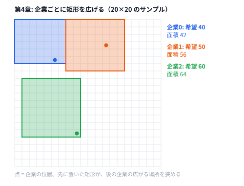

# 第4章 シミュレーションと素朴な解法

> **到達目標（灰色帯）**: まず AC（有効解）を出せる。問題文を読み、スコアを計算し、提出できる。

---

## 4.1 配列・グリッド上のシミュレーション

**霊夢**: 第3章で State と Move を学んだけど、AHC では盤面を動かすことが多いの？

**魔理沙**: そうだ。**グリッド（格子）** や **配列** 上で「1ステップずつ状態を更新する」解法が多い。これを **シミュレーション** と呼ぶ。AHC001「AtCoder Ad」は典型例だぜ。

**霊夢**: AHC001 って何？

**魔理沙**: 20×20 の街に企業が N 社あり、各社の本社座標 `(x, y)` に広告用の **矩形** を置く問題だ。矩形は重なってはいけない。各社の希望面積 `r` に近いほど満足度が高い。

| 要素 | 本書の玩具版 | 本番 AHC001 のイメージ |
|------|-------------|----------------------|
| 盤面 | 20×20 整数格子 | 同様 |
| 出力 | 各社 `a b c d`（矩形） | 同様 |
| 合法 | 重なりなし・境界内・中心点含有 | 公式ジャッジに準拠 |
| 解法 | 1×1 から四方に拡大 | 貪欲・焼きなましなど |

**霊夢**: 毎ターン矩形を大きくしていく感じなの？

**魔理沙**: 本リポジトリの `grow_rect` はまさにそれだ。`Rect` を値オブジェクトとして持ち、`can_place` で衝突を見る。

```python
# python/ch04/ahc001_grow.py — 矩形と重なり判定の核
@dataclass
class Rect:
    a: int
    b: int
    c: int
    d: int

    def area(self) -> int:
        return (self.c - self.a) * (self.d - self.b)


def overlaps_positive(r1: Rect, r2: Rect) -> bool:
    ix = min(r1.c, r2.c) - max(r1.a, r2.a)
    iy = min(r1.d, r2.d) - max(r1.b, r2.b)
    return ix > 0 and iy > 0
```

```go
// go/ch04/ahc001_grow.go — 同じ判定
func overlapsPositive(r1, r2 Rect) bool {
	ix := min(r1.C, r2.C) - max(r1.A, r2.A)
	iy := min(r1.D, r2.D) - max(r1.B, r2.B)
	return ix > 0 && iy > 0
}
```

**霊夢**: 辺が接してるだけなら OK？

**魔理沙**: この実装では **面積が正で重なる部分がある** とダメ（`ix > 0 and iy > 0`）。辺だけ接するのは OK だ。本番ジャッジも同様の「正の重なり」判定が多い。

**魔理沙**: シミュレーションのコツは次の3つ。

1. **状態を1か所に集約** — `rects: List[Rect]` のように
2. **操作を小さく** — 左に1マス広げる、など
3. **毎操作後に合法チェック** — 後述の `can_place`

---

## 4.2 ランダム操作による初期解生成

**霊夢**: いきなり賢く矩形を置くのは難しいの？

**魔理沙**: 灰色帯では **ランダム or 超単純ルール** で「とりあえず合法」が先だ。例えば次のような初期解生成がある。

| 手法 | 内容 | 本書での例 |
|------|------|-----------|
| 固定 | 1×1 を中心に置く | `grow_rect` の初期 `Rect(x,y,x+1,y+1)` |
| ランダム順 | 企業の処理順をシャッフル | （演習で試す） |
| ランダム拡大 | 四方のうちランダムに1方向拡大 | 本番寄りの入門 |

**霊夢**: 本書の `ahc001_grow` はランダムじゃないのね。

**魔理沙**: **貪欲に「面積が一番増える方向」** を選んで拡大している。ランダムよりマシな **素朴解** だ。まだ最適とは程遠いが、**合法 + そこそこスコア** を狙える。

```python
# python/ch04/ahc001_grow.py — grow_rect の1イテレーション（抜粋）
while rect.area() < company.r:
    best = None
    for _, da, db, dc, dd in expansions:
        nxt = Rect(rect.a + da, rect.b + db, rect.c + dc, rect.d + dd)
        if not can_place(nxt, others):
            continue
        gain = nxt.area() - rect.area()
        if best is None or gain > best[0]:
            best = (gain, nxt)
    if best is None:
        break
    rect = best[1]
```

**霊夢**: 企業を順番に処理してるのは順序依存？

**魔理沙**: その通り。先に大きい矩形を置くと、後の企業が狭くなる。**入力順のまま** はシンプルだが、スコアは順序で変わる。茶色帯（第5章）で「順序を工夫する」話につながる。

**霊夢**: 先に広げた矩形が、まだ置いていない企業の点を覆っちゃったら？

**魔理沙**: その企業はどこに置いても重なって、出力ごと不正になる。だから `solve` では、まだ置いていない企業の 1×1 マスも障害物として渡している。

```python
# python/ch04/ahc001_grow.py — solve（未配置の社の点も障害物にする）
def solve(companies: List[Company]) -> List[Rect]:
    rects: List[Rect] = []
    for i, company in enumerate(companies):
        # まだ置いていない社の 1×1 マスも障害物にする（覆うと、その社の矩形と必ず重なる）
        pending = [Rect(c.x, c.y, c.x + 1, c.y + 1) for c in companies[i + 1 :]]
        rect = grow_rect(company, rects + pending)
        rects.append(rect)
    return rects
```



---

## 4.3 合法性チェック（validity check）の書き方

**霊夢**: WA になるのが怖いの。チェックはどこに書くの？

**魔理沙**: **解法の中** と **スコアモジュール** の両方に書くのが定石だ。

1. **解法内** — `can_place` で無駄な探索を避ける
2. **スコア側** — 提出前の最終確認（第3章の `score_module` と同じ役割）

本書の `python/ch04/score_ahc001.py` は次を検証する。

| チェック | 関数 | 失敗時 |
|---------|------|--------|
| 矩形数 = 企業数 | `score_solution` | stderr + exit 1 |
| 境界・正の面積 | `valid_rect` | 同上 |
| ペア重なり | `overlaps_positive` | 同上 |
| 中心点含有 | `contains` | その社の満足度 0 |

```python
# python/ch04/score_ahc001.py — 中心点と満足度
def contains(rect: Rect, x: int, y: int) -> bool:
    return rect.a <= x + 0.5 < rect.c and rect.b <= y + 0.5 < rect.d


def company_score(company: Company, rect: Rect) -> int:
    if not contains(rect, company.x, company.y):
        return 0
    s = rect.area()
    if s <= 0 or company.r <= 0:
        return 0
    return int(company.r * min(s, company.r) / max(s, company.r))
```

**霊夢**: `x + 0.5` って何？

**魔理沙**: 格子点 `(x, y)` はマスの **中心** とみなす AHC001 のルールに合わせた書き方だ。整数座標でも「半マスずらして」含まれるか判定している。

**霊夢**: 解法とスコアで判定がズレたら？

**魔理沙**: 地獄だ。**同じ関数** を共有するか、スコア側を正として解法を直す。本書はファイルが分かれているが、ロジックは揃えてある。

```python
# python/ch04/ahc001_grow.py — 解法側 can_place（境界 + 重なり + 正の面積）
def can_place(rect: Rect, others: List[Rect]) -> bool:
    if rect.a < 0 or rect.b < 0 or rect.c > GRID or rect.d > GRID:
        return False
    if rect.area() <= 0:
        return False
    return all(not overlaps_positive(rect, o) for o in others)
```

---

## 4.4 実行時間（TL）の意識と計測

**霊夢**: シミュレーションって遅くなりがちなの？

**魔理沙**: **ステップ数 × 1ステップのコスト** が効く。`grow_rect` は最大で面積分だけ拡大し、各ステップで4方向を試す。N 社・20×20 なら余裕だが、本番は N が大きい。

**霊夢**: 時間を計測するには？

**魔理沙**: Python なら `time.perf_counter()`、Go なら `time.Since` だ。

```python
# 概念: solve 全体の実行時間を測る
import time

t0 = time.perf_counter()
rects = solve(companies)
elapsed = time.perf_counter() - t0
print(f"elapsed={elapsed:.3f}s", file=sys.stderr)
```

```go
// 概念: Go 版
start := time.Now()
rects := solve(companies)
fmt.Fprintf(os.Stderr, "elapsed=%.3fs\n", time.Since(start).Seconds())
```

| 目安 | 灰色帯の習慣 |
|------|-------------|
| ローカル | サンプルは一瞬で終わることを確認 |
| 本番 TL | 問題文の「実行時間制限」をメモ |
| 改善ループ | 1回の Move が何 ms かをざっくり把握 |

**魔理沙**: 第0章の `tools/run.sh` や、後の章の **タイマー + ベスト解保存** と組み合わせる。今は「計測を stderr に出す」だけで十分だ。

**霊夢**: 遅いときは？

**魔理沙**: 全探索をやめる、候補を減らす、データ構造を変える——順番は後の章。灰色では **まず正しく動く** ことを優先する。

---

## 4.5 ハンズオン: AHC001「AtCoder Ad」— 箱を少しずつ動かす素朴な解法

**霊夢**: リポジトリのコードを動かすのね。

**魔理沙**: 手順は **読む → 実行 → スコア → Go でも同じ** だ。

### Step 1: サンプル入力を確認

`data/ch04/sample.txt` は企業 3 社。

```text
3
5 5 40
12 3 50
8 15 60
```

各行は `x y r`（座標と希望面積）。

### Step 2: Python で解法を実行

```bash
cd /path/to/yukkuri-heuristics
python python/ch04/ahc001_grow.py < data/ch04/sample.txt
```

期待される出力（例）:

```text
0 0 7 6
7 0 15 7
1 8 9 16
```

各行が `a b c d`（左下 `(a,b)`、右上は `(c,d)` 手前の半開区間）。

### Step 3: スコア計算（入力 + 出力を連結）

AHC ローカルテスターと同様、**入力の直後に出力** を stdin に渡す。

```bash
python python/ch04/ahc001_grow.py < data/ch04/sample.txt > /tmp/out.txt
cat data/ch04/sample.txt /tmp/out.txt | python python/ch04/score_ahc001.py
```

確認済みの結果:

```text
138
companies=3 ok
```

stderr に `ok`、stdout に合計スコア **138**。

### Step 4: Go でも実行

```bash
go run go/ch04/ahc001_grow.go < data/ch04/sample.txt > /tmp/out_go.txt
cat data/ch04/sample.txt /tmp/out_go.txt | go run go/ch04/score_ahc001.go
```

Python と同じ **138** になる（同一アルゴリズム）。

### Step 5: 改変（1パラメータずつ）

1. `expansions` の順序を入れ替え、矩形の形が変わるか見る
2. 企業ループを `reversed(companies)` にしてスコアの差を見る
3. `grow_rect` で `company.r` に届かず break した社を stderr に出す

### Step 6: コンテスト形式の意識

- 出力だけをファイルに保存 → 後から `cat input output | score` で検証
- 本番では公式 `tools` の `cargo run --release` でジャッジ

**霊夢**: ビジュアライザは？

**魔理沙**: 本番 AHC001 には Rust 製ビジュアライザがある。矩形を塗り分けて **重なり・はみ出し** を目視できる。第8章で自作も扱う。今はスコア **138** と `ok` が出れば第一関門クリアだ。

---

## 4.6 演習

1. `data/ch04/sample.txt` で、手動で1社だけ矩形を変えた出力を作る。小さくしたときのスコアの変化と、`score_ahc001.py` が `overlap` や `invalid` で落ちる変え方を確かめる。
2. 企業処理順をランダム化（`random.shuffle`）し、10回のスコア分布をメモする。
3. `grow_rect` の代わりに「希望面積まで一方向だけ伸ばす」版を書き、スコアを比較する。
4. 公式 AHC001 の問題文を開き、本書の玩具スコアと **満足度の式** の違いを1行でメモする。
5. Go の `ahc001_grow.go` に stderr で経過時間を出し、Python と比較する。

<details>
<summary>ヒント</summary>

1. 出力は入力の後ろに 4 数ずつ N 行つなげる。小さくするだけなら合法のままスコアが下がる。落とすには、面積を 0 にするか、隣の矩形に食い込ませる。
2. 処理順を変えたら、出力は **入力の順** に並べ直す。サンプルは 3 社しかないので差が出にくい。社数を増やしたランダム入力も作る。
3. 4 方向それぞれについて「その方向だけに伸ばした矩形」を作り、一番面積が大きいものを採る。
4. AHC001 の問題文の「得点」の節を見る。本書の玩具は `r × min(r, s) / max(r, s)` の線形だ。
5. `time.Now()` と `time.Since()` を `solve` の前後に置く。

</details>

<details>
<summary>解答例</summary>

**1.** サンプルの出力は `138` 点。1 社目を `2 2 7 6` に縮めると、合法のまま `120` 点に下がる。落とす例は次のとおり。

```bash
# 面積 0 → "invalid rect 0"
(cat data/ch04/sample.txt; printf '0 0 0 6\n7 0 15 7\n1 8 9 16\n') | python python/ch04/score_ahc001.py
# 右隣に 1 マス食い込む → "overlap 0 and 1"
(cat data/ch04/sample.txt; printf '0 0 8 6\n7 0 15 7\n1 8 9 16\n') | python python/ch04/score_ahc001.py
```

どちらも stdout は `0` で、終了コードは 1 になる。

**2.** サンプルの 3 社では、どの順でも `138` 点で変わらない。10 社のランダム入力（`random.Random(0)` で点と面積を作ったもの）だと、入力順で `250` 点、10 通りのシャッフルで `250〜281` 点にばらついた。

```python
# 解答例: 処理順をシャッフルして 10 回測る
import random
import sys

sys.path.insert(0, "python/ch04")
import ahc001_grow as g
import score_ahc001 as s

rng = random.Random(0)
points = rng.sample([(x, y) for x in range(20) for y in range(20)], 10)
companies = [g.Company(x, y, rng.randint(10, 60)) for x, y in points]
for seed in range(10):
    order = list(range(len(companies)))
    random.Random(seed).shuffle(order)
    rects = g.solve([companies[i] for i in order])
    placed = [None] * len(companies)
    for k, i in enumerate(order):
        placed[i] = rects[k]  # 出力は入力の順に戻す
    total, ok, msg = s.score_solution(
        [s.Company(c.x, c.y, c.r) for c in companies],
        [s.Rect(r.a, r.b, r.c, r.d) for r in placed],
    )
    print(seed, total, msg)
```

**3.** サンプルでは `40` 点で、元の `grow_rect`（138 点）よりかなり悪い。1 方向だけだと細長い 1 マス幅の矩形になり、すぐ壁や他社にぶつかるからだ。

```python
# 解答例: 希望面積まで 1 方向だけ伸ばす grow_rect
def grow_one_direction(company, others):
    best = None
    for da, db, dc, dd in [(-1, 0, 0, 0), (0, 0, 1, 0), (0, -1, 0, 0), (0, 0, 0, 1)]:
        rect = Rect(company.x, company.y, company.x + 1, company.y + 1)
        while rect.area() < company.r:
            nxt = Rect(rect.a + da, rect.b + db, rect.c + dc, rect.d + dd)
            if not can_place(nxt, others):
                break
            rect = nxt
        if best is None or rect.area() > best.area():
            best = rect
    return best
```

**4.** 公式は、点を含むとき `p_i = 1 − (1 − min(r_i, s_i) / max(r_i, s_i))²` で、得点は `10^9 × Σp_i / n`。面積が希望から少しずれても、ほとんど減点されない（2 乗なので、ずれが小さいときは減点も小さい）。本書の玩具は線形なので、少しのずれでも同じ割合で減る。

**5.** `main` の `solve` の前後に次を入れる。サンプルでは Python も Go も 1 ミリ秒未満で、差は見えない。`go run` は毎回ビルドするので、外から `time` で測るとビルドの時間が混ざる点に注意する。

```go
// 解答例: go/ch04/ahc001_grow.go の main で solve の時間を測る（import に "time" を足す）
start := time.Now()
rects := solve(companies)
fmt.Fprintf(os.Stderr, "elapsed=%v\n", time.Since(start))
```

</details>

---

## 章末まとめ

**霊夢**: シミュレーションは「小さく更新して合法を保つ」なのね。

**魔理沙**: まとめだ。

> **第4章まとめ**
>
> - **グリッドシミュレーション** — 矩形などの状態を1ステップずつ更新する
> - **初期解** — ランダムより先に、固定・素朴貪欲（四方拡大）で合法解を作る
> - **合法性チェック** — 境界・重なり・中心点含有を解法とスコアの両方で確認する
> - **実行時間** — `perf_counter` / `time.Since` でボトルネックの感覚をつかむ
> - **ハンズオン**: `ahc001_grow` → `cat input output | score_ahc001` で **138**（sample）
> - **次章（第5章）**: 貪欲法 — 評価関数を設計して逐次選択する（茶色帯）

**霊夢**: 138点、次はもっと伸ばしたいの。

**魔理沙**: その欲求が茶色帯への階段だ。まずは **ok が出るパイプライン** を体に覚えさせろ。提出できる人が一番強い、だぜ。
