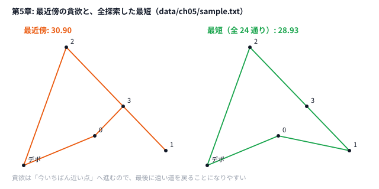

# 第5章 貪欲法 — ヒューリスティックの基本

> **到達目標（茶色帯 400〜799）**: 評価関数を決めて逐次選ぶ貪欲法で、筋の良い初期解を作れる。tie-break と順序依存の落とし穴を説明できる。

---

## 5.1 「全ての基本は（嘘）貪欲」の意味

**霊夢**: 茶色帯に入ったの。貪欲法って何から始めればいいの？

**魔理沙**: AHC 界隈には **「全ての基本は貪欲」** という冗談がある。厳密には嘘だが、**最初に試す解法の9割は貪欲** だと思っていい。

**霊夢**: 嘘なのに基本？

**魔理沙**: 貪欲だけでは最強になれないが、**初期解・部分問題・サブルーチン** としてほぼ必ず登場する。焼きなましも「ランダム初期解 + 貪欲的 Accept」みたいな構成が多いんだ。

| 段階 | 貪欲の役割 |
|------|-----------|
| 灰色 | 素朴シミュレーション（第4章の四方拡大） |
| 茶色 | **評価関数つき** の逐次選択 |
| 緑色以降 | 初期解生成 → SA / ビームで改善 |

**霊夢**: 第4章の `grow_rect` も貪欲だったのね。

**魔理沙**: 各ステップで **面積増加最大の方向** を選んでいた。評価関数が「増える面積」だけの貪欲だぜ。

---

## 5.2 評価関数を決めて逐次選択する

**霊夢**: 評価関数って、第3章のスコアと同じ？

**魔理沙**: **似ているが別物** だ。コンテストの **スコア** は最終的な解全体の点数。貪欲の **評価関数** は「今、この候補を選ぶとどれだけ良さそうか」の **局所的な指標** だ。

**霊夢**: 例を見せて。

**魔理沙**: 配達問題（AHC006「Food Delivery」の縮小版）では、今いる地点から **最も近い未訪問オーダー** を次に行く——これが **最近傍法（Nearest Neighbor）** だ。

```python
# python/ch05/greedy_delivery.py — 評価 = 距離（小さいほど良い）
def nearest_neighbor(
    depot: Tuple[float, float], orders: List[Tuple[float, float]]
) -> Tuple[List[int], float]:
    unvisited = set(range(len(orders)))
    route: List[int] = []
    cur = depot
    total = 0.0
    while unvisited:
        nxt = min(unvisited, key=lambda i: (dist(cur, orders[i]), i))  # 同じ距離なら番号の小さいほう
        total += dist(cur, orders[nxt])
        route.append(nxt)
        cur = orders[nxt]
        unvisited.remove(nxt)
    total += dist(cur, depot)
    return route, total
```

```go
// go/ch05/greedy_delivery.go — 同じロジック
for len(unvisited) > 0 {
    best := -1
    bestD := math.MaxFloat64
    for i := range unvisited {
        d := dist(cur, orders[i])
        if best == -1 || d < bestD || (d == bestD && i < best) { // 同じ距離なら番号の小さいほう（map の順番に頼らない）
            bestD = d
            best = i
        }
    }
    total += bestD
    route = append(route, best)
    cur = orders[best]
    delete(unvisited, best)
}
total += dist(cur, depot)
```

**霊夢**: 毎回 `min` で一番近いところへ行くのね。

**魔理沙**: 設計の型はこうだ。

```
while 未決定が残る:
    候補集合 C を列挙
    各 c ∈ C に評価値 f(c) を計算
    f が最良の c を選ぶ（確定）
    状態を更新
```

| 問題イメージ | 評価関数の例 |
|-------------|-------------|
| 配達順序 | 現在地からの距離 |
| スケジュール | その日の gain / ペナルティ |
| 矩形配置 | 面積増加量、はみ出しペナルティ |

---

## 5.3 貪欲の落とし穴（局所最適・順序依存）

**霊夢**: いつもうまくいくの？

**魔理沙**: **いつもはうまくいかない**。典型の落とし穴は2つ。

### 局所最適

**霊夢**: 局所最適って？

**魔理沙**: 各ステップでは最良だったが、**全体としてはもっと良い解** がある状態。配達の最近傍法は、交差する経路（くの字）を直すと短くなるケースがよくある（第6章の 2-opt）。

```
    A ●─────● B
         ╲ ╱      ← 交差を直すと短い
          ╳
         ╱ ╲
    C ●─────● D
```

### 順序依存

**霊夢**: 順序依存は第4章でも出てきたわ。

**魔理沙**: **何を先に決めるか** で結果が変わる。矩形を先に大きい社から置く / オーダーを ID 順に訪れる、など。**同じ貪欲ルールでも順序でスコアが変わる**。

| 対策（茶色〜緑） | 概要 |
|-----------------|------|
| 複数順序を試す | multi-start の入口 |
| 評価関数の変更 | 距離だけでなく「残りの見込み」を足す |
| 局所改善 | 2-opt、山登り、SA |

**霊夢**: 茶色帯ではどこまでやるの？

**魔理沙**: **貪欲で筋の良い解** + **簡単な改善（2-opt）** まで。本章は貪欲の設計、次章は改善だ。

---

## 5.4 複数候補の比較と tie-break

**霊夢**: 距離が同じオーダーが2つあったら？

**魔理沙**: **同点（tie）** のときの **タイブレーク** を決めておく。本書のコードは、Python も Go も「距離が同じなら番号の小さいほう」と、はっきり書いてある。

```python
# python/ch05/greedy_delivery.py — (距離, 番号) の辞書式順で比べる
        nxt = min(unvisited, key=lambda i: (dist(cur, orders[i]), i))  # 同じ距離なら番号の小さいほう
```

```go
// go/ch05/greedy_delivery.go
			if best == -1 || d < bestD || (d == bestD && i < best) { // 同じ距離なら番号の小さいほう（map の順番に頼らない）
```

**霊夢**: 書かなくても、だいたい同じにならない？

**魔理沙**: Go の `map` は、回す順番が実行のたびに変わる。だから `d < bestD` だけだと、同じ距離の候補のどれが選ばれるかが毎回変わって、Python と出力がずれる。Python の `set` も、順番は保証されていない。**同点の決め方は、言語に任せずに書く** のが鉄則だ。

| tie-break の例 | 意図 |
|---------------|------|
| インデックス昇順 | 再現性が高い |
| ランダム | multi-start 用 |
| 第2キー（例: y 座標） | 幾何的な偏りを避ける |

**霊夢**: 再現性が大事なの？

**魔理沙**: デバッグでは **同じ入力 → 同じ出力** が楽だ。本番探索では意図的にランダム tie-break も使う。`random.seed` または `Random(42)` を固定すれば比較実験がしやすい（第6章）。

---

## 5.5 ハンズオン: AHC006「Food Delivery」— 強い貪欲の設計

**霊夢**: 本番の Food Delivery はもっと複雑なんでしょ？

**魔理沙**: 本番は複数オーダー・制約・スコア式が入る。本書は **最近傍法だけ** の玩具に絞っている。それでも「評価 = 距離」の設計練習になる。

### 入力形式

`data/ch05/sample.txt`:

```text
0 0          # デポ (dx, dy)
4            # オーダー数
5 2
10 1
3 8
7 4
```

### 実行

```bash
python python/ch05/greedy_delivery.py < data/ch05/sample.txt
go run go/ch05/greedy_delivery.go < data/ch05/sample.txt
```

確認済みの出力:

```text
route: 0 3 1 2
orders=4 distance=30.90
```

Python / Go で **同じ経路・同じ距離**。

### 読み解き

- デポ `(0,0)` から開始
- 毎ステップ、未訪問のうち **最も近い** オーダーへ
- 最後にデポへ戻る距離を足す

**霊夢**: 30.90 がこのサンプルの貪欲の答えなのね。

**魔理沙**: この距離は **最適とは限らない**。第6章で 2-opt するともっと短くなるタイプの入力もある。まず **30.90 を再現** することがハンズオンのゴールだ。



**霊夢**: 最近傍だと、最後に遠くからデポへ戻ってくるのね。

**魔理沙**: 近い点を先に使い切ると、遠い点が最後に残る。貪欲の典型的な弱点だ。最短との差 1.97 を縮める方法が、第6章の 2-opt だ。

### 改変ステップ

1. オーダー読み込み順を逆にして、tie 時の挙動を見る
2. `key=lambda i: (dist(...), -i)` で「大きい ID 優先」に変え、経路が変わるか確認
3. 最後にデポへ戻らず打ち切ると、距離表示がどう変わるか（本番では不正な出力になるのでやらない）

### 本番 AHC006 への橋渡し

| 玩具 | 本番 AHC006 |
|------|---------------|
| 全オーダーを訪問 | **1000 件から 50 件を選ぶ**（どれを選ぶかも最適化） |
| 地点を1つずつ訪問 | 各オーダーは **店で受け取ってから届け先へ**（順序制約） |
| ユークリッド距離 | **マンハッタン距離**、オフィス (400, 400) から出発して戻る |
| 距離最小 | スコア `round(10^8 / (1000 + T))`（T は総移動時間） |

**魔理沙**: 強い貪欲 = **評価関数に問題の本質を1つ入れる** こと。距離だけでは弱いときは「締切までの余裕」など第2キーを足す——これは過去問解説で頻出だ。

---

## 5.6 演習

1. `greedy_delivery.py` の評価を「距離 + 0.01 * オーダーID」に変え、経路と `distance=` がどう変わるか記録する。
2. オーダーを **y 座標の降順** で並べ替えてから最近傍を回す「前処理つき貪欲」を試し、30.90 と比較する。
3. 4オーダーなら全順列（24通り）の最短距離を力技で求め、貪欲 30.90 との差を計算する（最適化の上界の感覚）。
4. Go 版の `(d == bestD && i < best)` の部分を消して、デポから等距離の点が並ぶ入力で何回か実行し、何が起きるかと、その理由を確かめる（すぐ戻すこと）。
5. AHC006 の問題文から、スコア式と、距離のほかに解の良し悪しを左右する要素（どのオーダーを選ぶか、順序の制約など）を1つ抜き出し、評価関数案としてメモする。

<details>
<summary>ヒント</summary>

1. `min(unvisited, key=...)` の `key` を書き換える。0.01 は距離に比べてとても小さいので、ほぼ同点のときだけ効く。
2. 最近傍法は「今いる点から一番近い点」を選ぶので、事前に並べ替えても、同点がなければ経路は変わらない。比べるなら「並べた順にそのまま回る」解にする。
3. `itertools.permutations(range(4))` で 24 通りを全部試し、デポから出てデポに戻る長さの最小を取る。
4. 消したあとの比較は `d < bestD` だけになる。距離が同じ候補が並んだとき、どれを先に見るかは何で決まっているかを考える。
5. 5.5 の「本番 AHC006 への橋渡し」の表も参考にする。

</details>

<details>
<summary>解答例</summary>

**1.** `key=lambda i: dist(cur, orders[i]) + 0.01 * i` に変えても、サンプルでは経路 `0 3 1 2`・`distance=30.90` のまま変わらない。どの段でも、一番近い点と次に近い点の差が 0.01×ID の差より大きいからだ。この形の第 2 キーは「同点に近いときだけ ID の小さい方を選ぶ」働きになる。

**2.** 最近傍法の前に y の降順に並べても、同点がないので結果は同じ（30.90）。並べた順（2, 3, 0, 1）にそのまま回ると `32.18` で、最近傍より悪い。単純な並べ替えだけでは、近い点を順に拾う最近傍に勝ちにくい。

**3.** 最短は `0 1 3 2` の `28.93`。貪欲の `30.90` との差は `1.97`（約 7%）だ。4 点なら全探索で最適が分かるが、点が増えると順列は爆発する（10 点で約 363 万通り）。この差を縮めるのが第6章の 2-opt だ。

```python
# 解答例: 4 オーダーの全順列を試す
import itertools
import sys

sys.path.insert(0, "python/ch05")
from greedy_delivery import dist, read_problem

depot, orders = read_problem(open("data/ch05/sample.txt"))

def length(route):
    pts = [depot] + [orders[i] for i in route] + [depot]
    return sum(dist(pts[k], pts[k + 1]) for k in range(len(pts) - 1))

best = min(itertools.permutations(range(len(orders))), key=length)
print(best, f"{length(best):.2f}")  # → (0, 1, 3, 2) 28.93
```

**4.** `if best == -1 || d < bestD {` にすると、デポ `(0, 0)` から等距離の 4 点 `(1,0) (0,1) (-1,0) (0,-1)` で、実行のたびに経路が変わる（手元では 15 回で 6 種類）。元の版は毎回 `0 1 2 3` で、Python と一致する。Go の `map` を `for range` で回す順番は、わざと毎回変わるように作られているので、同点のときに「最初に見つけたもの」を選ぶと、その順番しだいになる。

```bash
printf '0 0\n4\n1 0\n0 1\n-1 0\n0 -1\n' | go run go/ch05/greedy_delivery.go
```

**5.** スコアは `round(10^8 / (1000 + T))` で、T は総移動距離（マンハッタン距離）。式に入っているのは T だけだが、T を決めるのは「1000 件からどの 50 件を選ぶか」だ。評価関数案は、例えば「オフィスから店と届け先までの距離の和が小さいオーダーを優先して 50 件選ぶ」。順序の制約（店で受け取ってから届け先へ）を守らない出力は不正になるので、評価より先に合法性を確かめる。

</details>

---

## 章末まとめ

**霊夢**: 貪欲は「その場で一番良さそうなものを取る」なのね。

**魔理沙**: まとめだ。

> **第5章まとめ**
>
> - **「全ての基本は貪欲」** — 最初の一手と初期解の大半を占める
> - **評価関数** — 全体スコアとは別の、逐次選択用の局所指標
> - **落とし穴** — 局所最適・順序依存；改善は次章以降
> - **tie-break** — 同点時のルールで再現性と多様性を制御
> - **ハンズオン**: 最近傍法で `distance=30.90`（`data/ch05/sample.txt`）
> - **次章（第6章）**: 山登り・2-opt で経路を短くする

**霊夢**: 30.90 より短くしたいの。

**魔理沙**: 次は **近傍** を定義して、解を少しずつ直していく。貪欲で作って、山登りで伸ばす——茶色帯の定番パイプラインだぜ。
