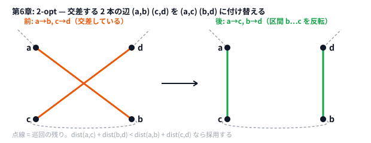
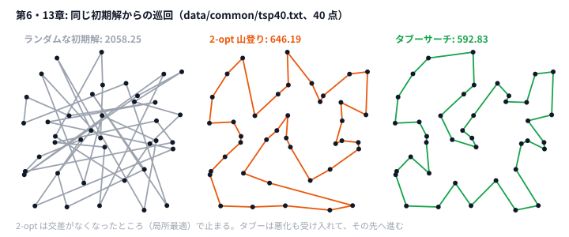

# 第6章 山登り法（Hill Climbing）

> **到達目標（茶色帯 400〜799）**: 近傍と受理条件を定義して山登り法を書ける。2-opt で経路を改善し、初期解の重要性を説明できる。

---

## 6.1 近傍（Neighborhood）の定義

**霊夢**: 山登りって、山を登るアルゴリズムなの？

**魔理沙**: メタファーだ。**今の解の「少しだけ変えた解」** の集合を **近傍（Neighborhood）** と呼ぶ。近傍の中に **より良い解** があれば移動する。これを繰り返すと、だんだんスコアが上がる（またはコストが下がる）。

**霊夢**: 第3章の Move と同じ？

**魔理沙**: Move は1回の操作。近傍は **その操作で到達できる解全体** だ。

| 解の表現 | 近傍の例 |
|---------|---------|
| 巡回順序 `tour` | 2点を入れ替え、2-opt で辺を付け替え |
| 矩形配置 | 1社の矩形を1マススライド |
| スケジュール | 2日分をスワップ |

**霊夢**: 近傍が大きすぎると？

**魔理沙**: 1ステップが遅くなる。小さすぎると **局所最適** から抜けられない。茶色帯では **2-opt 程度のコンパクトな近傍** から始めるのがおすすめだ。

```python
# 近傍探索の骨格（概念）
def hill_climb(state, score_fn, neighbors_fn):
    while True:
        best_move = None
        best_score = score_fn(state)
        for nxt in neighbors_fn(state):
            s = score_fn(nxt)
            if s > best_score:
                best_score = s
                best_move = nxt
        if best_move is None:
            break
        state = best_move
    return state
```

---

## 6.2 改善の受理条件（better / equal の扱い）

**霊夢**: 同じスコアの解が見つかったらどうするの？

**魔理沙**: 典型は3パターン。

| 条件 | 意味 | 用途 |
|------|------|------|
| **strictly better** | 厳しく改善のみ受理 | 標準の山登り |
| **equal も受理** | 横ばい移動で探索空間を広げる | 多様性・タブー前段 |
| **確率的受理** | 悪化もたまに許す | 焼きなまし（第9章） |

本書の `two_opt.py` は **距離が減るときだけ** 反転する（strictly better + 微小誤差 `1e-9`）。

```python
# python/ch06/two_opt.py
if after + 1e-9 < before:
    tour[i + 1 : k + 1] = reversed(tour[i + 1 : k + 1])
    improved = True
```

**霊夢**: equal を許すとループしそう。

**魔理沙**: **訪問済み状態** を記録するか、同点では **tie-break で1つだけ進む** ルールが必要だ。2-opt は反転で長さが変わるので、同点ループは起きにくい。

**霊夢**: 最大化問題では？

**魔理沙**: スコアが **増えたら受理**。最小化（距離）では **減ったら受理**。符号を間違えると悪化方向に進む——バグの定番だ。

---

## 6.3 2-opt の考え方と実装

**霊夢**: 2-opt って何？

**魔理沙**: 巡回路の **2本の辺を切って、別の繋ぎ方に付け替える** 操作だ。交差している辺を直すイメージ。

```
辺 (i, i+1) と (k, k+1) を削除
セグメント [i+1 .. k] を反転して再接続
```

**霊夢**: 距離だけ見ればいいの？

**魔理沙**: 反転前後で、**削除する2辺の長さの和** と **追加する2辺の長さの和** を比べればよい。全経路を再計算しなくて済む。



```python
# python/ch06/two_opt.py — 差分判定の核
a, b = tour[i], tour[(i + 1) % n]
c, d = tour[k], tour[(k + 1) % n]
before = (
    math.hypot(pts[a][0] - pts[b][0], pts[a][1] - pts[b][1])
    + math.hypot(pts[c][0] - pts[d][0], pts[c][1] - pts[d][1])
)
after = (
    math.hypot(pts[a][0] - pts[c][0], pts[a][1] - pts[c][1])
    + math.hypot(pts[b][0] - pts[d][0], pts[b][1] - pts[d][1])
)
if after + 1e-9 < before:
    tour[i + 1 : k + 1] = reversed(tour[i + 1 : k + 1])
```

```go
// go/ch06/two_opt.go
before := edgeDist(pts, a, b) + edgeDist(pts, c, d)
after := edgeDist(pts, a, c) + edgeDist(pts, b, d)
if after+1e-9 < before {
    reverseSegment(tour, i+1, k)
    improved = true
}
```

**霊夢**: `i` と `k` のループ範囲が難しそう。

**魔理沙**: 巡回路では **始点の隣接を壊さない** よう、`k` の上限を `n-1` に制限している（`i == 0` のとき）。Python / Go で同じ境界条件に揃えてある。

**魔理沙**: 外側ループは「改善がなくなるまで」。1回のスキャンで改善があれば `improved = True` で続行——**山登りの1イテレーション** だ。

---

## 6.4 初期解の重要性と multi-start の概要

**霊夢**: 2-opt だけじゃ最強になれないの？

**魔理沙**: 2-opt は **局所最適** で止まる。**初期巡回が悪い** と、そこから抜けられないこともある。

**霊夢**: だから初期解が大事？

**魔理沙**: 定番パイプラインはこうだ。

```
1. 貪欲（最近傍）で初期解
2. 2-opt で改善
```

本書の `two_opt.py` は **ランダム初期巡回**（`Random(42)`）を使い、改善幅をはっきり見せる。

```python
# python/ch06/two_opt.py
rng = random.Random(42)
tour = list(range(len(pts)))
rng.shuffle(tour)
before = tour_length(pts, tour)
tour = two_opt(pts, tour)
after = tour_length(pts, tour)
```

```go
// go/ch06/two_opt.go
rng := rand.New(rand.NewSource(42))
tour := make([]int, len(pts))
for i := range tour {
	tour[i] = i
}
rng.Shuffle(len(tour), func(i, j int) { tour[i], tour[j] = tour[j], tour[i] })
before := tourLength(pts, tour)
tour = twoOpt(pts, tour)
after := tourLength(pts, tour)
```

### multi-start（概要）

| 手法 | 内容 |
|------|------|
| multi-start | シードを変えて初期解を複数生成し、最良を採用 |
| 貪欲 + 2-opt | 第5章 + 本章の組み合わせ |
| 時間配分 | 残り時間で試行回数を増やす（第11章） |

**霊夢**: 茶色帯では multi-start までやるの？

**魔理沙**: **概要だけ** でよい。実装するなら `for seed in range(10):` で最良 `after` を更新する程度。本番は時間切れまで回す。

---

## 6.5 ハンズオン: AHC005「Patrolling」— 2-opt による経路改善

**霊夢**: Patrolling は巡回の問題なの？

**魔理沙**: AHC005 は、パトロールカーで道路を走り、**すべての道路マスを一度は見通せる** ようにしながら、スタートに戻るまでの **移動時間を短くする** 問題だ。経路の改善という点で TSP と同じ形なので、本書は **TSP 玩具**（点集合を1周する）に落としている。

### 入力

`data/ch06/sample.txt` — 8 点。

```text
8
0 0
4 1
...
```

### 実行

```bash
python python/ch06/two_opt.py < data/ch06/sample.txt
go run go/ch06/two_opt.go < data/ch06/sample.txt
```

確認済み（Python, seed=42）:

```text
tour: 3 4 5 6 7 0 1 2
n=8 before=48.49 after=28.98
```

**約 48 → 約 29** と大幅に短縮される。Go も `after=28.98` は一致する（初期 `before` は RNG 実装差で異なる場合あり）。

**霊夢**: 48.49 から 28.98 はすごいの。

**魔理沙**: ランダム初期が悪かった例だ。第5章の最近傍を初期にした版を自作すると、**before 自体が下がり、after もさらに良くなる** ことが多い。

### もう少し大きい入力で

8 点だと、どの手法もすぐ最適解に着いてしまい、違いが見えない。`data/common/tsp40.txt` は 40 点のランダムな入力だ（第13章・第19章でも同じものを使う）。

```bash
python python/ch06/two_opt.py < data/common/tsp40.txt | tail -1
```

```text
n=40 before=2058.25 after=646.19
```

**霊夢**: 2058 から 646 まで縮んだの。

**魔理沙**: だが、これは最適ではない。同じ入力・同じ初期解で、第13章のタブーサーチは 592.83、第19章の LNS は 596.49 まで行く。2-opt の山登りは「どの 2 本をつなぎ替えても短くならない」局所最適で止まる——その先へ行く方法が、緑色帯から先のテーマだ。



### 手順の分解

1. `read_points` で座標読み込み
2. `tour_length` で初期長さ
3. `two_opt` で山登り
4. 再度 `tour_length` で報告

```bash
# 経路だけ欲しいとき
python python/ch06/two_opt.py < data/ch06/sample.txt | head -1
```

### 改変

1. `Random(42)` を `0`, `1`, `2` に変え、`before` / `after` を表にする
2. 初期解を `list(range(n))`（ソート順巡回）に固定し、改善幅を比較
3. 第5章の最近傍出力を初期 `tour` に食わせる（演習）

### AHC005 本番との対応

| 玩具 | 本番 AHC005 |
|------|------|
| 全点を1周 | 全道路マスを **見通せれば** よい（全マスを踏む必要はない）。スタートに戻る |
| ユークリッド距離 | マスごとの移動コストの和（最短路で結ぶ） |
| 2-opt のみ | 「どの地点を経由するか」の選び直し + 2-opt / SA など |

---

## 6.6 演習

1. `two_opt.py` を **1改善だけ** 適用して終了する版にし、`before` との差分を見る。
2. 第5章 `greedy_delivery` の経路を点番号に直し、それを初期 `tour` にして 2-opt を回す（`n=4` なら手計算でも可）。
3. Python と Go で **同じ初期 tour**（例: `[0,1,2,3,4,5,6,7]`）から始め、`after` が一致するか確認する。
4. `equal` 受理（`after <= before`）に変え、ループや停滞が起きるか観察する（すぐ戻すこと）。
5. AHC005 の editorial / 解説スライドから **2-opt 以外の近傍** を1つ拾い、メモする。

<details>
<summary>ヒント</summary>

1. 改善を見つけて区間を反転したら、その場で `return` する。
2. 第5章のデポを点 0、オーダー 0〜3 を点 1〜4 にすると、最近傍の経路 `0 3 1 2` は tour `[0, 1, 4, 2, 3]` になる。
3. Python の `random.Random(42)` と Go の `rand.NewSource(42)` は、同じ seed でも違う並びを出す。初期 tour を手で固定すれば、乱数の違いを取り除ける。
4. 長さが **まったく同じ** 手があると、反転して戻す、をくり返すかもしれない。正方形の 4 隅と中心のように、対称な入力で試す。
5. 2-opt は「2 本の辺をつなぎ替える」手。ほかに「区間を切り取って別の場所に差し込む」手がある。

</details>

<details>
<summary>解答例</summary>

**1.** 最初の改善は `i=0, k=4`（点 4 と点 2 の間の区間を反転）で、`48.49 → 44.81`。改善が見つかるまで全部を回し続ける元の版は `28.98` まで下がる。1 回の改善で減るのは一部だけで、局所最適までは何度もくり返す必要がある。

```python
# 解答例: python/ch06/two_opt.py の two_opt を「1 改善だけ」にする
def two_opt_once(pts, tour):
    n = len(tour)
    for i in range(n):
        for k in range(i + 2, n if i > 0 else n - 1):
            a, b = tour[i], tour[(i + 1) % n]
            c, d = tour[k], tour[(k + 1) % n]
            before = math.hypot(pts[a][0] - pts[b][0], pts[a][1] - pts[b][1]) + math.hypot(pts[c][0] - pts[d][0], pts[c][1] - pts[d][1])
            after = math.hypot(pts[a][0] - pts[c][0], pts[a][1] - pts[c][1]) + math.hypot(pts[b][0] - pts[d][0], pts[b][1] - pts[d][1])
            if after + 1e-9 < before:
                tour[i + 1 : k + 1] = reversed(tour[i + 1 : k + 1])
                return tour
    return tour
```

**2.** 第5章の入力を点の列（`(0,0) (5,2) (10,1) (3,8) (7,4)`）に直し、tour `[0, 1, 4, 2, 3]` から 2-opt を回すと、`30.90 → 28.93` になる。tour は `[0, 1, 2, 4, 3]`（デポ → 0 → 1 → 3 → 2 → デポ）で、第5章の演習3で全探索した最適解と一致する。

**3.** 両方の `main` で、シャッフルの代わりに初期 tour を `[0, 2, 4, 6, 1, 3, 5, 7]` に固定すると、どちらも `before=50.11 after=28.98`、tour は `0 1 2 3 4 5 6 7` で一致する。`[0, 1, ..., 7]` から始めると、それがすでに局所最適なので何も変わらない。差を見るなら、少し崩した初期 tour を使う。

```go
// 解答例: go/ch06/two_opt.go の main で、シャッフルの代わりに初期 tour を固定する
tour := []int{0, 2, 4, 6, 1, 3, 5, 7}
```

**4.** サンプルでは止まる。座標が実数なので、長さがぴったり同じ手がめったにないからだ。正方形の 4 隅と中心（`(0,0) (2,0) (2,2) (0,2) (1,1)`）では、同じ長さの反転を行ったり来たりして **止まらなくなる**。`after + 1e-9 < before` のように「はっきり良くなったときだけ受理」に戻すこと。同じ長さの手を受理したいときは、SA（第9章）のように回数や時間で打ち切る。

```bash
printf '5\n0 0\n2 0\n2 2\n0 2\n1 1\n' | python python/ch06/two_opt.py   # 元の版は止まる
```

**5.** 例えば **Or-opt**（連続する 1〜3 点を切り取り、別の位置に差し込む）。2-opt は区間を反転するが、Or-opt は向きを変えずに区間を動かす。点の順番が「ほぼ合っているが、一部だけ離れた場所にある」ときに効く。

</details>

---

## 章末まとめ

**霊夢**: 山登りは「近くを探して良くなったら進む」なのね。

**魔理沙**: まとめだ。

> **第6章まとめ**
>
> - **近傍** — 解を少しだけ変えた候補集合；設計が探索の質を決める
> - **受理条件** — 基本は strictly better；equal / 確率は応用
> - **2-opt** — 2辺の差分比較 + セグメント反転で巡回を短くする
> - **初期解** — 貪欲・ランダム・multi-start でスタート地点を変える
> - **ハンズオン**: `two_opt` で **before≈48.49 → after≈28.98**（sample, seed=42）
> - **次章（第7章）**: 粗視化・分割で大きい問題を小さく考える

**霊夢**: 貪欲と山登り、セットで覚えるのね。

**魔理沙**: 茶色帯の **最短ルート** はこれだ。**作る（貪欲）→ 直す（2-opt）**。次は盤面が大きいときの **粗視化** に進むぜ。
