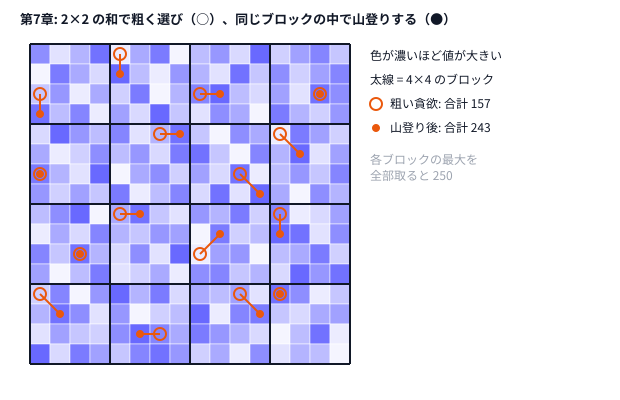
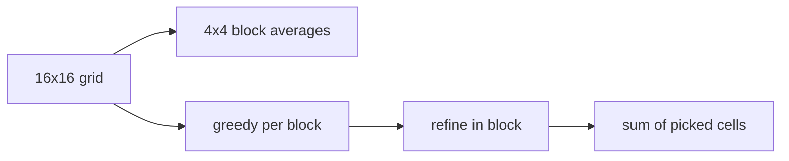

# 第7章 問題の粗視化と分割

> **到達目標（茶色帯 400〜799）**: 大きな盤面を粗視化・分割して考え、粗い解を細かい解へ展開（refinement）できる。

---

## 7.1 粗視化（Coarsening）— 盤面を粗い格子に落とす

**霊夢**: グリッドが 16×16 もあると、全部見るの大変なの。

**魔理沙**: **粗視化（Coarsening）** は、細かい盤面を **まとめて粗い表現** に落とす技法だ。16×16 を **4×4 のブロック** に分け、各ブロックの **平均値** だけを見る——そうすると 4×4 の小さな行列になる。

**霊夢**: 情報は失われるの？

**魔理沙**: 失われる。だが **全体の傾向**（どの辺りが値が高いか）が掴みやすくなる。粗い解を決めてから、細かい盤面に **展開（refinement）** するのが定番だ。

```python
# python/ch07/coarsen.py
BLOCK = 4
N = 16


def block_avg(grid: List[List[int]], bi: int, bj: int) -> int:
    s = 0
    for i in range(bi * BLOCK, (bi + 1) * BLOCK):
        for j in range(bj * BLOCK, (bj + 1) * BLOCK):
            s += grid[i][j]
    return s // (BLOCK * BLOCK)


def coarse_matrix(grid: List[List[int]]) -> List[List[int]]:
    return [
        [block_avg(grid, bi, bj) for bj in range(BLOCK)]
        for bi in range(BLOCK)
    ]
```

```go
// go/ch07/coarsen.go
func blockAvg(grid [][]int, bi, bj int) int {
	sum := 0
	for i := bi * blockN; i < (bi+1)*blockN; i++ {
		for j := bj * blockN; j < (bj+1)*blockN; j++ {
			sum += grid[i][j]
		}
	}
	return sum / (blockN * blockN)
}
```

| レベル | サイズ | 用途 |
|--------|--------|------|
| 細かい | 16×16 | 最終解・refine |
| 粗い | 4×4 平均 | 方針決め・デバッグ出力 |

---

## 7.2 小問題への分割（Decomposition）

**霊夢**: 分割って、別々に解くの？

**魔理沙**: **独立にほぼ解ける部分** に割ると考えやすい。本書では **各 4×4 ブロックごとに「1マス選ぶ」** という制約付き問題にしている。

```
16×16 全体
├─ ブロック (0,0) 4×4 → ここから1マス選ぶ
├─ ブロック (0,1) 4×4 → 1マス
├─ ...
└─ ブロック (3,3) 4×4 → 1マス
→ 合計 16 マスを選ぶ問題
```

**霊夢**: ブロックをまたぐ選択はできないの？

**魔理沙**: この玩具では **自主的な制約** として禁止している（7.3）。本番問題では制約が違うが、「まず分割して解く」発想は同じだ。

```python
# python/ch07/coarsen.py
SUB = 2  # 粗い判断に使う小ブロックの一辺


def greedy_per_block(grid: List[List[int]]) -> List[Tuple[int, int]]:
    """粗い判断: 各ブロックを 2×2 の小ブロックに分け、和が最大の小ブロックの左上を選ぶ."""
    picks: List[Tuple[int, int]] = []
    for bi in range(BLOCK):
        for bj in range(BLOCK):
            best_val = -1
            best_pos = (bi * BLOCK, bj * BLOCK)
            for si in range(bi * BLOCK, (bi + 1) * BLOCK, SUB):
                for sj in range(bj * BLOCK, (bj + 1) * BLOCK, SUB):
                    s = sum(grid[i][j] for i in range(si, si + SUB) for j in range(sj, sj + SUB))
                    if s > best_val:
                        best_val = s
                        best_pos = (si, sj)
            picks.append(best_pos)
    return picks
```

```go
// go/ch07/coarsen.go
func greedyPerBlock(grid [][]int) []pos {
	picks := make([]pos, 0, blockN*blockN)
	for bi := 0; bi < blockN; bi++ {
		for bj := 0; bj < blockN; bj++ {
			bestVal := -1
			best := pos{bi * blockN, bj * blockN}
			for si := bi * blockN; si < (bi+1)*blockN; si += subN {
				for sj := bj * blockN; sj < (bj+1)*blockN; sj += subN {
					s := 0
					for i := si; i < si+subN; i++ {
						for j := sj; j < sj+subN; j++ {
							s += grid[i][j]
						}
					}
					if s > bestVal {
						bestVal = s
						best = pos{si, sj}
					}
				}
			}
			picks = append(picks, best)
		}
	}
	return picks
}
```

**霊夢**: 1マスずつ見ないで、2×2 の和で「だいたいこの辺」と決めるのね。

**魔理沙**: そうだ。粗い判断だから、選んだマスがブロック内で一番いいとは限らない。そこを直すのが 7.3 の `refine` だ。

**魔理沙**: 分割のメリットは **計算が軽い・バグが局所化** されること。デメリットは **ブロック間の最適な組み合わせ** を見逃すことだ。

---

## 7.3 自主的な制約追加で考えやすくする

**霊夢**: 問題文にない制約を足していいの？

**魔理沙**: **探索用の仮制約** として足すのは戦略だ。公式の合法条件は守りつつ、解法の中で「こう置くと考えやすい」ルールを課す。

| 自主制約の例 | 効果 |
|-------------|------|
| ブロックごとに1マスまで | 候補が16×16→16箇所に激減 |
| 矩形は軸平行のみ | 配置問題の候補削減 |
| 経路は非交差を維持 | 2-opt が効きやすい |

**霊夢**: スコアが下がらない？

**魔理沙**: 下がることがある。**速くてそこそこの解** と **遅くて強い解** のトレードオフだ。コンテストではまず自主制約で **動く解** を作り、後から制約を緩めて改善する、という順もある。

**魔理沙**: `refine` は同じブロック内だけ動くので、**自主制約を保ったまま** 局所改善している。今いるマスの 8 近傍に、もっと大きいマスがあれば移る——を、動けなくなるまでくり返す山登りだ。

```python
# python/ch07/coarsen.py
def refine(grid, picks):
    # 同ブロック内の8近傍だけ見る（対角含む3×3）
    if ni // BLOCK != bi or nj // BLOCK != bj:
        continue
```

```go
// go/ch07/coarsen.go — refine の核（同じブロックの 8 近傍だけ見る）
if ni/blockN != bi || nj/blockN != bj {
	continue
}
if grid[ni][nj] > bestVal {
	bestVal = grid[ni][nj]
	best = pos{ni, nj}
}
```

---

## 7.4 アルゴリズムで解ける部分の切り出し

**霊夢**: 全部ヒューリスティックじゃなくていいの？

**魔理沙**: **きれいに解ける部分** は正確アルゴリズムに任せる。大きな問題 = **厳密パート + ヒューリスティックパート** の合成、と考えると設計が楽になる。

| 部分 | 手法の例 |
|------|---------|
| 最短経路1本 | ダイクストラ（AHC003 系） |
| 小さな割当 | 全探索・ハンガリアン |
| 残り | 貪欲・山登り・SA |

本書の玩具では、各 4×4 は **16マスしかない** ので、ブロック内の最大は全探索ですぐ求まる。山登りの `refine` は局所最適で止まることがあるが、全探索なら必ずブロック内の最大に届く（演習2）。ブロック数が増えたら **粗い4×4上でDP** などに拡張する発想だ。

**霊夢**: 粗い4×4でDPって、第何章？

**魔理沙**: 緑色以降のパイプラインだ。茶色では **粗視化 + 貪欲 + 局所 refine** までで十分戦える。

---

## 7.5 ハンズオン: 大きなグリッド問題を 4×4 ブロックに分割して解く

**霊夢**: `coarsen.py` を動かすのね。

**魔理沙**: 入力は `data/ch07/sample.txt`。先頭 `16` のあと 16 行の整数グリッド。

### 実行

```bash
python python/ch07/coarsen.py < data/ch07/sample.txt
go run go/ch07/coarsen.go < data/ch07/sample.txt
```

確認済みの出力（先頭部分）:

```text
coarse 4x4 (block averages):
8 7 8 9
8 8 8 8
8 7 8 9
8 10 8 6
greedy_sum=157
refined_sum=243
refined picks (row col):
3 0
1 4
...
```

### 読み方

| 出力 | 意味 |
|------|------|
| `coarse 4x4` | 各ブロックの平均値（粗視化結果） |
| `greedy_sum` | 各ブロックで、2×2 の和が最大の小ブロックの左上を取ったときの格子値の和（粗い解） |
| `refined_sum` | 同ブロック内 8 近傍で山登りしたあとの和 |
| `refined picks` | 選んだマスの `(row, col)` |

**霊夢**: 157 から 243 まで上がったの。

**魔理沙**: 粗い解を、細かい盤面で直した効果だ。ただし、各ブロックの最大を全部取ると 250 になる。山登りはブロックの中でも局所最適で止まることがある。その差は演習で確かめてみろ。



### パイプライン図



### 改変ステップ

1. 1ブロックだけ値を極端に大きくし、`refined_sum` が上がるか試す
2. `BLOCK = 2` に変えて粗さを変え、実行時間と `greedy_sum` を比較（コード変更はローカル練習用）
3. `coarse` の最大ブロックを先に処理する **順序依存貪欲** を試す

### 本番への接続

大きなグリッド問題（タイル、領域、配置）では次がよくある。

1. **粗視化** で方針を決める
2. **分割** でサブ問題を解く
3. **refinement** で細部を直す
4. 必要なら **SA**（第9章）で全体を揺らす

---

## 7.6 演習

1. `refined_sum` が各ブロックの最大の和（サンプルでは 250）に届かなかったブロックを探し、山登りがどこで止まったかを確かめる。
2. `refine` を「ブロック全体を総当りで最大」に置き換え、常に `refined_sum >= greedy_sum` になること、山登り版との差を確認する。
3. 粗視化 `coarse` の最大値ブロックから順に貪欲する **別順序** を実装し、合計が変わるか見る。
4. 選んだ16マスを ASCII で `#` 表示する小さな可視化を stderr に出す（デバッグ練習）。
5. 過去問で「グリッドを分割した」解説を1つ探し、ブロックサイズと手法をメモする。

<details>
<summary>ヒント</summary>

1. ブロックごとに「`refine` 後のマスの値」と「ブロック内の最大値」を並べて出す。差があるブロックが、山登りが止まった場所だ。
2. `refine` の中身を、ブロックの 16 マスから最大を探すループに置き換える。山登り版と出力を並べる。
3. この玩具では、各ブロックの選び方がほかのブロックに影響しない。順番を変えて何が変わるかを考えてから試す。
4. 選んだマスを `set` にし、16×16 を 1 文字ずつ `#` か `.` で出す。stdout を汚さないよう `file=sys.stderr` にする。
5. 解説で「領域に分ける」「区画ごとに」「ブロック」といった言葉が出てくる回を探す。

</details>

<details>
<summary>解答例</summary>

**1.** サンプルでは 16 ブロック中 5 ブロックで、`refine` がブロック内の最大に届かず止まっている。

| ブロック | 開始マス（値） | 止まったマス（値） | ブロック内の最大（位置） |
|---------|---------------|-------------------|------------------------|
| (1, 0) | (6, 0) 14 | (6, 0) 14 | 16 (6, 3) |
| (2, 0) | (10, 2) 15 | (10, 2) 15 | 16 (8, 2) |
| (2, 1) | (8, 4) 9 | (8, 5) 15 | 16 (10, 7) |
| (3, 0) | (12, 0) 5 | (13, 1) 15 | 16 (15, 0) |
| (3, 2) | (12, 10) 10 | (13, 11) 14 | 16 (13, 8) |

差の合計は 2+1+1+1+2 = 7 で、`250 − 243` と一致する。どれも、8 近傍により大きいマスがないところで止まっている（局所最適）。

**2.** 次の版にすると `refined_sum=250` になり、どの入力でも `refined_sum >= greedy_sum` が成り立つ（粗い貪欲のマスもブロック内の候補に含まれるので）。山登り版より 7 大きい。

```python
# 解答例: python/ch07/coarsen.py の refine を、ブロック内の総当りにする
def refine(grid, picks):
    refined = []
    for i, j in picks:
        bi, bj = i // BLOCK, j // BLOCK
        cells = [(r, c) for r in range(bi * BLOCK, (bi + 1) * BLOCK) for c in range(bj * BLOCK, (bj + 1) * BLOCK)]
        refined.append(max(cells, key=lambda p: grid[p[0]][p[1]]))
    return refined
```

この玩具は 1 ブロック 16 マスなので、総当りが一番いい。山登りが要るのは、候補が多すぎて総当りできないときだ。

**3.** 合計は変わらない（`greedy_sum=157`）。この玩具では、どのブロックで何を選んでも、ほかのブロックの選択肢は変わらないからだ。順序が効くのは、「隣のブロックで選んだマスと隣り合ってはいけない」のように、ブロック間に制約があるときだ。第4章の矩形のように、先に置いたものが後の場所を奪う問題では、順序でスコアが変わる。

**4.** `main` の最後に次を足す。サンプルでは、選んだ 16 マスが各ブロックに 1 つずつ散っているのが見える。

```python
# 解答例: python/ch07/coarsen.py の main の最後で、選んだマスを stderr に描く
    chosen = set(refined)
    for i in range(N):
        print("".join("#" if (i, j) in chosen else "." for j in range(N)), file=sys.stderr)
```

**5.** 例えば次の形でメモする。

```markdown
- 問題: AHC0xx
- 分割: 盤面を K×K の区画に分け、区画ごとに担当を決める
- ブロックサイズ: 一辺 5（N=50 を 10×10 に）
- 手法: 区画の中は貪欲、区画の割り当ては SA
```

</details>

---

## 章末まとめ

**霊夢**: 大きい問題は、小さくしてから戻すのね。

**魔理沙**: まとめだ。

> **第7章まとめ**
>
> - **粗視化** — 16×16 を 4×4 平均など粗い表現に落とし、傾向を掴む
> - **分割** — ブロック単位などに分け、サブ問題を独立に解く
> - **自主制約** — 考えやすさのための仮ルール（本番の合法は別途守る）
> - **切り出し** — 小さな部分は厳密・全探索、残りをヒューリスティック
> - **ハンズオン**: `coarsen` で粗い貪欲 `greedy_sum=157` を、ブロック内の山登りで `refined_sum=243` に展開した（sample）
> - **次章（第8章）**: ビジュアライザ駆動開発 — 解の形を目で見て直す

**霊夢**: 貪欲・山登り・粗視化、だいぶ揃ってきたの。

**魔理沙**: これで多くの AHC で **最初のまともな解** まで行ける。茶色帯の最後は **ビジュアライザ**——数字だけでなく解の形を見る習慣を付けてから、緑色帯の **焼きなまし** に進むぜ。分割した解も、最後に SA で全体を直す——という多段パイプラインは第11章だぜ。
