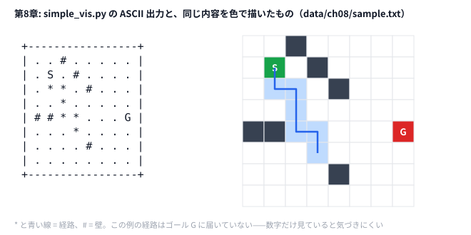

# 第8章 ビジュアライザ駆動開発

> **到達目標（茶色帯 400〜799）**: 公式ビジュアライザと簡単な自作ビジュアライザで **解の形** を目で確認し、バグ取りと改善に使える。Python / Go で **共通入力フォーマット** の ASCII 可視化ができる。
>
> 8.4（スコア推移・操作履歴の可視化）は **発展** 。第9章の焼きなましを学んだあとに読むと効く。

---

## 8.1 公式ビジュアライザと自作ビジュアライザ

**霊夢**: AHC って公式のビジュアライザがあるよね？ 自分で作る意味あるの？

**魔理沙**: まずは **公式 vis を毎回見る** のが基本だ（第2章）。スコアだけ見て「なんか低い」で終わらせず、**解がどう見えるか** を確かめる——これが **ビジュアライザ駆動開発** だ。

**魔理沙**: 自作が効くのは、公式 vis では見えないものを見たいときだ。「この経路だけ重ねたい」「途中の状態を見たい」「ターミナルだけで素早く確認したい」など。最初は **ASCII で数十行** で十分。設計の要点は次の4つ。

| 要素 | 役割 |
|------|------|
| **入力フォーマット** | グリッド・経路・配置を1ファイルにまとめる |
| **レンダラ** | ASCII / HTML / PNG など、環境に合わせて選ぶ |
| **オーバーレイ** | 壁・開始・ゴールの上に経路や操作を重ねる |
| **メタ情報** | stderr に `path_len` や legend を出す |

**霊夢**: 最初から GUI を作るの？

**魔理沙**: 不要だ。**ASCII グリッド** ならターミナルだけで回る。第8章の `simple_vis` は `data/ch08/sample.txt` を読み、壁 `#`・開始 `S`・ゴール `G`・経路 `*` を描く。

入力フォーマット（共通）:

```text
N
grid row 0 ... row N-1    # 0=空 1=壁 2=開始 3=ゴール
path_len
r0 c0
r1 c1
...
```

Python の読み込み:

```python
# python/ch08/simple_vis.py
@dataclass
class VisInput:
    n: int
    grid: List[List[int]]
    path: List[Tuple[int, int]]

def read_vis(stream: TextIO) -> VisInput:
    lines = [ln.strip() for ln in stream.read().splitlines() if ln.strip()]
    n = int(lines[0])
    grid = [list(map(int, lines[i + 1].split())) for i in range(n)]
    path_len = int(lines[n + 1])
    path = [tuple(map(int, lines[n + 2 + i].split())) for i in range(path_len)]
    return VisInput(n=n, grid=grid, path=path)
```

Go も同じ行順:

```go
// go/ch08/simple_vis.go
type VisInput struct {
    N    int
    Grid [][]int
    Path [][2]int
}
```

**霊夢**: Python と Go で見た目を揃えるの？

**魔理沙**: **フォーマットを先に決める** のがコツだ。レンダラは言語ごとに違っても、**同じ `sample.txt`** を食わせれば diff が取れる。

---

## 8.2 デバッグと解法改善への活用

**霊夢**: スコアが伸びないとき、vis で何を見るの？

**魔理沙**: 典型パターンは3つ。

1. **制約違反の形** — 重なり・未訪問・壁貫通が一目で分かる
2. **無駄な迂回** — 経路がループやデッドエンドに入っている
3. **局所最適の「形」** — 同じスコア帯で形が似ている → 近傍が足りない

オーバーレイの核心:

```python
# python/ch08/simple_vis.py
def overlay_path(grid, path):
    view = [[CELL_CHARS.get(grid[r][c], "?") for c in range(n)] for r in range(n)]
    for r, c in path:
        if grid[r][c] in (2, 3):   # S/G は上書きしない
            continue
        view[r][c] = PATH_CHAR  # "*"
    return view
```

```go
// go/ch08/simple_vis.go — 経路を重ねる部分
for _, p := range path {
	r, c := p[0], p[1]
	if r < 0 || c < 0 || r >= n || c >= n {
		continue
	}
	if grid[r][c] == 2 || grid[r][c] == 3 {
		view[r][c] = cellChars[grid[r][c]]
	} else {
		view[r][c] = "*"
	}
}
```

**霊夢**: デバッグは print より vis が速い？

**魔理沙**: **空間問題** では圧倒的に速い。数値ログだけだと「どのセルが悪いか」が分からない。vis を見て **近傍操作を1つ足す** — それが 8.5 演習の流れだ。

改善ループ:

```
解法を走らせる → vis 出力 → 形を観察 → 近傍/初期解を修正 → 再実行
```

stderr 例:

```
legend: . empty  # wall  S start  G goal  * path
grid=8 path_len=7
```

**path_len** が想定より短い・長いとき、経路生成側のバグを vis 側で切り分けられる。

---

## 8.3 ハンズオン: Python / Go 共通フォーマットの簡易ビジュアライザ

**霊夢**: 実際に動かすの？

**魔理沙**: `data/ch08/sample.txt` で確認するぜ。

### Step 1: 読む

`sample.txt` は 8×8 グリッド、経路は S から始まる 7 マス。壁 `#` を避けて進む道が `*` で見える。ただし G の手前で終わっていて、まだ G には着いていない（演習1で延ばす）。

### Step 2: 写す（実行）

```bash
python python/ch08/simple_vis.py < data/ch08/sample.txt
go run go/ch08/simple_vis.go -input data/ch08/sample.txt
```

期待出力（ASCII 抜粋）:

```text
+-----------------+
| . . # . . . . . |
| . S . # . . . . |
| . * * . # . . . |
| . . * . . . . . |
| # # * * . . . G |
| . . . * . . . . |
| . . . . # . . . |
| . . . . . . . . |
+-----------------+
```

**魔理沙**: 同じ内容を色で描くと、こうなる。HTML 版（`--html`）も、このような色分けで描く。



**霊夢**: ASCII だと記号を 1 つずつ追わないといけないけど、色だと壁と経路と S・G が一目で分かるの。

**魔理沙**: 盤面が 30×30 や 50×50 になると、その差はもっと大きくなる。ASCII はターミナルでの素早い確認、色は全体をつかむとき、と使い分けろ。

HTML（任意。ブラウザで見たり共有したりしたいとき）:

```bash
python python/ch08/simple_vis.py --html data/ch08/sample.txt > /tmp/ch08.html
open /tmp/ch08.html   # macOS
```

### Step 3: 改変（経路を差し替え）

`sample.txt` の path 部分だけ書き換え、**同じ grid で別経路** を比較する。

```text
7
1 1
2 1
3 1
4 1
4 2
4 3
5 3
```

→ 壁 `#` にぶつかる経路なら `*` が壁セルに乗る。制約チェック vis として使える。

### Step 4: コンテスト形式（解法と接続）

解法が経路を stdout に出すなら、vis 用ファイルに整形して渡す:

```bash
# 自分の解法の出力を ch08 フォーマットに合わせて path.txt を作る
python python/ch08/simple_vis.py path.txt
```

**パイプライン**: `[solver] → [path file] → [simple_vis] → 目視 → [近傍追加]`

---

## 8.4 【発展】スコア推移・操作履歴の可視化（第9章のあとに）

**霊夢**: 解の形だけじゃなく、スコアの推移も見たいの。

**魔理沙**: 慣れてきたら **探索ログ** も vis の対象にする。第9章の焼きなましや第18章の multi-start を学んだあとに効いてくるので、今は「こういうこともできる」と眺めるだけでいい。

| 可視化対象 | 形式 | 用途 |
|-----------|------|------|
| スコア時系列 | CSV → 折れ線 | SA の冷却・受理率の確認 |
| 操作履歴 | `(turn, op, delta)` リスト | どの操作が効いたか |
| スコア分布 | ヒストグラム | multi-start の谷の数 |

簡易スコアログ（解法側 stderr）:

```python
# 概念: 探索ループ内（第9章の SA は制限時間の 10% ごとに sa step=... score=... T=... を出している）
if step % 1000 == 0:
    print(f"log score={best} step={step}", file=sys.stderr)
```

操作履歴を vis 入力に載せる拡張例:

```text
# sample_with_ops.txt（拡張案）
N
... grid ...
path_len
... path ...
ops_len
swap 3 4 +120
relocate 1 7 -40
```

**霊夢**: 本番コンテスト中も vis を回す？

**魔理沙**: **ローカル専用** が基本。提出バイナリに matplotlib は載せない。ASCII か軽量 HTML を **オフライン生成** する。

---

## 8.5 演習

**基本**

1. `data/ch08/sample.txt` の経路を **1ステップ延長** し、vis で G に届くか確認する。
2. 次の AHC（または過去問）で、提出のたびに **公式 vis で形を見て** 気づいたことを1行メモする。
3. 自分の過去問（AHC001 や AHC005 など）用に **grid 符号だけ** 変えた vis フォーマットを1ページ書く。
4. 第6章の 2-opt の改善前後の巡回路を、各点に **訪問順の数字** を書いた ASCII 図にして2ファイルに保存し、並べて比べる（`simple_vis.py` は通ったマスに `*` を付けるだけなので、同じ点を回る巡回路は前後で同じ図になる）。

```bash
paste before.ascii after.ascii
```

**発展（第9章のあとで）**

5. 第9章の SA の stderr（`sa step=... score=... T=...`）をファイルに保存し、スプレッドシートで score と T を折れ線にする。

<details>
<summary>ヒント</summary>

1. 経路の最後は `(5, 3)`、G は `(4, 7)`。マンハッタン距離を数えてみる。`simple_vis.py` は stdin ではなく、ファイル名を引数で受け取る。
2. 1 行メモは「何が見えたか」と「次に何を試すか」の 2 つを書く。
3. 符号（0〜3）の意味を問題に合わせて決め直す。AHC001 なら「企業の点」「矩形の内側」、AHC005 なら「道路」「障害物」など。
4. 第6章の点はどれも 0〜9 の整数座標なので、10×10 のマスに置ける。各点に、何番目に訪れたかを書く。
5. stderr をファイルに保存し、`sa step=` の行だけを `sed` で CSV にする。

</details>

<details>
<summary>解答例</summary>

**1.** 1 ステップでは届かない。`(5, 3)` から G までは縦 1・横 4 で、最低 5 歩かかる。5 行目は壁がないので、`(5,4) (5,5) (5,6) (5,7) (4,7)` を足して `path_len` を 12 にすると G に着く。

```bash
(head -9 data/ch08/sample.txt
 printf '12\n1 1\n2 1\n2 2\n3 2\n4 2\n4 3\n5 3\n5 4\n5 5\n5 6\n5 7\n4 7\n') > extended.txt
python python/ch08/simple_vis.py extended.txt
```

```text
| # # * * . . . G |
| . . . * * * * * |
```

**2.** 例えば「AHC00x 提出3: 右下の領域がまったく使われていない → 初期解の置き方を変える」。毎回 1 行でも書くと、同じ見落としを 2 度しなくなる。

**3.** AHC001 なら、例えば次のようにする。

```text
N
grid row 0 ... row N-1    # 0=空き 1=矩形の内側 2=企業の点（矩形の外） 3=企業の点（矩形の内側）
path_len                  # 使わないので 0
```

**4.** 次のスクリプトで、2-opt の前後を並べられる。改善後は番号 0→1→…→7 が外周を順に回っていて、交差がなくなったことが分かる。

```python
# 解答例: 2-opt の前後の tour を、訪問順の数字で描く
import random
import sys

sys.path.insert(0, "python/ch06")
from two_opt import read_points, two_opt


def draw(pts, tour, size=10):
    view = [["." for _ in range(size)] for _ in range(size)]
    for order, p in enumerate(tour):
        x, y = pts[p]
        view[size - 1 - int(y)][int(x)] = str(order)  # 上が y の大きい側
    return "\n".join(" ".join(row) for row in view)


pts = read_points(open("data/ch06/sample.txt"))
tour = list(range(len(pts)))
random.Random(42).shuffle(tour)
open("before.ascii", "w").write(draw(pts, tour) + "\n")
open("after.ascii", "w").write(draw(pts, two_opt(pts, list(tour))) + "\n")
```

```text
. . . . . 5 . . . .	. . . . . 2 . . . .
. . 2 . . . . . 1 .	. . 3 . . . . . 1 .
. . . . . . . . . .	. . . . . . . . . .
. . . . . . . . . .	. . . . . . . . . .
3 . . . . . . . . 0	4 . . . . . . . . 0
. . . . . . . . . .	. . . . . . . . . .
. . . . . . . . . .	. . . . . . . . . .
. . . . . . . 4 . .	. . . . . . . 7 . .
. . . . 7 . . . . .	. . . . 6 . . . . .
6 . . . . . . . . .	5 . . . . . . . . .
```

**5.** 次のように CSV にして、スプレッドシートで読み込む。score は早い段階で大きく伸びてから頭打ちになり、T は時間とともに下がっていく。

```bash
python python/ch09/sa_intro_hc.py < data/ch09/sample.txt 2> sa.log > /dev/null
(echo step,score,T
 grep '^sa step=' sa.log | sed -E 's/sa step=([0-9]+) score=([0-9]+) T=([0-9.]+)/\1,\2,\3/') > sa.csv
```

</details>

---

## 章末まとめ

**霊夢**: 数字より形を見る開発、早めに身につけておくのね。

**魔理沙**: まとめだ。

> **第8章まとめ**
>
> - まず **公式 vis を毎回見る**。自作 vis は「公式で見えないもの」を見るために作る
> - **共通フォーマット**（grid + path）を Python / Go で共有し、**ASCII** で十分
> - 制約違反・無駄な迂回・局所最適の「形」を目で見つける
> - 【発展】スコア推移・操作履歴の可視化は、第9章の SA を学んだあとに
> - ハンズオン: `simple_vis.py` / `simple_vis.go` + `data/ch08/sample.txt`
> - 演習: vis を見て **近傍操作を1つ追加**
> - 第2部（茶）の締め: 次章から **第3部（緑）** — 焼きなまし・ビームサーチ

**霊夢**: 見える化できる人は、改善も速いんだね。

**魔理沙**: その通り。第9章の **焼きなまし** では、温度とスコアのログを vis と並べて見ると調整がぐっと楽になるぜ。
