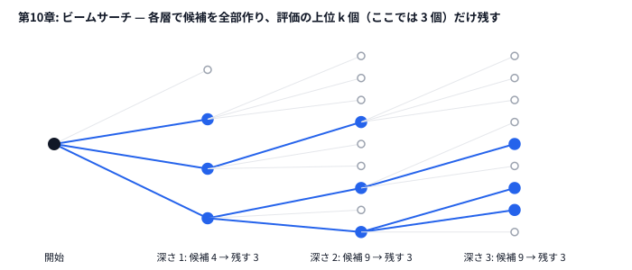

# 第10章 ビームサーチ（Beam Search）

> **到達目標（緑色帯 800〜1199）**: ビーム幅と評価関数を調整し、部分解を広げながら高スコアの操作列を構築できる。

---

## 10.1 幅優先探索との違い

**霊夢**: ビームサーチって、幅優先探索（BFS）と同じなの？

**魔理沙**: **似ているが同じじゃない**。どちらも「層ごとに状態を広げる」が、BFS は **全候補を保持** し、ビームサーチは **上位 K 個だけ残す**。

```
深さ 0:        [S]
深さ 1:     BFS: 全子をキューに入れる（枝が指数増）
            Beam: 子を全部作る → 評価で上位 K のみ残す

深さ 2:     BFS: さらに全展開…
            Beam: また K 個だけ…
```

| | BFS | ビームサーチ |
|---|-----|-------------|
| 保持する部分解 | 全部（メモリ爆発） | 上位 **beam_width** 個 |
| 最適性 | 最短経路などで最適 | **近似**（K が小さいと外す） |
| 典型用途 | 小さなグラフ | パズル・経路・配置の **構築** |

**霊夢**: K が小さいと正解から外れる？

**魔理沙**: 外れる。**ビーム幅**を上げると精度は上がるが、**時間とメモリ**も増える。AHC では「何ステップ先まで」「何本の候補を生かすか」を問題ごとに決める。

```python
# 概念コード
beam = [start_state]
for depth in range(max_depth):
    candidates = []
    for state in beam:
        for move in legal_moves(state):
            candidates.append(apply(state, move))
    beam = select_top_k(candidates, k=BEAM_WIDTH)  # ここが BFS と違う
```



---

## 10.2 ビーム幅・評価関数・枝刈り

**霊夢**: 上位 K 個は何で並べるの？

**魔理沙**: **優先度 = 今のスコア + 見積もり（ヒューリスティック）** が定番。第10章の `beam_fill.py` では **最大化** なので、Python の `heapq` 用に **負のスコア** をキーにしている。

```python
# python/ch10/beam_fill.py
@dataclass(order=True)
class BeamNode:
    neg_score: int   # 小さいほど優先 → 実質スコア+h が大きい順
    depth: int
    r: int = field(compare=False)
    c: int = field(compare=False)
    visited: int = field(compare=False)
    score: int = field(compare=False)
    path: str = field(compare=False)
```

| 設計要素 | 本リポジトリ | 調整のコツ |
|---------|-------------|-----------|
| ビーム幅 | `BEAM_WIDTH = 80` | 2倍にして改善幅を測る（演習） |
| 評価 | `score + heuristic(...)` | 見積もりが甘いと誤枝、厳しいと枝刈り過多 |
| 枝刈り | `heapq.nsmallest(beam_width, candidates)` | 候補数が爆発する層では幅を絞る |

```python
# python/ch10/beam_fill.py — 1層の流れ
candidates: List[BeamNode] = []
for node in beam:
    for dr, dc, ch in DIRS:
        # ... 合法なら candidates に追加
        h = heuristic(grid, n, new_visited, nr, nc)
        candidates.append(
            BeamNode(
                neg_score=-(new_score + h),
                depth=node.depth + 1,
                # ...
            )
        )

beam = heapq.nsmallest(beam_width, candidates)  # 上位 K
```

```go
// go/ch10/beam_fill.go — 良い順に安定ソートして上位 width 個を残す
sort.SliceStable(candidates, func(i, j int) bool {
    if candidates[i].priority != candidates[j].priority {
        return candidates[i].priority < candidates[j].priority
    }
    return candidates[i].depth < candidates[j].depth
})
if len(candidates) > width {
    candidates = candidates[:width]
}
beam = candidates
```

**魔理沙**: ヒープで「上位 K 個だけ持つ」書き方もあるが、**向きを間違えやすい**。最小ヒープ（priority = −スコア）に積んで溢れたら `Pop` すると、捨てられるのは priority 最小、つまり**一番良い候補**だ。上位 K を残したいなら「最悪が先頭に来るヒープ」（priority の大きい順）にする必要がある。迷ったらソートで十分だぜ。

**霊夢**: 見積もりが間違ってても動く？

**魔理沙**: 動く。ビームサーチは **最適性の保証はない** が、AHC では **強い貪欲よりマシな構築** が取れることが多い。評価関数の設計が勝負だ。

---

## 10.3 メモリと実行時間のトレードオフ

**霊夢**: ビーム幅 80 って、6×6 だと重くない？

**魔理沙**: この簡略版は **各層の候補数 ≤ 4 × beam_width** 程度に抑えている。**訪問済みビットマスク** で重複経路を弾いている。

| コスト要因 | 第10章実装 | 本番 AHC002 での注意 |
|-----------|----------|---------------------|
| 層数 | `n*n - 1`（全マス訪問） | タイル数・制約で深さが変わる |
| 分岐 | 最大4方向 | タイルの種類・ルールで増える |
| 状態 | `visited` を uint64 ビット列 | n が大きいとビット幅不足に注意 |
| パス文字列 | `path` を連結 | 長いと GC/コピーが重い → 親インデックス方式も検討 |

```python
# python/ch10/beam_fill.py
def cell_id(r: int, c: int, n: int) -> int:
    return r * n + c

# visited の bit i がマス i 訪問済み
new_visited = node.visited | (1 << vid)
```

```go
// go/ch10/beam_fill.go
newVisited := node.visited | (1 << vid)
```

**霊夢**: パスを文字列で持つのは楽だけど遅い？

**魔理沙**: 学習用には読みやすい。本番では **親ノード ID + 最後の1手** で復元する方式が多い（メモリ O(beam_width × depth)）。

```text
# トレードオフ早見表
beam_width ↑  → 精度↑ 時間↑ メモリ↑
heuristic 強  → 枝刈り↑ 誤爆リスク↑
層を浅く     → 速いが未完成解
```

---

## 10.4 部分解のスコア見積もり

**霊夢**: heuristic 関数、中身は何？

**魔理沙**: **「まだ踏んでない隣接マスの価値の和」** という簡易見積もりだ。AHC002 本番ではもっと賢い下界を使うが、緑帯では **「今取った点数 + 取れそうな上限っぽいもの」** で十分学べる。

```python
# python/ch10/beam_fill.py
def heuristic(grid, n, visited, r, c) -> int:
    est = 0
    for dr, dc, _ in DIRS:
        nr, nc = r + dr, c + dc
        if 0 <= nr < n and 0 <= nc < n:
            vid = cell_id(nr, nc, n)
            if (visited >> vid) & 1 == 0:
                est += grid[nr][nc]
    return est
```

| 見積もりの種類 | 特徴 |
|---------------|------|
| 0（見積もりなし） | 今のスコアだけで beam → 貪欲に近い |
| 隣接和（第10章） | 実装が軽い、盤面埋め向き |
| 残りマスの上位 M 個の和 | 強いが計算コスト増 |
| 問題固有 DP | AHC002 上位解法では別設計 |

**霊夢**: `neg_score = -(new_score + h)` なのは？

**魔理沙**: `heapq` は **最小ヒープ** だから、最大化したい値を **マイナス** にして並べる。`nsmallest(k, candidates)` で **スコア+h 最大の k 個** が残る。

```python
# 概念: 「今のスコア + 先の見積もり」で並べる
priority = -(current_score + heuristic_estimate)
```

**霊夢**: 途中で見つかった best は別管理？

**魔理沙**: その通り。層を進めながら **歴代最高スコアの path** を `best_score` / `best_path` に保存している。最後の beam 先頭とは限らないからだ。

```python
# python/ch10/beam_fill.py
if new_score > best_score:
    best_score = new_score
    best_path = new_path
```

---

## 10.5 ハンズオン: AHC002「Walking on Tiles」— ビームサーチで盤面を埋める

**霊夢**: 本番問題そのまま？

**魔理沙**: [AHC002](https://atcoder.jp/contests/ahc002/tasks/ahc002_a) の **「高いタイルを多く踏む経路」** を、**6×6・重複訪問なし** に簡略化した版だ。スタートは左上 `(0,0)`、出力は `U/D/L/R` の文字列（本番は 50×50 で、1×1・1×2・2×1 のタイルが敷かれ、**同じタイルは1回しか踏めない**。開始位置は入力で与えられる）。

### 入力形式（`data/ch10/sample.txt`）

```text
6
3 1 4 2 5 0
...
```

1行目: `n`、続く `n` 行が `n×n` のタイル値。

### Step 1: 実行

```bash
cd /path/to/yukkuri-heuristics
python python/ch10/beam_fill.py < data/ch10/sample.txt
```

期待出力の例:

```text
# stdout（経路）
DRRURRDDDRDDLLUUULLLDDRURDDL

# stderr
tiles=29 score=100 beam_width=80
```

**霊夢**: 6×6 なのに tiles=29 なのは、全部埋めてない？

**魔理沙**: 全部埋める必要はない。スコアは **踏んだマスの値の合計** だから、価値の低いマスは無視していい。簡略版の見積もりと幅だと、行き止まりに入って早めに終わることもある。ここでは **ビームの挙動を観察する** のが目的だ。

### Step 2: Go

```bash
go run go/ch10/beam_fill.go < data/ch10/sample.txt
```

### Step 3: ビーム幅を変える（改変）

```python
# python/ch10/beam_fill.py（改変例）
BEAM_WIDTH = 40   # → 速いがスコア低下の可能性
BEAM_WIDTH = 160  # → 遅いが改善の可能性
```

```bash
# 2回実行して stderr の score を比較
python python/ch10/beam_fill.py < data/ch10/sample.txt 2>&1 | tail -1
```

### Step 4: 見積もりを外す実験

```python
# 改変例: heuristic を常に 0 にすると「今のスコアのみ」で beam
def heuristic(...) -> int:
    return 0
```

スコアと `tiles=` がどう変わるかメモする。

### Step 5: AHC002 本番への橋渡し

| 簡略版（第10章） | AHC002 本番 |
|----------------|------------|
| 6×6 固定 | 50×50 固定 |
| 1マスずつ踏む | 1×1・1×2・2×1 のタイル単位で、**同じタイルは1回まで** |
| スタートは左上 | スタートは入力で与えられる |
| `BEAM_WIDTH=80` | 数百〜数千＋高速化が必要なことも |

公式の `tools` でビジュアライザを見ながら、**同じタイルを2回踏んでいないか**、**価値の高い領域を取り残していないか** を確認する習慣をつけろ。

---

## 10.6 演習

1. `BEAM_WIDTH` を **40 / 80 / 160** にし、**score・実行時間（`time` コマンド）** を表にする（10.2 の表のとおり「2倍でどれだけ伸びるか」を見る）。
2. `heuristic` を「未訪問マスの最大値」だけに変え、スコアと `tiles=` を比較する。
3. スタートを `(0,0)` 以外に変えられないか検討し、AHC002 のルールと照合する。
4. `best_path` を層ごとに stderr 出力し、**どの深さで best が更新されたか** をプロットする（紙でも可）。
5. 第6章の山登り（経路の2-opt）と組み合わせる案を箇条書きで書く（第11章パイプラインの予習）。

<details>
<summary>ヒント</summary>

1. 幅を変えて `time python ...` を何回か動かす。この盤面は小さいので、Python の起動時間のほうが長い。`beam_search` だけを `time.perf_counter()` で測ると差が見える。
2. `heuristic` の `est += grid[nr][nc]` を `est = max(est, grid[nr][nc])` にする。ヒューリスティックを 0 にした版とも比べると、見積もりの効き目が分かる。
3. AHC002 の入力の 1 行目を読む。開始マスは誰が決めるか。
4. `beam = heapq.nsmallest(...)` の直後で、層の番号 `_ + 1` と `best_score` を stderr に出す。
5. 第6章の 2-opt は「経路の 2 本の辺をつなぎ替える」手。AHC002 の経路は 1 本の道なので、そのままでは使えない。どんな手なら「経路の一部を作り直す」ことになるかを考える。

</details>

<details>
<summary>解答例</summary>

**1.** 手元では次のようになった（盤面の値の合計は 106）。

| BEAM_WIDTH | score | tiles | beam_search の時間 |
|-----------|-------|-------|-------------------|
| 40 | 82 | 25 | 0.004 秒 |
| 80 | 100 | 29 | 0.009 秒 |
| 160 | 100 | 29 | 0.019 秒 |
| 320 | 101 | 30 | 0.038 秒 |

幅を 2 倍にすると時間もほぼ 2 倍になるが、スコアは「40→80 で大きく伸び、80→160 は変わらず、320 でまた少し伸びる」と階段状に変わる。幅を上げれば必ず伸びるわけではない。`time` で外から測ると、どれも 0.5 秒前後で差が見えない（Python の起動時間がほとんど）。

**2.** 隣の未訪問マスの「和」ではなく「最大」を見積もりにすると、幅 80 で `score=101 tiles=30` と、元の版（100）より良くなった。ヒューリスティックを 0 にしても幅 80 で 100 になる。この盤面では、隣接マスの和は先の見積もりとしてあまり当たっていない。見積もりは「入れると必ず良くなる」ものではないので、入れる・入れないの両方を測って決める。

**3.** できない。AHC002 では、開始マス `(si, sj)` が入力で与えられる。玩具の `(0, 0)` 固定は、その簡略版だ。本番に寄せるなら、`read_grid` で開始マスも読み、`start_r, start_c` に使う。

**4.** 次の 1 行を足すと、best は 1 層目から 28 層目まで毎層更新され、28 層目の `100` が最後だった。29 層目以降は、ビームに残ったどの経路も行き止まりになり、候補がなくなって終わる。値が 0 以上の盤面では、1 歩進むごとにスコアが下がらないので、best は「一番深くまで行けた経路」でほぼ決まる。

```python
# 解答例: python/ch10/beam_fill.py の beam_search で、層ごとに best を出す
        beam = heapq.nsmallest(beam_width, candidates)
        print(f"layer={_ + 1} best_score={best_score}", file=sys.stderr)
```

**5.** 例えば次の案がある。

- ビームで作った経路を初期解にし、「経路の途中の区間を消して、同じ両端を別の道でつなぎ直す」近傍で山登りする（第19章の LNS と同じ発想）。
- 経路の末尾を k 歩切り落とし、そこから小さなビームで伸ばし直す。
- 2-opt はそのまま使えない。AHC002 の経路は隣のマスへしか進めないので、辺をつなぎ替えると、隣り合わない 2 マスを結ぶ不正な経路になる。

</details>

---

## 章末まとめ

**霊夢**: BFS は全部持つ、ビームは上位 K だけ、なのね。

**魔理沙**: まとめだ。

> **第10章まとめ**
>
> - **ビームサーチ**は層ごとに候補を展開し、**上位 K（ビーム幅）** だけ残す近似探索
> - **評価**は `現在スコア + 見積もり`。`heapq` では負にして最大化
> - **トレードオフ**: 幅↑で精度↑、時間・メモリ↑。パス保持は本番で軽量化も検討
> - **見積もり**が枝刈りの質を決める。簡略版は隣接未訪問マスの和
> - ハンズオン: `python/ch10/beam_fill.py` / AHC002 簡略版
> - 次章（第11章）: 貪欲 → 山登り → SA の多段パイプライン

**霊夢**: stderr の `tiles=` と `score=`、ちょっとした変更の効果がすぐわかるのだ。

**魔理沙**: ビームは **幅と見積もりのセット商品**だ。片方だけいじっても伸び悩むときは両方をログ付きで振れ。緑帯の終わりには **「構築（ビーム）＋改善（SA）」** を組み合わせられるようになる（次章）ぜ。
