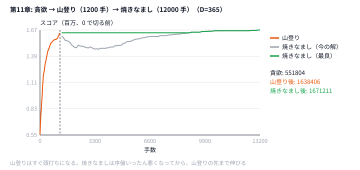

# 第11章 多段パイプライン

> **到達目標（緑色帯 800〜1199）**: 貪欲・山登り・焼きなましを時間配分付きでつなぎ、各段のスコアログからボトルネックを特定できる。

---

## 11.1 貪欲 → 山登り → 焼きなまし の組み合わせ

**霊夢**: 第5章から第9章、バラバラに学んだけど、本番はどう組み合わせるの？

**魔理沙**: **パイプライン**だ。1つの手法に賭けず、**役割分担** させる。

```
[貪欲]  粗い解を速く作る（construct）
   ↓
[山登り] 確実に良くなる手だけ入れる（polish）
   ↓
[焼きなまし] 局所最適から抜けて伸ばす（explore）
```

| 段階 | 役割 | 第11章コード |
|------|------|-------------|
| 貪欲 | 初期解の質を底上げ | `greedy_schedule` |
| 山登り | 悪化なしで詰める | `hill_climb` |
| SA | 悪化受理で探索 | `sa` |

**霊夢**: 全部入れると遅くない？

**魔理沙**: **時間で区切る**から大丈夫。第11章の `pipeline.py` は **合計1.8秒**（本番の制限時間 2 秒から、起動と出力の分を残す）のうち、前半60%を construct（貪欲+山登り）、残りを SA に使う。

```python
# python/ch11/pipeline.py
TOTAL_SEC = 1.8  # 本番の制限時間 2 秒から、起動と出力の分を残す
CONSTRUCT_RATIO = 0.6

t0 = time.perf_counter()
end = t0 + TOTAL_SEC
construct_end = t0 + TOTAL_SEC * CONSTRUCT_RATIO
```

```go
// go/ch11/pipeline.go
const (
	totalSec       = 1.8 // 本番の制限時間 2 秒から、起動と出力の分を残す
	constructRatio = 0.6
)
```

**霊夢**: Intro HC と同じスコア関数？

**魔理沙**: 第9章と同じ **日程最適化**（`score_schedule`）。パイプラインは **問題に依存しない骨格** で、中身の `greedy` / `hill_climb` / `sa` だけ差し替えれば AHC011 系にも応用できる。

---

## 11.2 時間配分（construct 60% / improve 40% など）

**霊夢**: 60% / 40% は固定？

**魔理沙**: **出発点**だ。問題によって振る。

| 配分 | 向いている状況 |
|------|----------------|
| construct 長め（70%） | 初期解の質が勝負（配置・構築が難しい） |
| improve 長め（50%以上 SA） | 初期解はそこそこ、探索で伸びる |
| 山登り短め | 近傍が重い・改善が早く頭打ち |

```python
# 第11章のタイムライン（TOTAL_SEC=1.8 の例）
# 0.0s ─────────────── 1.08s ───── 1.8s
#      [    greedy + hill_climb    ][  SA  ]
#      ←── CONSTRUCT_RATIO=0.6 ──→
```

```python
# python/ch11/pipeline.py
print("phase=greedy start", file=sys.stderr)
state = greedy_schedule(problem)
print(f"phase=greedy end score={score_schedule(problem, state)}", file=sys.stderr)

print("phase=hill_climb start", file=sys.stderr)
state = hill_climb(problem, state, construct_end, rng)

print("phase=sa start", file=sys.stderr)
state = sa(problem, state, end, rng)
```

**霊夢**: 山登りは `construct_end` まで？

**魔理沙**: そう。SA は **`end` まで**。`time.perf_counter() < deadline` でループを切るので、**オーバーヘッド分は自分でマージン** を取るのが本番作法だ。

```python
# python/ch11/pipeline.py
while time.perf_counter() < deadline:
    # 1 step
```

**霊夢**: 貪欲は時間使わない？

**魔理沙**: 第11章の貪欲は **日ごとに26通り試す** 小さな D 向け。D=365 本番では貪欲にも締切を付けるか、もっと軽い construct（ランダム+SA）にする。

---

## 11.3 途中経過の保存と最終提出の選び方

**霊夢**: SA の途中でスコアが落ちたら、提出は下がる？

**魔理沙**: だから **best-so-far（歴代最高）** を別変数で持つ。第9章 SA と同じ思想をパイプライン全体に広げる。

| 変数 | 意味 |
|------|------|
| `current` / `state` | 今探索中の解（悪化もありうる） |
| `best` | 今まで見た最高スコアの解 |
| 提出 | **常に best**（または最終 `state` が best ならそれ） |

```python
# python/ch11/pipeline.py（抜粋）
# hill_climb: 受理は改善のみ → current のスコアは単調増加
if delta > 0:
    current.types[day] = t
    score += delta

# sa: best を更新
if score > best_score:
    best = current.copy()
    best_score = score
return best  # 最終的に best を返す
```

```go
// go/ch11/pipeline.go（抜粋）
if delta := deltaChange(problem, current.Types, day, t); delta > 0 { // 差分だけ（第9章 9.4）
	current.Types[day] = t
	score += delta
	break
}
```

**霊夢**: 段階ごとのスコアも残した方がいい？

**魔理沙**: **必須に近い**。第11章は stderr にフェーズログを出す。

```text
phase=greedy start
phase=greedy end score=1079455
phase=hill_climb start
phase=hill_climb end score=1079455
phase=sa start
phase=sa end score=1079507
elapsed=1.800s
```

（時間・step 数・途中のスコアはマシン速度で変わる。）

**霊夢**: 山登りは貪欲と同じ数字だけど、SA で少し伸びてるの。

**魔理沙**: サンプル D=5 では **貪欲がすでに強く**、山登りは貪欲の解から動けない（局所最適）。SA は悪化も受け入れるので、谷を越えて 1079455 → 1079507 に届く。これがパイプラインに SA を入れる理由だ。演習では **construct を弱くする**（ランダム初期解）などして、各段の差をもっと大きくしてみろ。

```python
# ボトルネック調査用メモテンプレート
# | phase      | end_score | 所要時間(概算) |
# | greedy     |           |                |
# | hill_climb |           |                |
# | sa         |           |                |
```

**霊夢**: 複数回実行したらどれを提出？

**魔理沙**: **スコア最大の1本**。シード違いの multi-start なら、各 run の best を比較して最高を選ぶ（第6章 multi-start の延長）。

---

## 11.4 ハンズオン: Intro HC 型スケジュールで「貪欲 → 山登り → SA」（応用先: AHC011）

**霊夢**: パズル問題なの？ コードは日程だけど。

**魔理沙**: **概念の橋渡し**だ。[AHC011](https://atcoder.jp/contests/ahc011/tasks/ahc011_a) は、線が描かれたタイルを **空きマスへスライド** させて、線がつながった **大きな木（閉路のない連結成分）** を作る問題で、本番解法はだいたい次の形になる。

```
1. 構築: 貪欲 / ビーム / ランダムで操作列 or 配置の初期解
2. 改善: 山登りで確実に良化
3. 仕上げ: SA で盤面を抜け出す
```

第11章コードは **同じパイプライン骨格** を、手元で検証しやすい Intro HC 型スコア（`data/ch11/sample.txt`）に載せ替えている。AHC011 に応用するときは `greedy_schedule` と近傍を **スライド操作** に差し替える。

### Step 1: 実行（2秒・フェーズログ）

```bash
cd /path/to/yukkuri-heuristics
python python/ch11/pipeline.py < data/ch11/sample.txt
```

stderr 先頭の例:

```text
phase=greedy start
phase=greedy end score=1079455
phase=hill_climb start
hc step=200 score=1079455
...
phase=sa start
sa step=9279 score=1074883 T=2685.68
...
sa step=86292 score=1079507 T=18.62
phase=sa end score=1079507
elapsed=1.800s
```

（時間・step 数・途中のスコアはマシン速度で変わる。）

stdout: 5行のタイプ（例）

```text
1
17
9
14
13
```

**魔理沙**: D=5 だと 3 段の差が見えないので、D=365 で、時間の代わりに手数で区切って描いた（図を毎回同じにするため）。



**霊夢**: 貪欲 55 万から山登りで一気に 160 万台。焼きなましはそこから一度下がるのね。

**魔理沙**: 温度が高い序盤は、悪くなる手も受け入れるからだ。山登りが止まった谷から出て、最後は山登りより上に着く。各段に「得意な仕事」がある、というのが多段パイプラインの考え方だ。

### Step 2: Go

```bash
go run go/ch11/pipeline.go < data/ch11/sample.txt
```

### Step 3: 時間配分の改変

```python
# 改変例: python/ch11/pipeline.py の定数を書き換える
CONSTRUCT_RATIO = 0.3  # construct 短く → SA に時間を回す
CONSTRUCT_RATIO = 0.8  # 山登り長く → 初期解重視
```

各設定で `phase=* end score=` を記録する。

### Step 4: 段階を1つ外す実験

```python
# hill_climb をスキップして greedy → sa だけにする
# sa をコメントアウトして greedy → hill_climb だけにする
```

どの段でスコアが伸びたか表にまとめる（11.5 演習）。

### Step 5: AHC011 本番への対応表

| パイプライン段 | AHC011 での例 |
|---------------|--------------|
| 貪欲 | 木を目標に近づける操作を貪欲に積む |
| 山登り | 1手戻し・スワップで改善のみ |
| SA | 悪手を含む操作列のランダム変更 |
| 時間配分 | 構築にビーム、残り SA など |

公式 `tools` のビジュアライザで **木の連結性** と **スコア** を確認しながら、第10章ビーム＋第11章パイプラインを合成するのが緑〜水色の定番ルートだ。

---

## 11.5 演習

1. 本番サイズの `data/common/intro_hc_d365.txt`（D=365）で動かし、各段の伸びを確かめる。さらに `CONSTRUCT_RATIO` を `0.3 / 0.6 / 0.8` で振り、**各 `phase=* end score=`** と `elapsed=` を表にする。

```bash
python python/ch11/pipeline.py < data/common/intro_hc_d365.txt
```

（手元の Python では `greedy 551804 → hill_climb 1567145 → sa 1641107`。D=5 のサンプルでは見えなかった各段の効果がはっきり出る。山登りと SA は第9章 9.4 の差分更新で回しているので、Python でも 1 秒あたり数万手を試せる。）
2. 初期解を `greedy_schedule` ではなく **ランダム**（第9章と同様）にし、3段階の伸び方を比較する。
3. stderr の `hc step=` / `sa step=` をファイルにリダイレクトし、**どの段階で best が最後に更新されたか** を特定する。

```bash
python python/ch11/pipeline.py < data/ch11/sample.txt 2> pipeline.log
grep 'phase=' pipeline.log
grep 'best' pipeline.log  # 必要ならコード側に best 更新ログを追加
```

4. 第10章 `beam_fill.py` で得た経路を「初期解」とみなす案を書き、パイプラインに組み込むには何が要るか箇条書きにする。
5. AHC011 の問題文を読み、**State / Move / Score** を第3章テンプレートで埋める（実装は水色帯の第15章パズルのあとでも可）。

<details>
<summary>ヒント</summary>

1. ファイル先頭の `CONSTRUCT_RATIO` は「全体 1.8 秒のうち、貪欲と山登りに使う割合」。残りが SA の時間になる。SA の時間が短すぎると何が起きるかを考えておく。
2. `main` の `state = greedy_schedule(problem)` を、第9章と同じランダムな日程に置き換える。
3. stderr には段ごとの `phase=* end score=` が出る。どの段で数字が最後に変わったかを見る。
4. ビームの経路は第10章の問題（AHC002 型）の解で、第11章のパイプラインは Intro HC の日程の解だ。そのままつなぐことはできない。経路の問題でパイプラインを組むには、何を作り直す必要があるかを考える。
5. AHC011 は、空きマスを上下左右に動かしてタイルを並べ替える問題。State は盤面、Move は空きマスの移動、Score は「できた木の大きさ」と「使った手数」で決まる。

</details>

<details>
<summary>解答例</summary>

**1.** 手元の一例（D=365、どれも `elapsed=1.80s` 前後）。

| CONSTRUCT_RATIO | greedy | hill_climb | sa |
|----------------|--------|-----------|----|
| 0.3 | 551804 | 1421790 | 1714998 |
| 0.6 | 551804 | 1567145 | 1641107 |
| 0.8 | 551804 | 1577150 | 1591736 |

山登りに時間を多く配るほど山登りの段のスコアは上がるが、最後のスコアは SA に時間を残した 0.3 が一番よかった。山登りは途中で頭打ちになり（0.6 と 0.8 でほとんど変わらない）、そこから先を伸ばせるのは悪化を受け入れる SA だけだ。0.8 では SA が 0.36 秒しかなく、ほとんど伸ばせない。時間で打ち切るので、同じ設定でも数万ずつぶれる。差が小さいときは何回か動かして比べる。

**2.** ランダムな初期解にすると、手元では `greedy 0 → hill_climb 0 → sa 830882` だった（貪欲から始めると約 164 万）。ランダムな日程は満足度が大きくマイナスで、山登りで少し良くしても、まだ 0 で切られている。D=365 では、山登りも SA も、悪い初期解から良いところまで登りきる時間が足りない。貪欲の初期解は、残りの段の時間を節約する役目を果たしている。

**3.** `data/ch11/sample.txt`（D=5）では、次のように **SA の段** が最後に best を更新した。貪欲の解は「1 日だけ変えても良くならない」局所最適なので、山登りは動けない。SA は悪化を受け入れて、そこから抜けた。

```text
phase=greedy end score=1079455
phase=hill_climb end score=1079455
phase=sa end score=1079507
```

**4.** 例えば次のものが要る。

- 経路の問題の State（通ったマスの列）と、合法性のチェック（隣のマスにしか進めない、同じタイルを 2 度踏まない）
- 経路の Move（末尾を切って伸ばし直す、途中の区間を別の道でつなぎ直す、など）と、その差分のスコア計算
- 「greedy」の段を `beam_search` に差し替え、`hill_climb` と `sa` の段を経路の Move で書き直す
- 段ごとの時間配分（ビームに何割使うか）

パイプラインの「段を並べて時間を配る」骨組みはそのまま使えるが、中身の State / Move / Score は問題ごとに作り直す。

**5.** 例えば次のように埋まる。

```markdown
## State
- N×N の盤面。各マスは線の模様（16 通り）か空きマス。空きマスの位置
## Move
- 空きマスを U / D / L / R に 1 つ動かす（隣のタイルと入れ替わる）。手数の上限は T
## Score
- 一番大きい木のタイル数 S。全部つながった木（S = N² − 1）ができたら、使った手数 K が少ないほど高い
- 木ができる前は S を増やすこと、できた後は K を減らすことが目標
```

</details>

---

## 章末まとめ

**霊夢**: 貪欲で土台、山登りで整えて、SA で伸ばす——流れがはっきりしたの。

**魔理沙**: まとめだ。

> **第11章まとめ**
>
> - 本番は **貪欲 → 山登り → SA** の多段パイプラインが定番
> - **時間配分**（例: construct 60% / improve 40%）は問題で調整する
> - 提出は **best-so-far**。フェーズごとの stderr ログでボトルネックを見る
> - ハンズオン: `python/ch11/pipeline.py`（1.8秒・フェーズログ）/ AHC011 の概念
> - 第3部（緑）の締め: **SA・ビーム・パイプライン** を組み合わせて戦う
> - ここまでの内容で、[付録G](appendix-g.md) の通し演習（Intro HC 問題A を最後まで解く）に挑戦できる
> - 次部（水色）: インタラクティブ・タブー・データ構造高速化・高度 SA（第12章〜）

**霊夢**: `phase=greedy end score=` を見ると、どこに時間を足すか決めやすいのね。

**魔理沙**: ログ無しのパイプラインは **闇雲チューニング** になる。緑帯のうちに **「段階別スコア＋残り時間」** を stderr に吐く癖を付けろ。水色帯ではインタラクティブや差分更新と組み合わせて、同じ骨格で本番問題に載せ替えるんだぜ。
