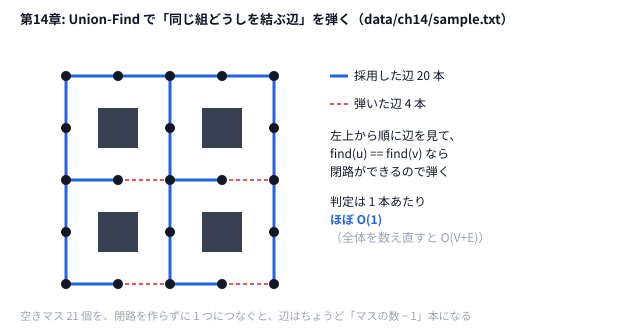

# 第14章 データ構造で速くする

> **到達目標（水色帯 1200〜1599）**: Union-Find と Fenwick で連結性・区間和を高速化し、近傍評価の差分更新を設計できる。

---

## 14.1 Union-Find（素集合データ構造）

**霊夢**: Union-Find って、グループ分けを高速にマージするやつ？

**魔理沙**: **素集合データ構造**だ。`find` で代表元、`unite` で集合を合体。**経路圧縮**と**ランク（またはサイズ）** でほぼ定数時間。

```python
# python/ch14/union_find.py
class UnionFind:
    def find(self, x: int) -> int:
        while self.parent[x] != x:
            self.parent[x] = self.parent[self.parent[x]]  # 経路圧縮
            x = self.parent[x]
        return x

    def unite(self, a: int, b: int) -> bool:
        ra, rb = self.find(a), self.find(b)
        if ra == rb:
            return False
        # ランクで木の高さを抑える
        ...
        return True
```

```go
// go/ch14/union_find.go
func (uf *UnionFind) Find(x int) int {
    for uf.parent[x] != x {
        uf.parent[x] = uf.parent[uf.parent[x]]
        x = uf.parent[x]
    }
    return x
}
```

**霊夢**: `unite` が `False` のときは、もともと同じグループ？

**魔理沙**: そう。**辺を足しても連結成分数が減らない** ときはスキップできる。AHC010 系では、タイルの線がどこまでつながっているか（どのマスが同じ路線か）をまとめて管理するのに使える。

### ベンチマーク（単体実行）

```bash
python python/ch14/union_find.py
go run go/ch14/union_find.go
```

`n=5000`・`m=20000` の union 反復で、素朴再構築より **数倍〜十数倍** 速くなる（環境依存）。

---

## 14.2 セグメント木・Fenwick Tree によるスコア差分更新

**霊夢**: Fenwick は区間和を速くするツリー？

**魔理沙**: **Binary Indexed Tree** だ。一点更新・前缀和が `O(log n)`。セグメント木はより汎用だが、実装は Fenwick の方が短い。

```python
# python/ch14/fenwick.py
class Fenwick:
    def add(self, i: int, delta: int) -> None:
        i += 1
        while i <= self.n:
            self.bit[i] += delta
            i += i & -i

    def range_sum(self, l: int, r: int) -> int:
        if l == 0:
            return self.prefix(r)
        return self.prefix(r) - self.prefix(l - 1)
```

```go
// go/ch14/fenwick.go — 同様の add / prefix / range_sum
```

**霊夢**: 近傍でスコアが「区間の和の変化」だけなら、全配列をなめなくていいのね。

**魔理沙**: その設計が **差分更新可能な近傍** だ。毎回 `sum(arr[l:r+1])` すると `O(n)`、Fenwick なら `O(log n)`。

```bash
python python/ch14/fenwick.py
```

出力例: `speedup=...x`（`naive_range_sum_ms` と `fenwick_ms` の比）。2 行の `checksum` が同じなら、両方が同じ答えを出している。

---

## 14.3 ヒープ・優先度キューによる貪欲高速化

**霊夢**: ヒープは第12章のダイクストラでも使ってたわね。

**魔理沙**: **最小コストを常に取り出す** 構造だ。用途は次の通り。

| 用途 | 例 |
|------|-----|
| ダイクストラ | `heapq` で `(距離, 頂点)` |
| 貪欲マッチング | コスト昇順の辺をキューから |
| ビームサーチ | `heapq.nsmallest`（第15章） |
| スケジューリング | 締切順のイベントキュー |

```python
# 骨格: heapq の基本操作
import heapq
pq = [(0.0, start)]
d, u = heapq.heappop(pq)
heapq.heappush(pq, (nd, v))
```

**霊夢**: Go は `container/heap` を使うの？

**魔理沙**: 本番 Go では **heap パッケージ** が定番。第12章サンプルは頂点が小さいので配列ダイクストラでも足りるが、**V≥1000** なら heap に切り替えろ。

---

## 14.4 差分更新可能な近傍操作の設計

**霊夢**: 第13章の `before` / `after` も差分更新？

**魔理沙**: TSP の 2-opt では **4 辺だけ** 見ればよい。タブーでも `new_len = cur_len - before + after` としている。

| 問題 | 差分の単位 |
|------|-----------|
| TSP 2-opt | 削除2辺 + 追加2辺 |
| Intro HC 1日変更 | 元タイプ・新タイプの2つだけ（第9章 9.4） |
| グリッド辺追加 | 連結成分数の変化（UF） |
| スコア配列 | Fenwick の `add` |

**霊夢**: 全再計算との比較は第14章の `loop_toy`？

**魔理沙**: `python/ch14/loop_toy.py` が **辺追加のたびに全 UF 再構築** vs **インクリメンタル UF** を比較する。

```python
# python/ch14/loop_toy.py
def greedy_loop_edges(h, w, grid, use_uf: bool):
    uf = UnionFind(h * w) if use_uf else None
    ...
    if use_uf:
        if uf.unite(here, there):
            edges.add(key)
    else:
        trial = set(edges)
        trial.add(key)
        comps = full_recompute_components(h, w, trial)  # 遅い
```

---

## 14.5 ハンズオン: AHC010「Loop Lines」— 合法操作の高速生成

**霊夢**: AHC010 は線を引いてループを作る問題よね？

**魔理沙**: 惜しい。[AHC010「Loop Lines」](https://atcoder.jp/contests/ahc010/tasks/ahc010_a) は、30×30 に並んだ線路タイルを **それぞれ 0〜3 回回転** させて線をつなぎ、できたループのうち **長い方から 2 つの長さの積** を最大化する問題だ（ループが2つ未満なら0点）。線を自由に引くわけじゃない。回転を1枚変えるたびにループの形が変わるので、**つながりを速く調べるデータ構造** が効いてくる。

**魔理沙**: 本リポジトリは **5×5 グリッドの玩具** だ。`#` を避けながら辺を貪欲に足し、UF で **連結性を保つ**。

```bash
python python/ch14/loop_toy.py data/ch14/sample.txt
```

出力の例:

```text
grid=5x5 edges=20 placed=20 components=5
full_recompute_ms=9.82
union_find_ms=1.60
speedup=6.1x
```

（`*_ms` と `speedup` はマシン速度で変わる。`components` などの結果は同じになる。）

**データ**（`data/ch14/sample.txt`）:

```text
5 5
.....
.#.#.
.....
.#.#.
.....
```

### ハンズオン手順

1. `union_find.py` 単体で speedup を確認
2. `fenwick.py` 単体で区間和 speedup を確認
3. `loop_toy.py` で **UF あり/なし** の `benchmark_connectivity`
4. Go 版: `go run go/ch14/loop_toy.go < data/ch14/sample.txt`

```go
// go/ch14/loop_toy.go — Python と同じ貪欲 + UF
```

**霊夢**: `components=5` はまだバラバラなグループがあるってこと？

**魔理沙**: いや、空きマスはもう全部つながっている。図にするとこうだ。



**魔理沙**: 空きマス 21 個は 20 本の辺で 1 つの組になっていて、残りの 4 つは壁のマスがそれぞれ 1 つずつ——合わせて 5 だ。赤い点線は、両端がもう同じ組にいるので、足すと閉路になる辺。UF なら `find` を 2 回呼ぶだけで弾ける。

**魔理沙**: このサンプルは辺を貪欲に足すだけの簡略版だ。本番 AHC010 では「タイルの回転」が操作で、評価は「長い2ループの積」になる。それでも、つながりの管理に UF を使う考え方はそのまま持っていける。

---

## 14.6 演習

1. `loop_toy.py` の `use_uf=False` 分岐で、`trials=80` の `full_recompute_ms` を記録し、グリッドを `10×10` に拡大したときの倍率を推定する。
2. Fenwick に **区間 add（差分の差分）** を実装し、区間加算クエリを追加する。
3. 第13章 `tabu_tsp` の `edge_dist` 呼び出し回数を数え、差分更新だけに書き換えた場合の削減率を概算する。
4. Python `union_find` と Go `union_find` の `union_find_ms` を同条件で比較する。
5. AHC010 問題文を読み、**State / Move / Score** を第3章形式で1ページにまとめる。

```bash
# Python vs Go（ループ玩具）
python python/ch14/loop_toy.py data/ch14/sample.txt
go run go/ch14/loop_toy.go < data/ch14/sample.txt
```

<details>
<summary>ヒント</summary>

1. `use_uf=False` では、辺を 1 本試すたびに全部の辺から連結成分を数え直す。マスの数が 4 倍になると、試す辺の本数も 1 回の数え直しの重さも約 4 倍になる。サンプルを縦横 2 回ずつ並べれば 10×10 の入力が作れる。
2. 区間 [l, r] に x を足すときは、「l から先に +x、r+1 から先に −x」と差分の配列に書く。区間の和まで取りたいときは、Fenwick を 2 本使う。
3. `tabu_search` の 1 反復で試す手は n(n−3)/2 通りで、1 手につき `edge_dist` を 4 回呼ぶ。`tour_length` で全部測り直すと、1 手につき n 回になる。
4. `go run go/ch14/union_find.go` と `python python/ch14/union_find.py` を続けて動かす。
5. AHC010 は、タイルを回して線路をつなぎ、ループを作る問題。

</details>

<details>
<summary>解答例</summary>

**1.** 手元では、5×5 のサンプルで `full_recompute_ms=9.16`、サンプルを縦横 2 回ずつ並べた 10×10 で `157.64` で、約 17 倍だった。マスが 4 倍になると、時間はほぼその 2 乗の 16 倍になる。`union_find_ms` は `1.63 → 7.16` の約 4.4 倍で、マスの数にほぼ比例する。盤面が大きいほど、Union-Find の差が開く。

```bash
python - > grid10.txt <<'EOF'
rows = open("data/ch14/sample.txt").read().split("\n")[1:6]
print("10 10")
for r in range(10):
    print(rows[r % 5] * 2)
EOF
python python/ch14/loop_toy.py grid10.txt
```

**2.** 区間に足して 1 点を読むだけなら、差分の配列を Fenwick に入れればよい。区間の和も取りたいときは、次のように Fenwick を 2 本使う。

```python
# 解答例: 区間 add と区間 sum ができる Fenwick（python/ch14/fenwick.py の Fenwick を 2 本使う）
class RangeFenwick:
    def __init__(self, n):
        self.b1 = Fenwick(n + 1)
        self.b2 = Fenwick(n + 1)

    def range_add(self, l, r, x):  # [l, r] に x を足す
        self.b1.add(l, x)
        self.b1.add(r + 1, -x)
        self.b2.add(l, x * l)
        self.b2.add(r + 1, -x * (r + 1))

    def prefix(self, i):  # [0, i] の和
        return self.b1.prefix(i) * (i + 1) - self.b2.prefix(i)

    def range_sum(self, l, r):
        return self.prefix(r) - (self.prefix(l - 1) if l > 0 else 0)
```

ランダムな区間加算と区間和を、ふつうのリストでの計算と突き合わせて一致すれば完成だ。

**3.** 1 反復で試す手は n(n−3)/2 通りで、1 手あたり `edge_dist` が 4 回。40 点の入力 `data/common/tsp40.txt`では、800 反復で `edge_dist` が 2,368,000 回呼ばれた。もし 1 手ごとに `tour_length`（n 回の距離計算）で測り直すと 1 手あたり 40 回なので、今の差分版は全部測り直す場合の 4/40 = 10%（削減率 90%）で済んでいる。点が多いほど削減率は上がる。

なお 8 点のサンプルでは、11 反復で探索が止まる。点が少ないとつなげる辺の種類も少なく、タブーの辺が増えると、すべての手がタブーになってしまうからだ（`best_move is None` で抜ける）。

**4.** 手元では Python `union_find_ms=6.71`、Go `0.27` で、約 25 倍の差だった。素朴な版との比（`speedup`）は Python で 1.9 倍、Go で 2.4 倍で、どちらの言語でも Union-Find のほうが速い。言語の差は、アルゴリズムの差よりずっと大きい（第28章）。

**5.** 例えば次のように埋まる。

```markdown
## State
- 30×30 のタイル。各タイルの回転数（0〜3）
## Move
- タイルを 1 つ選んで 90° 回す
## Score
- できたループのうち、長い 2 つの長さの積 L1 × L2（ループが 1 つ以下なら 0）
- 回転のたびに全部のループをたどり直すと遅いので、変わったタイルの周りだけ数え直す工夫がいる
```

</details>

---

## 章末まとめ

**霊夢**: UF は連結、Fenwick は和、ヒープは「いちばん良さそうな手」——役割分担がはっきりしたの。

**魔理沙**: まとめだ。

> **第14章まとめ**
>
> - **Union-Find**: 経路圧縮 + ランクで `unite` / `find` を高速化
> - **Fenwick**: 一点更新・区間和を `O(log n)` — スコア差分に直結
> - **ヒープ**: ダイクストラ・貪欲・ビームの優先度付け
> - **差分更新**: 近傍ごとに変わる部分だけ再計算（TSP 4 辺、UF の unite）
> - 玩具: `python/ch14/loop_toy.py` + `data/ch14/sample.txt`（UF で約 6× 高速の例）
> - 次章: パズル構造とビーム + ヒューリスティック（第15章）

**霊夢**: 全更新はデバッグ用、本番は差分って覚えとくのね。

**魔理沙**: 水色帯の **実装力** はここが分かれ目だ。遅い合法判定は、どんなに良い近傍でも時間切れになるんだぜ。
