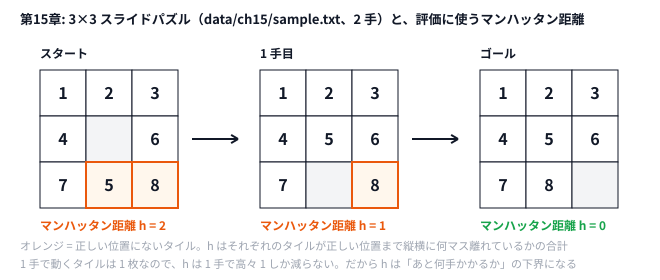

# 第15章 パズル・構造問題

> **到達目標（水色帯 1200〜1599）**: 操作列としてパズルをモデル化し、評価関数付きビームサーチでスライド系問題に挑める。

---

## 15.1 操作列問題としてのモデリング

**霊夢**: スライドパズルって、0 を動かして並べ替えるやつ？

**魔理沙**: 状態は **N×N のタイル列**、操作は **空白と隣接タイルの swap** だけ。解は **操作列**（何手目にどこへ動かすか）として表せる。

| 要素 | 本リポジトリ |
|------|-------------|
| State | `tuple` / `[]int` の長さ `n*n` |
| Move | 空白の上下左右 |
| Goal | `1..n*n-1` + `0`（右下が空白） |

```python
# python/ch15/slide_beam.py
def goal_state(n: int) -> Tuple[int, ...]:
    return tuple(list(range(1, n * n)) + [0])

def neighbors(state, n):
    b = blank_pos(state)
    # 4方向に swap した新状態を列挙
```

```go
// go/ch15/slide_beam.go
func goalState(n int) []int {
    g := make([]int, n*n)
    for i := 0; i < n*n-1; i++ {
        g[i] = i + 1
    }
    g[n*n-1] = 0
    return g
}
```

**霊夢**: AHC011 のスライディングツリーとも似てる？

**魔理沙**: どちらも **空きマスにタイルをスライドさせる操作列** を探す点は同じだ。違いは「ゴール」——15パズルは並びが1つに決まっているが、AHC011 は **線がつながって大きな木になれば、どのタイルがどこにあってもよい**。スコアも「木の大きさ」と「手数」で決まるので、目標配置を自分で選ぶところから設計になる。パイプライン（第11章）と組み合わせるのが実戦だ。

---

## 15.2 合法状態の探索空間の縮小

**霊夢**: 全部の並べ替えを見ると factorial で爆発するのよね？

**魔理沙**: まず **到達可能な状態だけ** に限定する。

| 縮小技法 | 内容 |
|---------|------|
| `visited` 集合 | 同じ盤面を再訪しない |
| 逆手禁止 | 直前の swap を即戻さない（演習で追加可） |
| パリティ | 15パズルは偶奇で到達可能性が決まる |
| IDA* / A* | 深さとヒューリスティックで枝刈り |

**霊夢**: 第15章はビームサーチ？

**魔理沙**: `beam_search` で **幅を `width=100` に制限** し、各深さで `f = depth + h` が小さい順に残す。

```python
# python/ch15/slide_beam.py
beam = [(manhattan(start, n, goal), 0, start)]
visited = {start}
for depth in range(1, max_depth + 1):
    candidates = []
    for _, _, state in beam:
        for nxt in neighbors(state, n):
            if nxt in visited:
                continue
            ...
    beam = heapq.nsmallest(width, candidates)  # 深さごとに上位 width 個だけ残す
```

**霊夢**: `max_depth=40` で打ち切るのは保険？

**魔理沙**: 無限ループ防止だ。本番は **残り時間** と **ビーム幅** を同時に管理する（第10章・第11章の延長）。

### 15パズルのパリティ（参考）

スライドパズルは、どんな配置からでもゴールに行けるわけではない。到達できるかは偶奇で決まる——**幅が奇数（3×3 の8パズルなど）なら転倒数の偶奇** がゴールと同じか、**幅が偶数（4×4 の15パズルなど）なら「転倒数 + 空白の行」の偶奇** がゴールと同じか、だ（転倒数は空白を除いて数える）。実装チェックの骨格:

```python
# 骨格: 演習で完成させる（リポジトリには入っていない）
def parity_ok(state, n, goal):
    # 幅が奇数なら転倒数の偶奇、偶数なら転倒数 + 空白行の偶奇をゴールと比較（演習で完成させよ）
    inv = 0
    flat = [v for v in state if v != 0]
    gf = [v for v in goal if v != 0]
    for i in range(len(flat)):
        for j in range(i + 1, len(flat)):
            if flat[i] > flat[j]:
                inv += 1
    return True  # 簡略: 本番はゴールとの差分を実装
```

**霊夢**: サンプル 3×3 は到達可能な配置？

**魔理沙**: `data/ch15/sample.txt` は **2手で解ける** 配置。不可解入力を入れると `solved=False` になり、`explored` だけが増える。

---

## 15.3 ヒューリスティック評価関数の設計

**霊夢**: `manhattan` って、各タイルのマンハッタン距離の和？

**魔理沙**: **0 を除く各タイル** について、今の位置とゴール位置の |Δrow|+|Δcol| を足す。**許容的（admissible）** なので A* の `h` として使える。

```python
# python/ch15/slide_beam.py
def manhattan(state: Tuple[int, ...], n: int, goal: Tuple[int, ...]) -> int:
    h = 0
    for i, v in enumerate(state):
        if v == 0:
            continue
        gi = goal.index(v)
        r, c = divmod(i, n)
        gr, gc = divmod(gi, n)
        h += abs(r - gr) + abs(c - gc)
    return h
```

| ヒューリスティック | 特徴 |
|-------------------|------|
|  misplaced tiles | 簡単だが弱い |
| **Manhattan** | 定番・実装容易 |
| Linear Conflict | 同じ行/列の逆順ペナルティ |

**霊夢**: `f = depth + h` は A* と同じ形？

**魔理沙**: ビームでは **各深さで上位 width 個** だけ残す近似 A* だ。`h` を強くすると解に近づきやすいが、**誤った枝を切りすぎる** こともある。



**霊夢**: 1 手ごとに h が 1 ずつ減ってるの。

**魔理沙**: 1 手で動くタイルは 1 枚、動く距離は 1 マスだから、h は 1 手で多くても 1 しか減らない。だから「あと h 手はかかる」と言える——これが許容的ということだ。

---

## 15.4 ハンズオン: スライドパズル系問題の解法パイプライン

**霊夢**: サンプルは何手くらい？

**魔理沙**: `data/ch15/sample.txt` は **3×3**、1手でゴールではない配置。

```text
3
1 2 3
4 0 6
7 5 8
```

```bash
python python/ch15/slide_beam.py < data/ch15/sample.txt
go run go/ch15/slide_beam.go < data/ch15/sample.txt
```

検証済み:

```text
n=3 solved=True depth=2 explored=7 beam_width=100
```

**霊夢**: depth=2 なら、2手で揃ったのね。explored=7 は小さいわ。

**魔理沙**: ヒューリスティックが効いている証拠だ。パイプライン例:

```
  読み込み → manhattan 初期評価
      ↓
  ビーム拡張（幅100）
      ↓
  ゴール到達 → depth を報告
```

### 改変ハンズオン

1. `beam_width` を `20` / `200` に変え、`explored` と `depth` を記録
2. `manhattan` の代わりに **misplaced count** を実装し、比較
3. 第11章タイマーで `max_depth` ではなく **残り時間** 打ち切り

```python
# 評価関数差し替えの骨格
def beam_search(start, n, width=100, max_depth=40, heuristic=manhattan):
    ...
    f = depth + heuristic(nxt, n, goal)
```

```go
// go/ch15/slide_beam.go
solved, depth, explored := beamSearch(start, n, 100, 40)
fmt.Printf("n=%d solved=%s depth=%d explored=%d beam_width=100\n", n, solvedS, depth, explored) // solvedS は "True"/"False"（Python と表記をそろえる）
```

### 解法パイプライン（AHC011 / スライド系の一般形）

```text
  [構築] 貪欲・人間的ヒューリスティックで初期盤面
      ↓
  [改善] ビーム / IDA* / 山登り（手数・スコア）
      ↓
  [仕上げ] SA で操作列を微調整（第11章）
      ↓
  best-so-far 提出
```

**霊夢**: 第15章の `slide_beam` は真ん中のビームだけ？

**魔理沙**: そう。前後に **第5章貪欲** や **第9章 SA** を足すのは読者の演習だ。`explored=7` はビームが効いた小さい例だ。

```python
# python/ch15/slide_beam.py — ゴール到達時の戻り値
if nxt == goal:
    return True, depth, len(visited)
```

---

## 15.5 演習

1. 逆手禁止（親状態に即戻る swap を除外）を入れ、`explored` がどう変わるか見る。
2. ゴールからの **逆ビーム**（双方向探索）を設計し、必要手数の上限を議論する。
3. `beam_width=10` で `solved=False` になる例を自作入力で作る。
4. 第10章 `beam_fill` と第15章 `slide_beam` の **共通テンプレ**（候補生成・幅制限）を箇条書きで比較する。
5. AHC011 を読み、**木構造の制約** を State にどう載せるかメモする（実装は任意）。

```bash
# 自作ケース
printf '3\n1 2 3\n4 5 6\n7 0 8\n' | python python/ch15/slide_beam.py
```

<details>
<summary>ヒント</summary>

1. `beam_search` には、すでに `visited`（一度見た盤面は二度と候補にしない）がある。親の盤面も `visited` に入っている点に注目する。逆手禁止の効き目を見るなら、`visited` を外した版で比べる。
2. ゴールから逆向きにもビームを伸ばし、両側の盤面が一致したところで止める。8 パズルは、最適でも最長 31 手かかる。
3. ゴールから空きマスをランダムに 40 回ほど動かした盤面を、seed を変えていくつも作り、`width=10` と `width=100` の両方で解く。
4. 2 つのコードで「状態」「候補の作り方」「評価」「幅で切る処理」がどこに書いてあるかを並べる。
5. AHC011 のスコアは「一番大きい木」の大きさで決まる。木はループを持たない。タイルをつないだときに、ループができたかどうかを素早く判定できるものは何か。

</details>

<details>
<summary>解答例</summary>

**1.** 今のコードに逆手禁止を足しても、`explored` は変わらない。親の盤面はもう `visited` に入っているので、逆手は最初から候補にならないからだ。`visited` を外して比べると、効き目が見える。演習3の盤面（`8 2 7 / 5 6 4 / 0 3 1`）で、手元では次のようになった。

| 版 | solved | depth | explored |
|----|--------|-------|----------|
| `visited` あり（元の版） | True | 28 | 3258 |
| `visited` なし・逆手禁止 | True | 30 | 3815 |
| `visited` なし・逆手禁止なし | False | − | 9285 |

逆手禁止がないと、「動かして戻す」だけの候補がビームを埋めてしまい、解けなくなる。逆手禁止は、`visited` ほどメモリを使わずに無駄の大部分を消せる。

**2.** 例えば次のように設計する。

- スタートとゴールの両方からビームを伸ばし、1 層ずつ交互に進める。
- 両側の `visited` を辞書（盤面 → そこまでの手数）にし、片側で作った盤面がもう一方の辞書にあれば、2 つの手数を足して解とする。
- ゴール側の評価は「スタートの盤面までのマンハッタン距離」。

8 パズルは最長 31 手なので、両側が 16 手ずつ進めば必ず出会える。片側だけで 31 手ぶん探すより、1 本あたりの深さが半分で済む。ただしビームは候補を捨てるので、両側のビームが別の場所を探して出会えないこともある。

**3.** 例えば次の盤面は、`width=10` では解けず（`explored=622` で候補が尽きる）、`width=100` なら 28 手で解ける。

```bash
printf '3\n8 2 7\n5 6 4\n0 3 1\n' | python python/ch15/slide_beam.py
# → n=3 solved=True depth=28 explored=3258 beam_width=100
```

`main` の `beam_search(start, n)` を `beam_search(start, n, 10)` にすると `solved=False` になる。ゴールから 40 回ランダムに動かした盤面を seed 0 から順に試したところ、seed 4 でこの盤面が出た。

**4.** 例えば次のように比べられる。

| 項目 | 第10章 `beam_fill` | 第15章 `slide_beam` |
|------|-------------------|--------------------|
| 状態 | 位置・訪問済みビット・経路 | 盤面のタプル |
| 候補の生成 | 4 方向のうち未訪問のマス | 空きマスを 4 方向に動かす |
| 評価 | 今のスコア + 隣接マスの見積もり（大きいほど良い） | 手数 + マンハッタン距離（小さいほど良い） |
| 重複の扱い | 経路ごとに訪問済みを持つ | 全体で 1 つの `visited` |
| 幅で切る | `heapq.nsmallest(beam_width, ...)` | `heapq.nsmallest(width, ...)` |
| 終わり方 | 候補が尽きたら best を返す | ゴールに着いたら返す |

共通の骨組みは「候補を全部作る → 評価する → 上位の幅だけ残す」のくり返しで、違うのは状態・候補・評価の 3 つだけだ。

**5.** 例えば次のようにメモする。

```markdown
- State に、タイル同士のつながりを Union-Find で持つ
- 隣り合う 2 枚の線がつながったら unite する。もう同じ集合だったら、ループができた（木ではなくなった）
- 評価は「ループを含まない一番大きい集合の大きさ」
- 空きマスを動かすと、つながりが切れることもある。Union-Find は切断が苦手なので、動いたタイルの周りだけ数え直すか、毎回作り直す
```

</details>

---

## 章末まとめ

**霊夢**: パズルは状態・操作・ヒューリスティックの三点セットね。ビームで幅を絞るのが現実的なの。

**魔理沙**: 第4部（水色）も残りは高度 SA の1章だ。

> **第15章まとめ**
>
> - **操作列モデル**: 空白 swap で状態遷移、ゴールは順序タイル + 0
> - **探索空間縮小**: visited、深さ上限、（応用で）パリティ・逆手禁止
> - **Manhattan** を `h` にした `f = depth + h` ビーム
> - 実装: `python/ch15/slide_beam.py` / `go/ch15/slide_beam.go` / `data/ch15/sample.txt`
> - 検証: `solved=True depth=2 explored=7`
> - 次章（第16章）: 高度な焼きなましテクニック — 複数近傍・再ヒート

**霊夢**: 評価関数を変えるとビームの精度が変わる——第10章の続きね。

**魔理沙**: パズルは **ビジュアライザで手数を目視** するとバグが早い。水色帯のパイプラインは **構築（貪欲）→ ビーム → SA** もあり得る。次章では SA に **近傍の引き出し** を増やすんだぜ。
