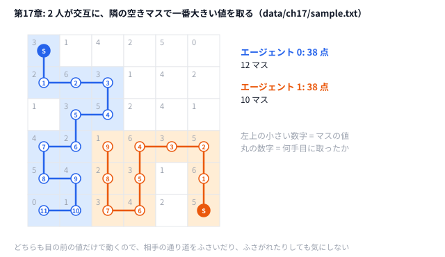

# 第17章 マルチエージェント問題

> **到達目標（青色帯 1600〜1999）**: 複数主体の **状態・手番・衝突** をモデル化し、協調と競合を分けて設計できる。2 人の陣取りゲーム（競合）を貪欲＋手番管理で骨格化し、[AHC008](https://atcoder.jp/contests/ahc008)「Territory」のような **協調型**（自分が全員を動かす）問題との違いを説明できる。

---

## 17.1 複数主体の状態管理

**霊夢**: 今まで「1 つの解」だったけど、エージェントが2人いたら状態が2倍？

**魔理沙**: 倍どころじゃない。**グローバル状態** に全部載せる。

| 変数 | 意味（第17章） |
|------|----------------|
| `owner[r][c]` | マス `-1` / `0` / `1` の所有者 |
| `positions[agent]` | 各エージェントの現在地 |
| `scores[agent]` | 累積スコア |
| `turn` | 何手目か（手番は `turn % 2`） |

```python
# python/ch17/territory_greedy.py
owner = [[-1] * n for _ in range(n)]
positions = list(problem.starts)
scores = [0, 0]
```

**霊夢**: 初期位置は？

**魔理沙**: 入力の `starts` で与える。開始マスは即占領し、そのマスの `grid` 値をスコアに加算する。

```python
# python/ch17/territory_greedy.py
for agent in range(2):
    r, c = positions[agent]
    owner[r][c] = agent
    scores[agent] += problem.grid[r][c]
```

第17章の玩具は **2 体が交互に動き、未占領マスを奪い合う陣取りゲーム** だ（4 近傍・未占領マスのみ進入）。本番の AHC にはこれと性質の違うマルチエージェント問題もある——17.3 で比べる。

---

## 17.2 行動スケジューリングと衝突回避

**霊夢**: 同じマスに二人入ったら？

**魔理沙**: **未占領 (`owner == -1`) だけ選ぶ** ことで衝突を防ぐ。本番の問題では移動・設置などのルールがもっと細かいが、考え方は同じ——**合法手集合** を毎ターン再計算する。

```python
# python/ch17/territory_greedy.py
DIRS = ((-1, 0), (1, 0), (0, -1), (0, 1))

def best_move(n, grid, owner, agent, pos):
    for dr, dc in DIRS:
        r, c = r0 + dr, c0 + dc
        if owner[r][c] != -1:
            continue  # 衝突回避
        val = grid[r][c]
        # 最大 val のマス（同点は辞書順で小さい座標）
```

```go
// go/ch17/territory_greedy.go
func bestMove(n int, grid [][]int, owner [][]int, pos [2]int) (bool, int, int) {
	bestVal := -1
	bestR, bestC := -1, -1
	for _, d := range dirs {
		r, c := pos[0]+d[0], pos[1]+d[1]
		if r < 0 || c < 0 || r >= n || c >= n {
			continue
		}
		if owner[r][c] != -1 {
			continue
		}
		val := grid[r][c]
		if bestVal < 0 || val > bestVal || (val == bestVal && (r < bestR || (r == bestR && c < bestC))) {
			bestVal = val
			bestR, bestC = r, c
		}
	}
	return bestVal >= 0, bestR, bestC
}
```

**霊夢**: 手番はどう回すの？

**魔理沙**: **交互ターン**。`agent = turn % 2` で、動けなければ `stagnant` を増やし、両者とも動けない状態で終了する。

```python
# python/ch17/territory_greedy.py
while stagnant < 2:
    agent = turn % 2
    mv = best_move(...)
    if mv is None:
        stagnant += 1
        turn += 1
        continue
    stagnant = 0
    # 占領して turn += 1
```

| 設計の落とし穴 | 対策 |
|----------------|------|
| 同マス二重占領 | 進入前に `owner` を確認 |
| 無限ループ | パス連続で打ち切り |
| 手番の取りこぼし | `turn` と `agent` を常に対で更新 |

---

## 17.3 協調と競合のモデリング

**霊夢**: 2 人は協力するの？ 奪い合うの？

**魔理沙**: 問題による。第17章の玩具は **競合**——自分のスコアを最大化しつつ、相手の伸びを **ブロック** する手が強い。一方、[AHC008「Territory」](https://atcoder.jp/contests/ahc008/tasks/ahc008_a) は **協調** だ。30×30 の部屋で、**自分が人間 5〜10 人を全員動かし**、勝手に動き回るペット 10〜20 匹を避けながら仕切りを置いて、**ペットのいない広い区画** を作る。人間同士は味方で、相手は「行動ルールが決まったペット」という環境だ。

| 観点 | 競合（第17章の玩具） | 協調（AHC008 Territory） |
|------|-------------------|-----------|
| 目的関数 | 個別スコア | 人間全員の平均（区画の広さ × 2^−区画内のペット数） |
| 手の評価 | 自分の利得 − 相手利得の近似 | チーム全体の利得 |
| 主な難しさ | 相手の手を読む | 全員の行動を **衝突させずに分担** し、乱数で動くペットに備える |
| 探索 | ミニマックス・MCTS（第20章） | 役割分担 + シミュレーション、共同計画 |

**霊夢**: 貪欲だけだと弱い？

**魔理沙**: 競合では、1 手先だけ見ると **相手に取られる高得点マス** を見落とす。青色では **2〜3 手読み**、終盤の **完全探索の枝刈り**、第16章の **SA で行動列全体を焼く** などに伸ばす。

### 状態の実装チェックリスト

マルチエージェントの解法を書くとき、次を **1 ファイルの struct / dataclass** にまとめるとバグが減る。

1. `grid`（得点）と `owner`（占有）を混同しない  
2. 移動後に **必ず `owner` と `scores` を同時更新**  
3. 手番インデックスと **ログ出力の agent ID** を一致させる  
4. 終了条件（パス・ターン上限）を問題文と同型にする  

```go
// go/ch17/territory_greedy.go — solve の流れは Python と同型
for stagnant < 2 {
    agent := turn % 2
    mv := bestMove(...)
    // ...
}
```

**霊夢**: 出力形式は？

**魔理沙**: 第17章サンプルは **スコア2行 + 操作ログ**。本番は公式の出力仕様に合わせる（AHC008 なら毎ターン、人間全員分の行動を1行で出す）。ハンズオンでは **stderr に集計、stdout に提出相当** と分ける（第0章の I/O テンプレート）。

### シミュレーション駆動デバッグ

| 確認項目 | 方法 |
|---------|------|
| 不正な占領 | `owner[r][c]` が二重に0/1にならないか |
| スコア合計 | 移動のたびに `grid` 加算が1回だけか |
| 手番 | `moves_log` の agent が交互か |

`data/ch17/sample.txt` は 6×6 で開始 `(0,0)` と `(5,5)`。対称な盤面のため **同点スコア** になりやすい——評価関数を変えると差が出る（17.5）。

---

## 17.4 ハンズオン: 2 人の陣取りゲーム — エージェント行動の設計

**霊夢**: 本番問題そのままじゃないんだ。

**魔理沙**: 競合型の玩具だ。マルチエージェントの骨格——**グリッド + 複数エージェント + 手番 + 貪欲移動**——はここで固める。コードは `territory_greedy`、入力は `data/ch17/sample.txt`。

```
6              # n
(6 lines grid)
0 0            # agent 0 start
5 5            # agent 1 start
```

### Step 1: 実行

```bash
python python/ch17/territory_greedy.py < data/ch17/sample.txt
go run go/ch17/territory_greedy.go < data/ch17/sample.txt
```

stderr 例: `territory0=38 territory1=38 moves=20`。stdout は `score0 score1` のあと `agent r c` のログ。



**霊夢**: 2 人とも 38 点なのに、青のほうがマスが多いの。

**魔理沙**: 青は値 0 や 1 のマスまで拾っているからだ。どちらも「隣で一番大きい値」しか見ないので、遠くの大きい値を取りに行くことはない。相手の通り道をふさぐ・ふさがれる、も考えていない——Step 2 で評価関数を変えるのはそのためだ。

### Step 2: 評価関数の改変

`best_move` の比較を変える:

```python
# 案A: 現状 — grid 値最大
# 案B: grid + 隣接未占領数（伸びしろ）
# 案C: grid - 相手が次に取れそうな最大値（簡易防御）
```

各案で `territory0`, `territory1` を記録する。

### Step 3: 手番順の実験

- **交互（現状）**: `turn % 2`
- **1 エージェントずつ全ターン**: エージェント0が動けなくなるまで0のみ動かす（17.5 演習）

### Step 4: AHC008 本番との違い

| 第17章（競合の玩具） | AHC008 Territory（協調） |
|--------|-------------------------|
| 2 体が交互に動く | 人間全員が **同じターンに同時に** 行動し、そのあとペットが動く（300 ターン） |
| `owner`（どちらのマスか） | 仕切りの有無と、各マスの人間・ペットの位置 |
| `best_move`（移動先） | 「その場にとどまる / 移動 / 隣に仕切りを置く」の選択。ペットや人間の隣には置けない |
| 相手をブロック | 味方の人間どうしがぶつからないよう **役割を分担** する |
| 最終スコア = 占領マスの値 | 各人間がいる区画の広さ × 2^−(区画内のペット数) の平均 |

公式ページ: [AHC008](https://atcoder.jp/contests/ahc008)。ビジュアライザで **ペットの動きと仕切りの置き方** を目視すると、貪欲の弱点が見える。

### Step 5: 第20章 MCTS への橋渡し

陣取りゲームの1手を「ノード＝盤面＋手番」とみなせば **MCTS の層** になる。第20章 `mcts_toy` はグラフ上の対戦だが、**UCB1 で手を選ぶ流れ** は同じ。貪欲 `best_move` を rollout ポリシーにすれば、**MCTS + 貪欲 rollout** の原型になる。

---

## 17.5 演習

1. **評価案 B/C** を実装し、同一 `sample.txt` で `(territory0, territory1)` を比較する。
2. **エージェント0だけ** が最大 `T` 手動くモードを追加し、交互ターンとの差を 3 行で説明する。
3. AHC008 の問題文と解説を読み、上位解法が **人間の役割分担** と **ペットの捕獲（区画の閉じ方）** をどう設計していたかを箇条書きにする。

```bash
python python/ch17/territory_greedy.py < data/ch17/sample.txt 2> ter.log
grep territory ter.log
go run go/ch17/territory_greedy.go < data/ch17/sample.txt 2>&1 | head -3
```

4. `DIRS` を斜め4方向に増やしたとき、`moves` 数とスコアがどう変わるか予測し、実行と照合する。

<details>
<summary>ヒント</summary>

1. `best_move` の `val = grid[r][c]` を案ごとに書き換える。案 B は「取ったあとのマスの空いている隣の数」を足す。案 C は「取ったあと、相手が次に取れる一番大きい値」を引く。比べるときに選ぶのは評価の値、足すのはマスの値（`grid[r][c]`）だ。サンプル 1 つでは差が出にくいので、ランダムな盤面をいくつも作る。
2. `solve` の `while` ループを 2 つに分け、エージェント 0 が動けなくなるまで 0 だけを動かし、そのあと 1 を動かす。
3. AHC008 は、人間が仕切りを置いてペットのいない広い区画を作る、協調型の問題だ。
4. 動ける方向が増えると、行き止まりになりにくくなる。一方で、相手の行き先をふさぎやすくもなる。

</details>

<details>
<summary>解答例</summary>

**1.** サンプルでは、案 A・B・C のどの組み合わせでも `(38, 38)` で差が出ない。そこで、0〜9 の値の 8×8 盤面をランダムに 50 個作り（開始は `(0,0)` と `(7,7)`）、エージェント 0 だけ案を変え、1 は案 A のままにして比べた。

| エージェント 0 の案 | 平均の差（territory0 − territory1） | 0 が勝った数 |
|-------------------|-----------------------------------|-------------|
| A（値が最大） | −13.5 | 21 / 50 |
| B（値 + 空いている隣の数） | +5.2 | 27 / 50 |
| C（値 − 相手が次に取れる最大） | −10.6 | 22 / 50 |

案 B が一番よかった。値だけで選ぶと、行き止まりに入って早く動けなくなることが多い。伸びしろを足すと、長く動き続けられる。案 C は少し良くなるが、相手の次の 1 手しか見ていないので効果は小さい。

```python
# 解答例: 案 B の評価（best_move の val を書き換える）
        owner[r][c] = agent
        free = sum(
            1 for dr2, dc2 in DIRS
            if 0 <= r + dr2 < n and 0 <= c + dc2 < n and owner[r + dr2][c + dc2] == -1
        )
        owner[r][c] = -1
        val = grid[r][c] + free
```

**2.** エージェント 0 が動けなくなるまで 0 だけを動かすと、サンプルでは `(73, 5)`（手数 21）になった。交互（`(38, 38)`）のときより、0 が大きく取る。先に動ける側が、相手の近くのマスまで取ってしまうからだ。3 行でまとめると次のようになる。

- 交互だと、2 人が同じ速さで陣地を広げ、取り合いになる。
- 1 人ずつだと、先に動く側が、相手の開始地点の近くまで取ってしまう。
- 手番の決まりが、評価関数より大きくスコアを動かすことがある。問題文の手番の決まりは必ず読む。

**3.** 例えば次のようにまとめる。

- 役割分担: 人間の一部が仕切りを置く「壁役」、残りがペットのいない場所へ移動する役、のように分ける解法が多い。
- 区画の閉じ方: 盤面を大きな区画に分け、ペットがいないタイミングで入口を閉じる。
- 第17章との違い: 第17章は 2 人が取り合う競合だが、AHC008 は全員が協力して、ペットのいない広い区画を作る。

**4.** 予測は「方向が増えると行き止まりになりにくく、手数も合計も増える」。実行すると、サンプルでは手数 20 → 26、合計 76 → 98（`54, 44`）と予測どおりだった。ところが 1 で作ったランダムな 8×8 盤面の 1 つ（`random.Random(3)`）では、手数 40 → 36、合計 253 → 221 と、逆に減った。斜めに動けると、相手の進む先を早くふさいでしまい、2 人とも動けなくなるのが早まることがある。予測は必ず実行して確かめる。

</details>

---

## 章末まとめ

**霊夢**: 状態はグローバルに持って、手番で回す——整理できた。

**魔理沙**: まとめだ。

> **第17章まとめ**
>
> - マルチエージェントは **`owner`・位置・スコア・手番`** を一体で更新する
> - **合法手** と **衝突回避** を毎ターン再計算する
> - 競合問題では **相手の利得** を見た手が強い。協調問題（AHC008）では **全員の役割分担** が鍵
> - ハンズオン: `territory_greedy`（2 人の陣取りゲーム）。AHC008 との違いは 17.4 Step 4
> - 次章: **多点スタートと並列探索**（第18章）

**霊夢**: 1回の SA で足りないときは？

**魔理沙**: **シードを変えて何本も回す** のが次章だ。そのあと LNS で解を大きく動かして、青色の締めにするぜ。
