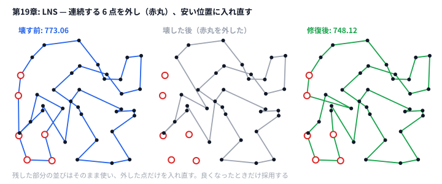

# 第19章 大近傍探索（Large Neighborhood Search）

> **到達目標（青色帯 1600〜1999）**: **広い近傍** を **破壊（destroy）と再構築（repair）** で設計できる。TSP で LNS を実装し、**破壊率とスコア・時間のトレードオフ** を測れる。

---

## 19.1 広い近傍の設計

**霊夢**: 2-opt や1日 swap じゃ足りないときは？

**魔理沙**: **一度にたくさんの要素を入れ替える** — それが **Large Neighborhood Search（LNS）** の「大」だ。第16章 SA の近傍ポートフォリオの延長でもある。

| 近傍 | 変更規模 | 例 |
|------|---------|-----|
| 小 | 1〜2要素 | 2-opt, 1日 swap |
| 大 | 区間・集合 | 経路の連続 k 頂点削除して再挿入 |

**霊夢**: 大きく壊すと合法解が壊れない？

**魔理沙**: **repair** で必ず直す。第19章 TSP では「巡回順序」だけなので、外した頂点を残りの巡回に **挿入し直せば** 合法巡回になる。

```python
# python/ch19/lns_tsp.py
def destroy_segment(tour: List[int], rng: random.Random) -> Tuple[List[int], List[int]]:
    n = len(tour)
    seg_len = rng.randint(1, max(1, n // 3))  # 破壊率 ≒ 1/3 まで
    start = rng.randint(0, n - 1)
    removed = []
    kept = list(tour)
    for _ in range(seg_len):
        # pop すると後ろが詰まって同じ位置に次の頂点が来るので、start は進めない（連続区間を外す）
        idx = start % len(kept)
        removed.append(kept.pop(idx))
    return kept, removed
```

```go
// go/ch19/lns_tsp.go
func destroySegment(tour []int, rng *rand.Rand) ([]int, []int) {
	n := len(tour)
	if n <= 3 {
		return append([]int{}, tour...), nil
	}
	segLen := 1 + rng.Intn(max(1, n/3))
	start := rng.Intn(n)
	kept := append([]int{}, tour...)
	removed := make([]int, 0, segLen)
	for k := 0; k < segLen; k++ {
		// 取り除くと後ろが詰まって同じ位置に次の頂点が来るので、start は進めない（連続区間を外す）
		idx := start % len(kept)
		removed = append(removed, kept[idx])
		kept = append(kept[:idx], kept[idx+1:]...)
	}
	return kept, removed
}
```

---

## 19.2 部分問題を最適化 / ヒューリスティックに解く

**霊夢**: 壊したあと、全部最適化するの？

**魔理沙**: **部分問題のサイズ** に応じて選ぶ。

| 部分問題サイズ | repair 手法 |
|---------------|------------|
| 小（≤10） | 全列挙・DP |
| 中 | 貪欲・2-opt |
| 大 | ヒューリスティック + 局所改善 |

第19章は **最安挿入（cheapest insertion）** で repair する。外した頂点を1つずつ、残した巡回の「入れると増える長さがいちばん小さい位置」に戻す:

```python
# python/ch19/lns_tsp.py
def repair_tour(pts, partial, removed):
    if not partial:
        return nearest_neighbor_tour(pts, removed[0], removed)
    tour = list(partial)
    for v in removed:
        best_pos, best_cost = 0, float("inf")
        for i in range(len(tour)):
            a, b = tour[i], tour[(i + 1) % len(tour)]
            cost = dist(pts, a, v) + dist(pts, v, b) - dist(pts, a, b)  # 辺 a-b の間に v を入れる増分
            if cost < best_cost:
                best_pos, best_cost = i + 1, cost
        tour.insert(best_pos, v)
    return tour
```

```go
// go/ch19/lns_tsp.go
func repairTour(pts []Point, partial, removed []int) []int {
	if len(partial) == 0 {
		return nearestNeighbor(pts, removed[0], removed)
	}
	tour := append([]int{}, partial...)
	for _, v := range removed {
		bestPos, bestCost := 0, math.Inf(1)
		for i := range tour {
			a, b := tour[i], tour[(i+1)%len(tour)]
			cost := edgeDist(pts, a, v) + edgeDist(pts, v, b) - edgeDist(pts, a, b) // a-b の間に v を入れる増分
			if cost < bestCost {
				bestPos, bestCost = i+1, cost
			}
		}
		tour = append(tour[:bestPos], append([]int{v}, tour[bestPos:]...)...)
	}
	return tour
}
```

**霊夢**: 外した頂点だけじゃなく、全部を最近傍法で作り直したら駄目なの？

**魔理沙**: 駄目だ。それだと **残した部分の並びを捨てる** ことになり、何を壊しても同じ巡回ができあがる——LNS ではなく「最近傍法のやり直し」になってしまう。**良い部分は残し、壊した所だけ直す** のが LNS の要点だ。

**霊夢**: 配置問題だと？

**魔理沙**: 矩形 k 個を外して **空きマス貪欲** で戻す、など同型。問題の **本質構造**（第23章で詳しく扱う）が repair の設計図になる。

---

## 19.3 破壊と再構築（Destroy & Repair）

**霊夢**: LNS の1イテレーションの流れは？

**魔理沙**: 定番ループだ。

```
current tour
  → destroy（区間削除）
  → repair（部分 TSP）
  → 良ければ current を更新
  → best-so-far も更新
```

```python
# python/ch19/lns_tsp.py
def lns(pts, rng, iterations=200):
    n = len(pts)
    tour = list(range(n))
    rng.shuffle(tour)
    initial = tour_length(pts, tour)
    best = list(tour)
    best_len = initial

    for it in range(iterations):
        partial, removed = destroy_segment(tour, rng)
        candidate = repair_tour(pts, partial, removed)
        cand_len = tour_length(pts, candidate)
        if cand_len + 1e-9 < tour_length(pts, tour):
            tour = candidate
        if cand_len + 1e-9 < best_len:
            best = candidate
            best_len = cand_len
    return best, initial, best_len
```

Go も同型:

```go
// go/ch19/lns_tsp.go
func lns(pts []Point, rng *rand.Rand, iterations int) ([]int, float64, float64) {
    partial, removed := destroySegment(tour, rng)
    candidate := repairTour(pts, partial, removed)
    candLen := tourLength(pts, candidate)
    // ...
}
```

| 受理条件 | 効果 |
|---------|------|
| 改善のみ（第19章） | 安定、初期解依存 |
| SA 受理 | 多様性（第9章と合成） |
| 常に受理 + 多スタート | 探索幅↑ |

---

## 19.4 ハンズオン: 経路問題の LNS 実装

**霊夢**: 入力形式は？

**魔理沙**: `data/ch19/sample.txt` — 1行目 n、続く n 行が (x, y)。8点のユークリッド TSP。

```
8
0 0
4 1
...
```

### Step 1: 実行

```bash
python python/ch19/lns_tsp.py < data/ch19/sample.txt
go run go/ch19/lns_tsp.go < data/ch19/sample.txt
```

出力例:

```
lns it=50 current=28.98 best=28.98
...
tour: 6 5 4 3 2 1 0 7
n=8 before=48.49 after=28.98 improved=19.50
```

（上は Python 版。Go 版は乱数列が違うので初期巡回・`before`・`improved` が変わるが、`after=28.98` は同じになる。8 点だと最適に届くので差が見えないが、ランダムな 30 点では、手元で第6章の 2-opt 山登りより毎回短かった（例: 460.61 → 449.03）。）

ランダム初期巡回 **48.49** → LNS 後 **28.98**（約40%改善）。

40 点の `data/common/tsp40.txt`（第6章・第13章と同じ入力・同じ初期解）では、次のようになる。

```bash
python python/ch19/lns_tsp.py < data/common/tsp40.txt 2>/dev/null | tail -1
```

```text
n=40 before=2058.25 after=596.49 improved=1461.76
```

| 手法 | 40 点の after |
|------|--------------|
| 2-opt 山登り（第6章） | 646.19 |
| タブーサーチ（第13章） | 592.83 |
| LNS（第19章） | 596.49 |

LNS とタブーはほぼ互角で、どちらも山登りより 50 ほど短い。LNS は 200 回の破壊・修復を 0.04 秒ほどで終える。どちらが向くかは、問題と残り時間しだいだ（演習2で破壊の大きさを変えると、LNS の方が良くなる）。



### Step 2: ログを読む

50イテレーションごとに stderr:

```python
# python/ch19/lns_tsp.py
if (it + 1) % 50 == 0:
    print(f"lns it={it+1} current={...} best={best_len:.2f}", file=sys.stderr)
```

### Step 3: 改変 — 破壊率

```python
# python/ch19/lns_tsp.py
seg_len = rng.randint(1, max(1, n // 3))   # デフォルト
# seg_len = rng.randint(1, max(1, n // 2))  # より大胆
# seg_len = 1                               # ほぼ 2-opt 相当
```

**19.5 演習** でスコアと時間を表にする。

### Step 4: コンテスト形式

1. 初期解: ランダム shuffle（`seed=42` 固定で再現）
2. 残り時間の **80%** を LNS、**20%** を 2-opt（第6章）
3. stdout に `tour:` 行 — 本番提出形式に合わせて整形

---

## 19.5 演習

1. `iterations` を `50 / 200 / 500` に振り、**after** と実行時間を記録する。
2. 破壊長 `n//3` vs `n//2` vs `1` を比較し、**improved** 列を表にする。
3. repair を **2-opt だけ** に差し替えた版を設計し、LNS との差を述べる（実装任意）。
4. （第23章を読んだあとで）第23章の勝者スケジュールに **「3日連続区間を destroy して貪欲 repair」** LNS を想像で1段落書く。

```bash
# 再現実行
python python/ch19/lns_tsp.py < data/ch19/sample.txt 2> lns.log
grep best lns.log
go run go/ch19/lns_tsp.go < data/ch19/sample.txt 2>&1 | grep "after="
```

<details>
<summary>ヒント</summary>

1. `main` の `lns(pts, rng)` に `iterations` を渡す。8 点のサンプルは小さすぎて、すぐに最適解に着く。40 点の `data/common/tsp40.txt` でも比べる。
2. `destroy_segment` の `rng.randint(1, max(1, n // 3))` の上限を変える。壊す量が少ないと、修復しても元とほとんど同じ巡回路に戻る。
3. 外した頂点を、ひとまず残りの巡回路の末尾につなげ、そのあと第6章の `two_opt` で整える。最安挿入（今の repair）との違いは、「1 頂点ずつ局所的に決める」か「全体をまとめて直す」かだ。
4. 第23章のスケジュールは「日 → タイプ」の列。3 日分を外して空けたら、1 日ずつ一番良いタイプで埋め直す。

</details>

<details>
<summary>解答例</summary>

**1.** 手元では次のようになった（seed 42）。

| iterations | 8 点 after | 40 点 after | 40 点の時間 |
|-----------|-----------|------------|------------|
| 50 | 28.98 | 597.03 | 0.007 秒 |
| 200 | 28.98 | 596.49 | 0.042 秒 |
| 500 | 28.98 | 596.49 | 0.069 秒 |

40 点では、50 回でほとんど決まり、200 回以降は動かない。最安挿入の修復では、それ以上良い巡回路が作れない局所最適に入っている。回数を増やすより、壊し方を変えるほうが効く（2 の答え）。

**2.** 40 点・200 回で比べると次のようになった（8 点はどれも 28.98）。

| 破壊長の上限 | 40 点 after | improved |
|------------|------------|----------|
| 1 | 751.35 | 1306.89 |
| n//3 | 596.49 | 1461.76 |
| n//2 | 590.76 | 1467.48 |

1 点だけ外して戻す LNS は、ほぼ「1 点の位置を直す」山登りなので弱い。大きく壊すほど、残した部分にしばられずに作り直せて、局所最適から抜けやすい。ただし壊しすぎると、毎回ほぼランダムな巡回路から作り直すことになる。n//2 まで上げて良くなったのは、40 点の大きさでは、まだ壊しすぎにならないからだ。

**3.** 例えば次のように設計する。

```python
# 解答例（擬似コード）: repair を 2-opt だけにした版
def repair_two_opt(pts, partial, removed):
    tour = partial + removed  # 外した頂点を、とりあえず末尾につなげる
    return two_opt(pts, tour)  # 第6章の 2-opt で交差を消す
```

最安挿入との違いは次のとおり。

- 最安挿入は、外した頂点を 1 つずつ「今いちばん安く入る場所」に入れる。速いが、入れる順番しだいで、ほかの頂点に悪い場所が残る。
- 2-opt の修復は、巡回路全体を見て交差を消すので、残した部分の並びまで直せる。そのぶん 1 回の修復が O(n²) 以上と重く、同じ時間で回せる回数は減る。
- 2-opt は残した部分まで動かすので、「壊した所だけを作り直す」という LNS の性格が弱まり、ふつうの 2-opt の山登りに近づく。

**4.** 例えば次のように書く。

> 第23章の勝者スケジュールから、ランダムに選んだ 3 日連続の区間（d, d+1, d+2）のタイプを消す。その 3 日を、前から順に「その日に開くと満足度が一番上がるタイプ」で埋め直す（第1章の貪欲を、空けた区間だけで回す）。埋め直したスケジュールのスコアが元以上なら採用し、そうでなければ元に戻す。1 日だけ変える SA の近傍では、3 日を同時に入れ替えるような変更は、途中で一度悪くなるので受理されにくい。区間ごと作り直す LNS なら、そうした変更を 1 手で試せる。区間の長さ（3 日）は、破壊長と同じく測って決める。

</details>

---

## 章末まとめ

**霊夢**: 大きく壊して賢く直す——LNS は SA の近傍を広げる技術ね。

**魔理沙**: まとめだ。

> **第19章まとめ**
>
> - **LNS** = destroy + repair の反復
> - 破壊: 連続区間の削除（長さ ~ n/3）、再構築: 最安挿入（残した並びは使う）
> - `lns_tsp.py` / `lns_tsp.go` — `data/ch19/sample.txt`（8点 TSP）
> - **破壊率・反復数** でスコアと時間のトレードオフ
> - 第5部（青）の締め: 次章から **第6部（黄）** — MCTS（第20章）

**霊夢**: 次は木探索？ ゲームっぽいね。

**魔理沙**: 相手の手や乱数がある問題では **探索 / 利用** のバランスが効く。ターン制ヒューリスティックの入口だぜ。
