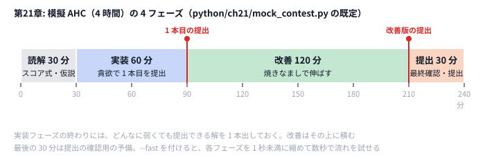

# 第21章 コンテスト戦略

> **到達目標（黄色帯 2000〜2399）**: 本番 AHC で **最初の30分の読解・仮説立て**、**提出タイミング**、**短期/長期の時間配分** を意識できる。No Submit を避ける **チェックリスト** と **模擬コンテスト** で、ログ付きの振り返りができる。

---

## 21.1 問題読解と解法仮説の立て方（最初の 30 分）

**霊夢**: 技術は揃ったけど、本番で最初に何をすればいいの？

**魔理沙**: **最初の30分** はコードを書かず、**読解と仮説** に使う。第21章の模擬コンテストも `read` フェーズが最初だ。

| 時間 | やること |
|------|---------|
| 0〜10分 | ストーリー・制約・スコア式・入出力形式 |
| 10〜20分 | 状態・操作・典型パターン（第22章カタログと照合） |
| 20〜30分 | **解法仮説を3案** メモ（貪欲 / SA / パイプライン等） |

**霊夢**: 3案も必要？

**魔理沙**: 1案だけだと実装に固執しがち。**第23章** では3案を実際に比較するが、第21章では **メモだけ** で十分。例（Intro HC スケジューリング）:

```
仮説A: 日ごと貪欲（decay を見ながら gain 最大）
仮説B: ランダム初期解 + SA
仮説C: 貪欲 → 山登り（パイプライン）
```

**霊夢**: 模擬コンテストではどう表れる？

**魔理沙**: `MockContest` が `read` フェーズで待機し、stderr にログを出す。

```python
# python/ch21/mock_contest.py — フェーズ定義
phase_min = [0.3, 0.5, 0.8, 0.2] if fast else [30.0, 60.0, 120.0, 30.0]
# read / implement / improve / submit（分）
```

```go
// go/ch21/mock_contest.go
phaseMin := []float64{30, 60, 120, 30}
if fast {
    phaseMin = []float64{0.3, 0.5, 0.8, 0.2}
}
```

**霊夢**: 30分経ったらすぐ実装？

**魔理沙**: 仮説が **1つも書けていない** なら、あと5分だけ延長してよい。ただし **implement フェーズに入ったら「動くもの優先」**（第3章）。完璧な設計より **提出可能な0点超え** が先だ。

---

## 21.2 提出タイミングとスコアログの活用

**霊夢**: いつ提出すればいいの？ ベストが出るまで待つ？

**魔理沙**: **早めの1回目** と **終盤の最終版** の2極が基本。AHC は [ベストパフォーマンス重視のレーティング](https://info.atcoder.jp/overview/contest/rating) だから、**提出回数より最高スコア** が効く。だが **1回も出さないと Rated 対象外** になるリスクもある。

| 提出 | 目的 |
|------|------|
| 初回（implement 終了時） | CE/RE 回避、スコア基準線 |
| 改善中（improve） | パラメータ変更の効果確認 |
| 終了10分前 | 最終版・ビルド確認 |

**霊夢**: ログはどう残す？

**魔理沙**: `mock_contest` は `SubmissionLog` を stderr に出す。`--json-log` で1行JSONも。

```python
# python/ch21/mock_contest.py
@dataclass
class SubmissionLog:
    phase: str
    elapsed_sec: float
    score: int
    note: str
```

```python
# python/ch21/mock_contest.py
def _emit(self, phase: str, event: str, score: int, note: str) -> None:
    entry = SubmissionLog(
        phase=f"{phase}:{event}",
        elapsed_sec=self.elapsed(),
        score=score,
        note=note,
    )
    self.logs.append(entry)
    line = f"[contest] phase={phase} event={event} t={entry.elapsed_sec:.2f}s score={score} {note}"
    print(line, file=sys.stderr)
```

```go
// go/ch21/mock_contest.go
func (c *MockContest) emit(phase, event string, score int, note string) {
	entry := SubmissionLog{
		Phase:      phase + ":" + event,
		ElapsedSec: c.elapsed(),
		Score:      score,
		Note:       note,
	}
	c.logs = append(c.logs, entry)
	fmt.Fprintf(os.Stderr, "[contest] phase=%s event=%s t=%.2fs score=%d %s\n",
		phase, event, entry.ElapsedSec, score, note)
	if c.jsonLog {
		b, _ := json.Marshal(entry)
		fmt.Fprintln(os.Stderr, string(b))
	}
}
```

**tools/contest_log.sh** で Python / Go 両方のログを `/tmp/yukkuri-contest-log/` に保存できる:

```bash
./tools/contest_log.sh data/ch23/sample.txt
# CONTEST_FAST=1 がデフォルト（--fast 相当）
```

**霊夢**: best-so-far はどこで更新？

**魔理沙**: `implement:submit` で貪欲、`improve:submit` で brief SA 後のスコア。本番でも **stderr に best score** を書く習慣をつける（第11章・第18章と同じ）。

---

## 21.3 短期コンテスト vs 長期コンテストの時間配分

**霊夢**: 4時間と2週間、同じ戦略？

**魔理沙**: 全然違う。第21章の模擬は **短期（4時間）** を `--fast` で圧縮したもの。

| フェーズ | 短期（本番4h） | `--fast`（秒） | 長期（例: 2週間） |
|---------|---------------|----------------|------------------|
| read | 30分 | 0.3 | 1〜2日（読解・仮説） |
| implement | 60分 | 0.5 | 2〜3日（初提出） |
| improve | 120分 | 0.8 | 残り（multi-start SA・LNS） |
| submit buffer | 30分 | 0.2 | 最終日（CE確認） |

**霊夢**: 長期は毎日コミット？

**魔理沙**: **中間提出** を忘れない。長期戦では「週次で1改善」が現実的（第29章）。短期は **improve に120分集中** — 第18章の multi-start SA や第20章 MCTS をここで回す。

```python
# python/ch21/mock_contest.py — improve フェーズの時間はまるごと SA に使う（brief_sa は time.perf_counter() と比べるので同じ時計で渡す）
improve_sec = self.phase_min[2] * 60.0 if not self.fast else self.phase_min[2]
improve_end = time.perf_counter() + improve_sec
self.state = brief_sa(self.problem, self.state, improve_end, self.rng)
```

```go
// go/ch21/mock_contest.go — improve フェーズ（期限は time.Time で渡す）
improveDur := c.phaseMin[2] * 60.0
if c.fast {
	improveDur = c.phaseMin[2]
}
c.emit("improve", "start", c.bestScore, fmt.Sprintf("duration=%.1fs", improveDur))
deadline := time.Now().Add(time.Duration(improveDur * float64(time.Second)))
c.emit("improve", "work", c.bestScore, "brief SA")
c.state = briefSA(c.problem, c.state, deadline, c.rng)
```

**霊夢**: 時間が足りないときは？

**魔理沙**: **submit バッファ（30分）** を削らない。改善を切り上げて **最終提出とビルド確認** に回す。黄色帯の失敗の多くは「最後の5分で CE」だ。

---

## 21.4 失敗から学ぶ — 本番の振り返り

**霊夢**: No Submit 回避は第2章でやったよね。

**魔理沙**: 基本は 2.6 のとおり、**最低1回は提出**（提出ゼロの回はレーティング計算に入らない）。黄色帯では、それに加えて **時間配分とログ** まで含めた完全版 `data/ch21/checklist.md` を終了前に読む。

```markdown
## 提出前（必須）
- [ ] **最低 1 回は提出した**
- [ ] 提出ファイルが **公式形式** に合っている
- [ ] ローカル tools / score で **サンプル入力が通る**
```

| よくある失敗 | 対策 |
|-------------|------|
| 「あとで直す」で提出ゼロ | implement 終了時に必ず1回 |
| 本番初 CE | ローカルテスターで先に通す（第2章） |
| インタラクティブ flush 忘れ | 第12章・第24章のプロトコル確認 |
| 長期で中間提出なし | 週1回はスコアを残す |

**霊夢**: 振り返りは？

**魔理沙**: チェックリスト末尾の **「次回への3点」** を必ず書く。第21.6 演習と第22章の復習シートに接続する。

---

## 21.5 ハンズオン: 模擬 AHC（4 時間）を 1 人で実施する

**霊夢**: 4時間は長い……

**魔理沙**: **`--fast`** で合計約1.8秒のダイジェスト版。流れは本番と同じだ。



**魔理沙**: 本番の配分は合計 240 分＝4 時間。最後の 30 分は提出の確認用の予備で、新しい改善は入れない。大事なのは、実装フェーズの終わりに **必ず 1 本提出しておく** ことだ。

### Step 1: 読む

`data/ch23/sample.txt` は Intro HC 形式（5日・26種類）。第9章のスコア関数と同じ。

### Step 2: 写す（実行）

```bash
python python/ch21/mock_contest.py data/ch23/sample.txt --fast --json-log
go run go/ch21/mock_contest.go data/ch23/sample.txt --fast --json-log
```

または一括:

```bash
./tools/contest_log.sh data/ch23/sample.txt
```

stderr 例:

```
[contest] phase=read event=start t=0.00s score=1041216 duration=0.3s
...
[contest] phase=implement event=submit t=0.81s score=1079455 initial solution
[contest] phase=improve event=start t=0.81s score=1079455 duration=0.8s
[contest] phase=improve event=submit t=1.61s score=1079507 improved solution
...
final_score=1079507 elapsed=1.82s submissions=13
```

（時間・途中のスコアはマシン速度で変わる。`--fast` では各フェーズを 0.3 / 0.5 / 0.8 / 0.2 秒に縮めている。improve フェーズの時間はまるごと SA に使う。本番サイズの `data/common/intro_hc_d365.txt` を渡すと、手元では貪欲 551804 → SA 後 約153万になった。）

stdout は **提出形式のスケジュール**（各行1種類）。

### Step 3: 改変

```python
# phase_min を [0.2, 0.3, 1.0, 0.1] に変更 → improve を長く
# brief_sa の temperature 初期値 5000 → 8000
```

Go も同様に `phaseMin` と `briefSA` の `temperature` を触る。

### Step 4: コンテスト形式

1. タイマーを見ながら **read 中に仮説3つ** を紙に書く
2. `implement:submit` のスコアを記録
3. `improve:submit` との差分を1行メモ
4. `data/ch21/checklist.md` を全部チェック

---

## 21.6 演習

1. `--fast` なし（本番配分: 30+60+120+30分）で **read フェーズだけ** 実際に30分使い、仮説3案を書く（implement は Ctrl+C で中断可）。
2. `contest_log.sh` を2回実行し、**improve 後のスコア差** を表にする。
3. 第22章 `review_sheet.py` を先取りして、模擬コンテストの振り返りを `--append-note` で追記する:

```bash
python python/ch22/review_sheet.py --contest mock --problem intro \
  --pattern scheduling --score 1079507 -o /tmp/mock_review.md
python python/ch22/review_sheet.py --append-note "improve で SA 追加" -o /tmp/mock_review.md
```

4. **次回への改善点を3つ** 書く（例: 初提出を15分早める / multi-start SA を improve に入れる / チェックリストを印刷）。

<details>
<summary>ヒント</summary>

1. 30 分のあいだは、コードを書かずに読むことに使う。仮説は「何を初期解にするか」「何を近傍にするか」「何を評価するか」のどれかを変える形で 3 つ書くと、比べやすい。
2. ログは `/tmp/yukkuri-contest-log/` に、実行した時刻の名前で残る。`grep 'event=submit'` で、提出したスコアだけを抜き出せる。サンプル（D=5）では差が出にくいので、`data/common/intro_hc_d365.txt` も渡してみる。
3. `--append-note` は、すでにあるシートの末尾にメモを足す。`-o` は同じファイルを指定する。
4. 「いつ」「何を」「どのくらい」まで書くと、次の回で守れたかどうかを判定できる。

</details>

<details>
<summary>解答例</summary>

**1.** 例えば Intro HC なら、次のような 3 案になる。

```markdown
- 案 1（初期解）: 1 日ずつ一番満足度が上がるタイプを選ぶ貪欲 → まず提出する
- 案 2（近傍）: 1 日のタイプを変える SA。差分更新（第9章）で手数を稼ぐ
- 案 3（近傍の追加）: 2 日の入れ替え・区間のシャッフルを足す（第16章）
```

**2.** サンプル（D=5）では、2 回とも `initial solution` が `1079455`、`improved solution` が `1079507` で、差はない。D=365 の入力を渡すと、手元では次のようになった。

| 実行 | Python initial → improved | Go initial → improved |
|------|--------------------------|----------------------|
| 1 回目 | 551804 → 1493379 | 551804 → 1588940 |
| 2 回目 | 551804 → 1451628 | 551804 → 1535823 |

貪欲の初期解は毎回同じだが、時間で打ち切る SA の結果は、同じ言語でも実行ごとに 4〜5 万ずつ変わる。1 回の実行で「改善した・しなかった」を判断しないこと。

```bash
./tools/contest_log.sh data/common/intro_hc_d365.txt
grep 'event=submit' $(ls -t /tmp/yukkuri-contest-log/py_*.log | head -1)
```

**3.** 実行すると、`/tmp/mock_review.md` に、日付・パターン・スコアと、「自力」「解説」「再実装」「パターン照合」の 4 つの節を持つシートができる。`--append-note` のメモは末尾に足される。シートの表の「上位の工夫」と「自分の実装」は、解説を読んだあとで自分で埋める。

**4.** 例えば次のように書く。

```markdown
1. 初提出を開始 45 分以内に出す（今回は 60 分かかった）
2. improve の段に、第18章の multi-start ではなく第16章の区間シャッフルを入れる（D=365 で試して良かった方）
3. 開始前に data/ch21/checklist.md を印刷し、終了 10 分前の項目に印を付ける
```

</details>

---

## 章末まとめ

**霊夢**: 技術より先に、時間の使い方と提出が勝負なんだね。

**魔理沙**: まとめだ。

> **第21章まとめ**
>
> - **最初の30分** は読解と **仮説3案**（実装は implement フェーズから）
> - **早めの1回提出** + ログ（`SubmissionLog` / `contest_log.sh`）で CE と No Submit を防ぐ
> - **短期**: read 30 / implement 60 / improve 120 / buffer 30 分 — **`--fast`** で手元検証
> - **長期**: 中間提出と週次改善（第29章へ）
> - `data/ch21/checklist.md` で終了前確認
> - 次章: **過去問の徹底復習**（第22章）

**霊夢**: 模擬、もう一回 `--fast` で回してみるわ。

**魔理沙**: ログの `implement:submit` と `improve:submit` の差を見れば、第18章の multi-start SA を入れる余地が見えるはずだぜ。
