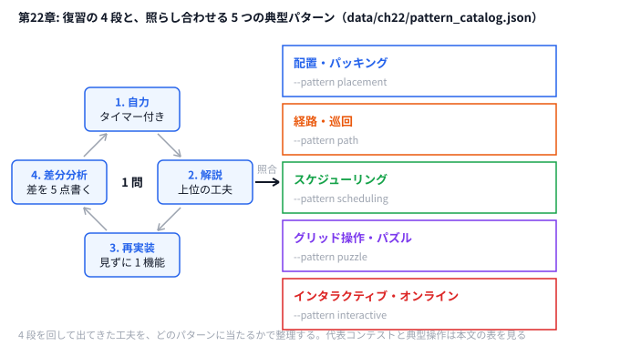

# 第22章 過去問の徹底復習

> **到達目標（黄色帯 2000〜2399）**: **自力 → 解説 → 再実装 → 差分分析** の4段復習を回せる。典型パターンカタログで問題を分類し、上位解法との **5点差分** を言語化できる。

---

## 22.1 復習の型（自力 → 解説 → 再実装 → 差分分析）

**霊夢**: 過去問、解いたあとスライド読むだけじゃダメなの？

**魔理沙**: 読むだけだと **再現できない**。黄色帯では **4段の型** を固定する。

```
1. 自力（タイマー付き）— 仮説・初提出
2. 解説・editorial — 上位の工夫を理解
3. 再実装 — 解説を見ずに1機能だけ再現
4. 差分分析 — スコアと設計の差を5点書く
```

| 段階 | 目的 | 時間目安 |
|------|------|---------|
| 自力 | 本番の再現性 | コンテスト時間の 30〜50% |
| 解説 | 盲点の発見 | 30分〜1時間 |
| 再実装 | 手が覚える | 1〜2時間 |
| 差分 | 次回に持ち越す | 15分 |

**霊夢**: 第21章の模擬コンテストともつながる？

**魔理沙**: その通り。第21章で **ログとチェックリスト**、第22章で **復習シート** に落とす。

```python
# python/ch22/review_sheet.py — テンプレートの骨格
def render_template(contest, problem, pattern_id, catalog, score):
    return f"""# 過去問復習シート — {contest} / {problem}
## 1. 自力（タイマー付き）
## 2. 解説・editorial
## 3. 再実装
## 4. パターン照合（第22章カタログ）
## 5. 次回への 3 点
"""
```

**霊夢**: 全部毎回やるの大変……

**魔理沙**: **苦手ジャンル1問** に絞る（22.3 ハンズオン）。完璧より **差分5点** が黄色帯の伸びしろだ。

---

## 22.2 典型パターンカタログ（配置 / 経路 / スケジューリング / パズル / インタラクティブ）

**霊夢**: 問題の見分け方がわからないの。

**魔理沙**: `data/ch22/pattern_catalog.json` に **5パターン** をまとめた。第22章の索引だ。

```json
{
  "id": "path",
  "name": "経路・巡回",
  "keywords": ["TSP", "巡回", "経路", "2-opt", "ダイクストラ"],
  "example_contests": ["AHC005", "AHC002", "AHC006"],
  "typical_moves": ["2-opt", "LNS destroy/repair", "最短路 + 局所改善"],
  "review_questions": [
    "距離はユークリッドかマンハッタンか？",
    "固定開始点・終点はあるか？",
    "インタラクティブかオフラインか？"
  ]
}
```

| ID | 名前 | 代表コンテスト | 典型操作 |
|----|------|---------------|---------|
| `placement` | 配置・パッキング | AHC001, AHC014 | swap, LNS 再配置 |
| `path` | 経路・巡回 | AHC005, AHC002, AHC006 | 2-opt, LNS |
| `scheduling` | スケジューリング | Intro HC | 日単位 swap, SA |
| `puzzle` | グリッド・パズル | AHC010, AHC011 | ビーム, 操作列 |
| `interactive` | インタラクティブ / オンライン | AHC003, AHC015, AHC016 | 重み更新, バンディット, 先読み |

**霊夢**: 復習シートに全部載るの？

**魔理沙**: `--pattern` で1つ選び、**そのパターン向けチェック** を自動挿入する。

```python
# python/ch22/review_sheet.py
def load_catalog(path: Path) -> List[Dict[str, Any]]:
    data = json.loads(path.read_text(encoding="utf-8"))
    return data.get("patterns", [])
```

```go
// go/ch22/review_sheet.go — パターンカタログ読み込み（抜粋）
type Pattern struct {
    ID              string   `json:"id"`
    Name            string   `json:"name"`
    ExampleContests []string `json:"example_contests"`
    ReviewQuestions []string `json:"review_questions"`
    // keywords, typical_moves も同様
}

func loadCatalog(path string) ([]Pattern, error) {
    raw, err := os.ReadFile(path)
    if err != nil {
        return nil, err
    }
    var c Catalog // Catalog は {Version int; Patterns []Pattern} の構造体
    if err := json.Unmarshal(raw, &c); err != nil {
        return nil, err
    }
    return c.Patterns, nil
}
```

**霊夢**: AHC020以降って toc にも書いてあったね。

**魔理沙**: 黄色帯の推奨は **AHC020以降で解説付きの問題**（付録D）。パターンIDを付けて **同じ型の問題を横展開** するのが第22章のコツだ。



**魔理沙**: 全体の流れはこの図、パターンごとの代表コンテストと典型操作は上の表だ。4 段を回して出てきた工夫を、どのパターンに当たるかで整理しておけば、次に同じ型の問題が来たとき、最初に試す近傍がすぐ出てくる。

---

## 22.3 ハンズオン: AHC020 以降の自分の苦手ジャンル過去問 1 問

**霊夢**: リポジトリに AHC020 のコードはないよね？

**魔理沙**: ハンズオンは **AtCoder 上の過去問1問** + リポジトリの **復習シート生成** の組み合わせ。手順は4段型に沿う。

### Step 1: 読む — パターンを決める

[AtCoder Heuristic Contest 一覧](https://atcoder.jp/contests/) から苦手1問を選び、カタログの `--pattern` を決める。

例: Intro HC → `scheduling`、AHC005 → `path`。

### Step 2: 写す — 復習シート生成

```bash
python python/ch22/review_sheet.py \
  --contest intro-heuristics \
  --problem C \
  --pattern scheduling \
  --score 1079507 \
  -o /tmp/review_intro_c.md

# Go 版も同じオプション（リポジトリのルートで実行）
go run go/ch22/review_sheet.go --pattern scheduling --score 1079507 -o /tmp/review_intro_c.md
```

生成される Markdown の先頭:

```markdown
# 過去問復習シート — intro-heuristics / C
- **日付**: 2026-05-20
- **パターン**: scheduling（スケジューリング）
- **スコア**: 1079507
```

### Step 3: 改変 — 自力パートを埋める

1. 問題文を15分で読み切り、チェックボックスに ✓
2. 仮説3つを「メモ」欄に書く
3. ローカルで1回スコアを出す（第2章テスター）

```bash
python python/ch09/sa_intro_hc.py < data/ch09/sample.txt   # 例: 既存解法
go run go/ch09/sa_intro_hc.go < data/ch09/sample.txt
```

### Step 4: コンテスト形式 — 差分表を埋める

解説スライドを読んだあと、シートの表を5行埋める:

```markdown
| # | 上位の工夫 | 自分の実装 |
|---|-----------|-----------|
| 1 | パイプライン貪欲→SA | 貪欲のみ |
| 2 | decay 差分更新 | 毎日 full 再計算 |
```

追記メモ:

```bash
python python/ch22/review_sheet.py \
  --append-note "2-opt 未実装が最大の差分" \
  -o /tmp/review_intro_c.md
```

---

## 22.4 演習

1. **5パターンそれぞれ** について、自分が解いた問題を1つずつ思い出し、ID を付ける（未経験なら「次に解く候補」を書く）。
2. 復習シート `--pattern path` で AHC005 系を想定し、**review_questions 3つ** に答える文を書く。
3. 上位参加者の解説と自分の解法の **差分を5点** 書く（22.3 の表を完成させる）。
4. 「次回への3点」を第21章チェックリストと突き合わせ、**1つはコンテスト戦略**（時間配分）、**1つは技術**（近傍追加等）、**1つは復習習慣** に分ける。

```bash
# カタログ内容の確認
python -c "import json; print(json.load(open('data/ch22/pattern_catalog.json'))['patterns'][1]['name'])"
# → 経路・巡回
```

<details>
<summary>ヒント</summary>

1. ID はコンテスト名と問題（例: `intro-heuristics/A`、`ahc005`）でよい。カタログの `examples` に挙がっている回から選んでもよい。
2. `review_sheet.py --pattern path` で作ったシートの「パターン照合」の節に、`path` の 3 つの質問が並ぶ。AHC005 の問題文の「入力」「得点」の節を見ながら答える。
3. 解説を読む前に、自分の解法を 3 行で書いておく。差分は「上位はやっていて、自分はやっていないこと」を書く。
4. 3 つを「時間配分」「技術」「習慣」の箱に分けてから、1 つずつ具体的にする。

</details>

<details>
<summary>解答例</summary>

**1.** 例えば次のように書く。

| パターン | 解いた問題（ID） |
|---------|----------------|
| placement 配置・パッキング | `ahc001`（第4章で玩具版を解いた） |
| path 経路・巡回 | `ahc005`（次に解く候補） |
| scheduling スケジューリング | `intro-heuristics/A`（第1・9章） |
| puzzle グリッド操作・パズル | `ahc011`（次に解く候補） |
| interactive インタラクティブ | `ahc003`（第12章） |

**2.** AHC005「Patrol Path」なら、例えば次のように答えられる。

- **距離はユークリッドかマンハッタンか？** — どちらでもない。道路のマスごとに通過時間（5〜9）があり、通ったマスの時間の合計が距離になる。最短路はダイクストラで求める。
- **固定開始点・終点はあるか？** — ある。入力で与えられるマスから出発し、同じマスに戻る。
- **インタラクティブかオフラインか？** — オフライン。入力を全部読んでから、経路を 1 本出力する。

**3.** AHC005 なら、例えば次のように埋まる（左が上位、右が自分）。左の列は、必ず実際の解説やスライドを読んで、自分で確かめてから書く。

| # | 上位の工夫 | 自分の実装 |
|---|-----------|-----------|
| 1 | 見るべきマスを全部見渡せる「立ち寄り点」を先に選ぶ | 全部の道路マスを回ろうとした |
| 2 | 立ち寄り点の巡回順を TSP として 2-opt で改善 | 最近傍の順のまま |
| 3 | 立ち寄り点の選び直しも SA の近傍に入れる | 立ち寄り点は固定 |
| 4 | 立ち寄り点の間の距離をダイクストラで前計算 | 毎回計算し直していた |
| 5 | ビジュアライザで見えていないマスを確認 | スコアだけ見ていた |

**4.** 例えば次のように分ける。

```markdown
- コンテスト戦略（時間配分）: 開始 1 時間以内に、全部同じ値でもいいので 1 回提出する（第21章チェックリスト「提出前（必須）」）
- 技術（近傍の追加）: 経路の問題では、巡回順の 2-opt に加えて「立ち寄り点の入れ替え」を近傍に入れる
- 復習習慣: コンテストの翌日に復習シートを 1 枚作り、差分表を 5 行埋める
```

</details>

---

## 章末まとめ

**霊夢**: 過去問は「解いた」で終わらせず、型で回すんだね。

**魔理沙**: まとめだ。

> **第22章まとめ**
>
> - 復習の型: **自力 → 解説 → 再実装 → 差分分析**
> - `data/ch22/pattern_catalog.json` で **5典型パターン** に分類
> - `review_sheet.py` で Markdown テンプレート生成・追記
> - ハンズオン: **苦手ジャンル過去問1問** + 差分5点
> - 第6部（黄）の締め — 第7部（橙）へ: **問題固有解法の設計**（第23章）

**霊夢**: 次は「問題ごとにオリジナル解法」だ。

**魔理沙**: カタログで型は分かった。橙は **その問題の本質** を見抜いて仮説を実験比較する番だぜ。
