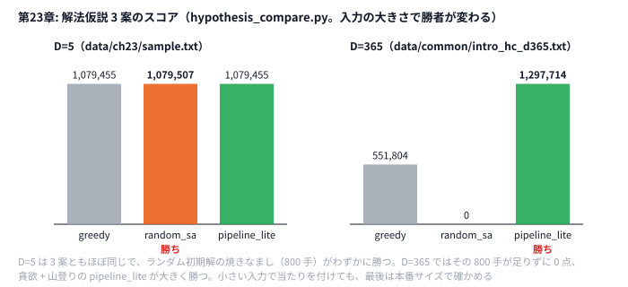

# 第23章 問題固有解法の設計

> **到達目標（橙色帯 2400〜2799）**: 問題の **本質構造** を見抜き、人間の解法をアルゴリズム化できる。**解法仮説3案** を同じ入力で比較し、最も効いた案を選べる。

---

## 23.1 問題の本質構造の見抜き方

**霊夢**: テンプレ SA じゃ足りない問題ってどう見分けるの？

**魔理沙**: **スコア式・制約・操作** の3点セットで「何が効くか」を言語化する。Intro HC スケジューリングなら:

| 要素 | 本質 |
|------|------|
| 状態 | 各日の種類（26通り） |
| スコア | gain − decay×経過日数 |
| 構造 | **順序依存** — 過去の選択が未来の decay に効く |

**霊夢**: 第22章のパターンと違う？

**魔理沙**: パターンは **入口**。橙は **この問題だけのクセ** を書く。例: 「同じ種類を連続させると decay が効きにくい」→ 操作設計に直結。

```python
# 本質メモの例（紙 or コメント）
# - 26種類は対称ではない → gain 表を見て「高 gain 日」を特定
# - decay 重い種類は間隔を空ける
# - 差分更新: 1日変更で satisfaction 再計算可能（days 小さいうちは full で可）
```

---

## 23.2 人間の解法をアルゴリズムに落とす

**霊夢**: 頭の中の「なんとなく良さそう」をコードにする方法は？

**魔理沙**: **3段**: (1) 手で小例を解く (2) 操作列に分解 (3) ループと評価関数に落とす。

人間: 「まず各日で一番良さそうな種類を選ぶ」→ **貪欲**

```python
# python/ch23/hypothesis_compare.py
def strategy_greedy(problem: ProblemInput) -> ScheduleState:
    last = [0] * 26
    satisfaction = 0
    schedule: List[int] = []
    for day in range(1, problem.days + 1):
        decay_all = sum(problem.decay[i] * (day - last[i]) for i in range(26))
        best_t, best_sat = 1, None
        for t in range(1, 27):
            # タイプ t を開くと、t の減衰だけ 0 になる
            sat = satisfaction + problem.gain[day - 1][t - 1] - (decay_all - problem.decay[t - 1] * (day - last[t - 1]))
            if best_sat is None or sat > best_sat:
                best_sat = sat
                best_t = t
        schedule.append(best_t)
        satisfaction = best_sat
        last[best_t - 1] = day
    return ScheduleState(schedule)
```

```go
// go/ch23/hypothesis_compare.go
func strategyGreedy(p ProblemInput) ScheduleState {
	last := make([]int, 26)
	satisfaction := 0
	schedule := make([]int, 0, p.Days)
	for day := 1; day <= p.Days; day++ {
		decayAll := 0
		for i := 0; i < 26; i++ {
			decayAll += p.Decay[i] * (day - last[i])
		}
		bestT, bestSat := 1, 0
		for t := 1; t <= 26; t++ {
			// タイプ t を開くと、t の減衰だけ 0 になる
			sat := satisfaction + p.Gain[day-1][t-1] - (decayAll - p.Decay[t-1]*(day-last[t-1]))
			if t == 1 || sat > bestSat {
				bestSat = sat
				bestT = t
			}
		}
		schedule = append(schedule, bestT)
		satisfaction = bestSat
		last[bestT-1] = day
	}
	return ScheduleState{schedule}
}
```

人間: 「ランダムから焼きなまし」→ **random_sa**

人間: 「貪欲のあと1日ずつ山登り」→ **pipeline_lite**

**霊夢**: 3案とも同じ問題で比べる？

**魔理沙**: `hypothesis_compare.py` が **同じ入力** で3戦略を走らせ、stderr にスコアと時間を出す。

---

## 23.3 スコア関数の微分可能な近似（勾配に相当するヒント）

**霊夢**: 微分可能って連続問題だけじゃないの？

**魔理沙**: AHC では **「どの方向に変えるとスコアが上がりやすいか」** のヒント、と捉える。Intro HC なら:

- **gain[day][t]** が大きい日は t を変える効果が大きい
- **decay[i]** が大きい種類 i は、直近に使うと satisfaction が落ちる

```python
# python/ch23/hypothesis_compare.py — pipeline_lite: 1日・1種類の変更だけ試す（勾配の離散版）
for _ in range(400):
    day = rng.randrange(problem.days)
    old = state.types[day]
    for t in range(1, 27):
        if t == old:
            continue
        if delta_change(problem, state.types, day, t) > 0:  # 差分だけ計算（第9章 9.4）
            state.types[day] = t
            break
```

```go
// go/ch23/hypothesis_compare.go
func strategyPipelineLite(p ProblemInput, rng *rand.Rand) ScheduleState {
	state := strategyGreedy(p)
	for s := 0; s < 400; s++ {
		day := rng.Intn(p.Days)
		old := state.Types[day]
		for t := 1; t <= 26; t++ {
			if t == old {
				continue
			}
			if deltaChange(p, state.Types, day, t) > 0 { // 差分だけ計算（第9章 9.4）
				state.Types[day] = t
				break
			}
		}
	}
	return state
}
```

| ヒントの取り方 | 例 |
|---------------|-----|
| スコア式を項分解 | gain 項 vs decay 項 |
| 小変更の差分 | 1 swap の Δscore |
| 緩和（第25章） | LP の双対変数 |

**霊夢**: 全部試すと遅くない？

**魔理沙**: **最初の当たりは days=5 のサンプル**（`data/ch23/sample.txt`）で速く付けてよい。ただし小さい入力だけで決めると、本番サイズで勝者が入れ替わることがある（演習1）。最後は `data/common/intro_hc_d365.txt` のような本番サイズでも確かめろ。

---

## 23.4 ドメイン知識の取り込み方

**霊夢**: 問題のストーリーからヒントって出る？

**魔理沙**: 出る。**キーワード → 典型操作** の対応表を作る（第22章カタログの拡張）。

| ストーリー語 | アルゴリズム |
|-------------|-------------|
| 「満足度が時間とともに減る」 | decay / スケジューリング |
| 「距離を短く」 | TSP / 2-opt / LNS（第19章） |
| 「クエリで真の距離が分かる」 | 重み推定 + バンディット（第24章） |

**霊夢**: 競プロ用語とストーリー語、両方メモ？

**魔理沙**: **復習シートの「メモ」欄** に両方書く。後から **ブログ1本** にしやすい（23.6 演習）。

---

## 23.5 ハンズオン: 最新 AHC 1 問 — 解法仮説 3 案の比較実験

**霊夢**: 手元のデータは Intro HC 形式だけ？

**魔理沙**: 第23章は **`data/ch23/sample.txt`（5日）** で3案比較。最新 AHC 1 問は **同じ手順** をフルサイズ入力に適用する。

### Step 1: 実行

```bash
python python/ch23/hypothesis_compare.py < data/ch23/sample.txt
go run go/ch23/hypothesis_compare.go < data/ch23/sample.txt
```

stderr 例:

```
strategy=greedy score=1079455 elapsed=0.000s
strategy=random_sa score=1079507 elapsed=0.006s
strategy=pipeline_lite score=1079455 elapsed=0.015s
best=random_sa score=1079507 total_elapsed=0.021s
```

（`elapsed` はマシン速度で変わる。）

stdout は **勝者のスケジュール**。



**霊夢**: D=5 で勝った random_sa が、D=365 では 0 点なの！

**魔理沙**: 800 手の焼きなましは、5 日なら十分だが、365 日のランダムな日程を直すには全然足りない。小さい入力は当たりを付けるのには速くて便利だが、勝者を決めるのは本番サイズだ。

### Step 2: 仮説メモと照合

```python
# python/ch23/hypothesis_compare.py
for name, fn in (
    ("greedy", lambda: strategy_greedy(problem)),
    ("random_sa", lambda: strategy_random_sa(problem, rng)),
    ("pipeline_lite", lambda: strategy_pipeline_lite(problem, rng)),
):
    ...
    print(f"strategy={name} score={score} elapsed={elapsed:.3f}s", file=sys.stderr)
```

```go
// go/ch23/hypothesis_compare.go — 3案比較（抜粋）
// go/ch23/hypothesis_compare.go — 3案比較（抜粋）
run := func(name string, fn func() ScheduleState) {
	start := time.Now()
	st := fn()
	elapsed := time.Since(start).Seconds()
	score := scoreSchedule(problem, st)
	results = append(results, result{name, score, elapsed, st.Types})
	fmt.Fprintf(os.Stderr, "strategy=%s score=%d elapsed=%.3fs\n", name, score, elapsed)
}
run("greedy", func() ScheduleState { return strategyGreedy(problem) })
run("random_sa", func() ScheduleState { return strategyRandomSA(problem, rng, 800) })
run("pipeline_lite", func() ScheduleState { return strategyPipelineLite(problem, rng) })
```

### Step 3: 改変 — 4案目を追加

例: `strategy_multi_start_sa`（第18章の `multi_start_sequential` を呼ぶ）を4行目に追加し、スコア差を測る。

### Step 4: コンテスト形式

1. 本番問題で **仮説3つを紙に書いてから** `hypothesis_compare` 相当の実験
2. **10分で結果** — 勝者以外は捨て、勝者だけ improve フェーズへ
3. ログに `best=...` を残す

---

## 23.6 演習

1. 3戦略の **elapsed と score** を表にし、スコア/秒を計算。時間制限2秒ならどれを採用するか理由を書く。さらに本番サイズの `data/common/intro_hc_d365.txt` でも比べ、**勝者が入れ替わる** ことを確かめる（手元では D=5 だと `random_sa` が勝つが、D=365 では 800 手の `random_sa` はランダム初期解から抜けられず 0 点、`pipeline_lite` が勝った。仮説比較は本番に近いサイズでもやる必要がある）。
2. `strategy_greedy` の tie-break を変え（今は同 sat なら番号の小さいほう。これを大きいほうにする）、スコアが変わるか確認。
3. 最新 AHC 1 問（AtCoder）で仮説3案を **箇条書き** し、最も効いた案を **200字のノート** にまとめる（ブログ下書き可）。
4. 勝った仮説に **第19章 LNS** や **第18章 multi-start SA** を足す案を1段落で設計する。

<details>
<summary>ヒント</summary>

1. stderr の `strategy=... score=... elapsed=...` を表に写し、`score / elapsed` を計算する。ただし、`elapsed` が 0.000 秒のものは割り算できない。スコア/秒だけで決めず、「制限時間内に収まるか」と「残り時間で何ができるか」も考える。
2. 今の `strategy_greedy` は `sat > best_sat` なので、同じ値ならもう番号の小さいほうを選んでいる。変えるなら `>=`（番号の大きいほう）にする。その前に、同点の日がそもそもあるかを数えてみる。
3. 仮説は「何を変えるか」と「なぜ効くと思うか」を 1 行ずつ書く。
4. 勝った `pipeline_lite` は、貪欲 + 山登り 400 手。残りの時間と、山登りが止まる理由から考える。

</details>

<details>
<summary>解答例</summary>

**1.** 手元では次のようになった。

| 入力 | 戦略 | score | elapsed |
|------|------|-------|---------|
| D=5 | greedy | 1079455 | 0.000 秒 |
| D=5 | random_sa | 1079507 | 0.007 秒 |
| D=5 | pipeline_lite | 1079455 | 0.024 秒 |
| D=365 | greedy | 551804 | 0.002 秒 |
| D=365 | random_sa | 0 | 0.701 秒 |
| D=365 | pipeline_lite | 1297714 | 0.393 秒 |

スコア/秒では、どちらの入力でも貪欲が飛び抜ける（時間がほぼ 0 なので）。だが、制限時間が 2 秒なら、どれも時間内に収まる。そうなると「時間内で一番スコアが高いもの」を選ぶべきで、D=365 なら `pipeline_lite` だ。さらに、余った約 1.6 秒を SA に回せば、もっと伸ばせる。スコア/秒は、「同じスコアならどちらが速いか」や、「時間が足りないときにどちらを削るか」を決めるときに使う。

**2.** `>=` に変えても、D=5 も D=365 もスコアは変わらない（1079455 と 551804）。同点を数えると、どちらの入力でも 0 日だった。満足度の値は 0〜20000 の乱数から作られていて、ぴったり同じになることはまずない。tie-break が効くのは、値が小さい整数で同点がよく出る問題だ。

**3.** 例えば次のように書く。

```markdown
## AHC0xx の仮説 3 案
- 案 1: 貪欲 → 理由: まず提出するため
- 案 2: 貪欲 + 1 点変更の SA → 理由: スコアの差分が O(1) で計算でき、手数を稼げそう
- 案 3: 案 2 + 2 点入れ替えの近傍 → 理由: 制約を保ったまま動かしたい
## 一番効いた案（200 字）
案 2 が一番伸びた。差分計算にしたことで 1 秒あたりの手数が約 30 倍になり、……
```

**4.** 例えば次のように書く。

> `pipeline_lite` の山登りは、1 日だけ変えても良くならない局所最適で止まる。そこで、余った時間で第19章の LNS を回す。勝者のスケジュールから 3 日連続の区間を消し、貪欲で埋め直して、良くなれば採用する。これを時間いっぱいくり返す。D=365 で第18章の multi-start を足すのは勧めない。Intro HC は 1 本の SA を長く回すほど伸びる型で、時間を分けると 1 本あたりが短くなり、かえって下がるからだ（第18章の演習2）。足すなら、LNS で崩す区間の長さや位置を変えた複数の候補を、同じ時間の中で順に試すほうがよい。

</details>

---

## 章末まとめ

**霊夢**: テンプレ当てはせず、仮説を実験で選ぶんだね。

**魔理沙**: まとめだ。

> **第23章まとめ**
>
> - **本質構造**（状態・スコア・順序依存）を言語化してから実装
> - 人間の解法 → **貪欲 / SA / パイプライン** などに分解
> - **勾配ヒント**: スコア式の項・1日変更の Δ
> - `hypothesis_compare` で **3案同時比較**（Python / Go）
> - 次章: **高度なインタラクティブ・オンライン**（第24章）

**霊夢**: 次は AHC003 系、バンディットで攻める章ね。

**魔理沙**: 仮説を実験で選ぶ考え方は、クエリの **探索と利用** にもそのまま使える。**UCB / Thompson** の比較が第24章だぜ。
