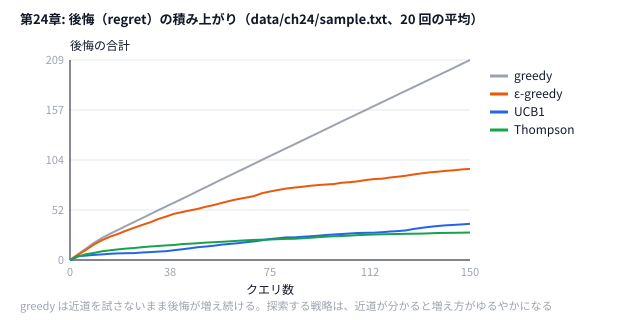

# 第24章 高度なインタラクティブ・オンライン

> **到達目標（橙色帯 2400〜2799）**: **多腕バンディット**（UCB1, Thompson Sampling, ε-greedy）で辺・クエリの探索/利用を制御できる。**AHC003 系** の重み更新戦略を3種比較し、クエリ効率の考え方を説明できる。

---

## 24.1 多腕バンディット（UCB, Thompson Sampling）

**霊夢**: 第12章でもバンディットって出てきたけど、橙では何が違うの？

**魔理沙**: 第12章のソルバは **利用だけ**——今の推定で一番短い経路を毎回出していた。第24章は **探索を入れる戦略の比較** だ。同じグラフ・同じクエリ列・同じ観測ノイズで、次の4つを並べる。

| 戦略 | 経路の選び方 |
|------|-------------|
| **greedy** | 今の推定で最短の経路（第12章と同じ。比べる基準） |
| **ε-greedy** | 確率 ε でランダムな経路、それ以外は greedy |
| **UCB1** | 通った回数が少ない辺ほど **短く見せて**（楽観）から最短路 |
| **Thompson** | 推定のまわりにばらつかせた値を引き、その値で最短路。通った回数が少ない辺ほど大きくばらつく |

**霊夢**: 「腕」は何に対応する？

**魔理沙**: 本来の多腕バンディットは「どのスロットマシンを引くか」だが、ここでは **どの経路を通すか** が腕だ。経路は辺の組み合わせなので腕が多すぎる。だから辺ごとに「推定」と「通った回数」を持ち、経路を選ぶときの重みに探索の分を混ぜる。

```python
# python/ch24/bandit_compare.py
    def planning_weight(self, key: Edge) -> float:
        """経路を選ぶときに使う重み。探索したい辺ほど短く見せる."""
        w = self.est[key]
        if self.strategy == "ucb1":
            # 通った回数が少ない辺ほど短く見せる（楽観）。クエリが進むと log でゆっくり効きが弱まる
            return w / (1.0 + UCB_C * math.sqrt(math.log(self.t + 2) / (self.pulls[key] + 1)))
        if self.strategy == "thompson":
            # 推定のまわりにばらつかせた値を引く。通った回数が少ない辺ほど大きくばらつく
            return w * math.exp(self.rng.gauss(0.0, THOMPSON_SIGMA / math.sqrt(self.pulls[key] + 1)))
        return w
```

```go
// go/ch24/bandit_compare.go
func (s *Solver) planningWeight(i int) float64 {
	w := s.est[i]
	switch s.strategy {
	case "ucb1":
		// 通った回数が少ない辺ほど短く見せる（楽観）
		return w / (1 + ucbC*math.Sqrt(math.Log(float64(s.t+2))/float64(s.pulls[i]+1)))
	case "thompson":
		// 推定のまわりにばらつかせた値を引く。通った回数が少ない辺ほど大きくばらつく
		return w * math.Exp(s.rng.NormFloat64()*thompsonSigma/math.Sqrt(float64(s.pulls[i]+1)))
	}
	return w
}
```

---

## 24.2 敵対的オンライン学習の基礎

**霊夢**: 敵対的って、入力が最悪に来るってこと？

**魔理沙**: **アルゴリズムの性能を最悪ケースで評価** する枠組みだ。競技では「隠しテストが難しい」≒ 敵が強い、と捉えればいい。そこで物差しにするのが **後悔（regret）** だ。

| 概念 | この章での意味 |
|------|-------------|
| 後悔（regret） | 選んだ経路の **真の** 長さ − 真の最短路長（クエリ全体で足す） |
| 探索 | まだよく分からない辺を、わざと通してみる |
| 利用 | 今の推定で一番短い経路を出す |

**霊夢**: 推定がずれていても、後悔は分かるの？

**魔理沙**: ソルバ自身には分からない。真の重みを知っている **採点側** だけが計算できる値だ。本番の AHC003 のスコア（真の最短距離 / 自分の経路の長さ）も、同じものを別の形で測っている。

```python
# python/ch24/bandit_compare.py
    for _ in range(rounds):
        for s, t in queries:
            path = solver.choose_path(s, t)
            true_len = sum(true_w[k] for k in path_edges(path))
            regret += true_len - dijkstra(n, true_w, s, t)[0]
            solver.update(path, true_len * noise.uniform(1 - NOISE, 1 + NOISE))
```

**霊夢**: ずっと探索ばかりだとスコア悪くない？

**魔理沙**: 悪い。逆に探索しないと、最初に見つけた経路にしがみついて、もっと短い道に気づけない。**バランス** が本体だ。UCB1 は通った回数が増えた辺ほどボーナスが減るので、探索が自然に減っていく。ε-greedy は ε を下げない限り、最後までランダムな経路を出し続ける。

---

## 24.3 クエリ効率と情報理論的な上限

**霊夢**: クエリ回数、有限だよね？

**魔理沙**: AHC003 系は **1クエリ1経路** が基本。本番で返ってくるのは **経路全体の長さ（ノイズ付き）1つだけ** だ（第12章）。どの辺が長かったかは、何度も通るうちに推定するしかない。この玩具も同じで、ソルバに渡すのは **選んだ経路の長さ × 0.9〜1.1** だけだ。

| 問い | 設計への効き |
|------|-------------|
| 1クエリで何が分かる？ | 経路の合計長（ノイズ付き）。辺ごとの値は分からない |
| 更新は線形？乗法？ | 第12章と同じ乗法: `est *= 1 + 学習率 × (観測 / 予測 − 1)` |
| Q が小さい | 早く当たりを付けたい → 楽観（UCB）で未知の辺を試す |
| Q が大きい | 探索の元が取れる → 序盤に広く試し、後半は利用寄り |

```python
# python/ch24/bandit_compare.py
    def update(self, path: List[int], observed: float) -> None:
        keys = path_edges(path)
        predicted = sum(self.est[k] for k in keys)
        factor = 1.0 + LEARNING_RATE * (observed / predicted - 1.0)
        for k in keys:
            self.est[k] *= factor
            self.pulls[k] += 1
        self.t += 1
```

**霊夢**: 情報理論的な上限って計算するの？

**魔理沙**: 理論の世界では **エントロピー** などを使うが、橙の実務は **「Q 回で全辺を1回ずつ触れるか」** のチェックが先だ。一度も通らない辺は、初期推定（この玩具では `INIT_WEIGHT = 6.0`）のまま残る。出力の `untouched_edges` がその本数だ。

---

## 24.4 ハンズオン: AHC003 系問題の高度な重み更新戦略

**霊夢**: フル AHC003 は重いけど、手元用は？

**魔理沙**: `data/ch24/sample.txt` — 6頂点9辺のグラフと、3本のクエリ。`bandit_compare.py` / `bandit_compare.go` は、このクエリ列を 50 周（150 クエリ）回して、4戦略の後悔を比べる。乱数の seed を変えて 20 回走らせた平均だ。

> **注**: 本番 AHC003 と同じ入出力で試したいときは、第12章の `local_judge.py` に、ここで学んだ探索（UCB / Thompson）を入れたソルバをつなげばいい（演習5）。

入力形式:

```
6 9
0 1 4.0
...
3        # クエリ数
0 5
1 4
2 5
```

### Step 1: 実行

```bash
python python/ch24/bandit_compare.py data/ch24/sample.txt
go run go/ch24/bandit_compare.go data/ch24/sample.txt
```

stderr（Python）:

```
graph n=6 m=9 queries=3 rounds=50 trials=20
strategy=greedy regret=209.00 untouched_edges=3.0
strategy=epsilon_greedy regret=95.20 untouched_edges=0.1
strategy=ucb1 regret=37.80 untouched_edges=1.4
strategy=thompson regret=28.75 untouched_edges=0.6
best=thompson (smallest regret)
```

（Go は乱数の作り方が違うので、数値は少しずれる。順位の傾向は同じ。）

**霊夢**: greedy がダントツで悪いの。

**魔理沙**: 初期推定を全部 6.0（真の重みの上限）にしているからだ。一度通った経路は観測で短く直されるが、通っていない辺は 6.0 のまま、つまり「遠そう」に見える。greedy は最初に見つけた経路を使い続け、`untouched_edges=3.0`——3本の辺を一度も試さない。探索を入れた3つは、その辺を試して近道を見つける。



### Step 2: 経路の選び方

```python
# python/ch24/bandit_compare.py
    def choose_path(self, s: int, t: int) -> List[int]:
        if self.strategy == "epsilon_greedy" and self.rng.random() < self.epsilon:
            plan = {k: self.rng.random() for k in self.est}  # 確率 ε でランダムな経路
        else:
            plan = {k: self.planning_weight(k) for k in self.est}
        return dijkstra(self.n, plan, s, t)[1]
```

探索したい辺の重みを **小さく見せてから** ダイクストラする——これで、最短路を求める仕組みのまま探索できる。

### Step 3: 改変

```bash
python python/ch24/bandit_compare.py data/ch24/sample.txt --epsilon 0.3   # ε を変える
python python/ch24/bandit_compare.py data/ch24/sample.txt --rounds 5      # クエリを減らす（15 クエリ）
```

ファイル先頭の `UCB_C`・`THOMPSON_SIGMA`・`INIT_WEIGHT` も変えてみる（演習）。

### Step 4: コンテスト形式

1. 各クエリ前に **推定グラフ** を stderr ログ（任意）
2. **flush** してからクエリ送信（第12章）
3. 終了後に戦略のうち **本番で使う1つ** を決め、理由を1行

## 24.5 演習

1. **ε = 0.05, 0.15, 0.30** で `epsilon_greedy` の regret を比較する（`--epsilon`）。
2. `--rounds 5`（15 クエリ）と既定の 50 周（150 クエリ）で、UCB1 と Thompson の regret を比べる。クエリが少ないときに強いのはどちらか。
3. `INIT_WEIGHT` を `6.0` から `1.0` や `3.0` に変え、greedy の regret と `untouched_edges` がどう変わるかを見て、理由を説明する。
4. 第8章の **ビジュアライザ** の考え方で「どの辺を何回通ったか」を色付けする案をスケッチする。
5. 第12章の `solver.py` をコピーし、最初の 100 クエリだけ「通った回数が少ない辺ほど推定を短く見せる」（UCB 風の楽観）経路選択にして、`local_judge.py --seed 1〜5` で元のソルバとスコアを比べる。

```bash
python python/ch24/bandit_compare.py data/ch24/sample.txt 2>&1 | tee bandit.log
grep strategy bandit.log
go run go/ch24/bandit_compare.go data/ch24/sample.txt 2>&1 | grep best
```

<details>
<summary>ヒント</summary>

1. ε が小さすぎると、試さない辺が残る。大きすぎると、もう分かっている良い経路を捨ててランダムな経路を出す回数が増える。
2. クエリが少ないと、探索に使った分を後で取り返す時間がない。UCB1 は「通った回数」で決まり、Thompson は乱数で決まる。どちらが序盤に早く当たりを付けやすいかを考える。
3. 初期推定が真の重みより小さいと、通っていない辺は「近そう」に見える。greedy はそれを試すか。
4. 第8章の `simple_vis` は、マスごとに 1 文字を描いた。辺ごとに「通った回数」を描くにはどうするか。
5. 第12章の `Solver` を継承し、`weight` を「最初の 100 クエリだけ楽観」に差し替える。`update` で使う予測の長さは、楽観を入れる前の推定で測り直す。

</details>

<details>
<summary>解答例</summary>

**1.** 手元では次のようになった（50 周・20 回の平均）。

| ε | regret | untouched_edges |
|---|--------|----------------|
| 0.05 | 170.95 | 0.3 |
| 0.15 | 95.20 | 0.1 |
| 0.30 | 100.60 | 0.0 |

0.05 は探索が少なすぎて、近道に気づくまでに時間がかかる。0.30 は全部の辺を試せるが、分かったあとでも 3 回に 1 回ランダムな経路を出すので、そのぶん後悔が積み上がる。この玩具では 0.15 がちょうどよかった。ε-greedy は、どの ε でも UCB1（37.80）や Thompson（28.75）に届かない。ランダムな経路は「まだ分からない辺」を狙って試すわけではないからだ。

**2.** 手元では次のようになった。

| | 15 クエリ（`--rounds 5`） | 150 クエリ（既定） |
|---|------------------------|------------------|
| UCB1 | 6.45 | 37.80 |
| Thompson | 10.10 | 28.75 |

クエリが少ないときは UCB1、多いときは Thompson が強い。UCB1 は通っていない辺を、決まった順に確実に試すので、早く当たりが付く。ただし UCB1 のボーナスは log でゆっくりとしか減らないので、分かったあとも探索を続けてしまい、後半で後悔が増える。Thompson は分かった辺ほどばらつきが小さくなるので、後半は利用に寄っていく。本番の Q に合わせて、手元で両方を測って決める。

**3.** 手元では次のようになった（50 周・20 回の平均）。

| INIT_WEIGHT | greedy の regret | greedy の untouched_edges | Thompson の regret |
|------------|-----------------|--------------------------|-------------------|
| 1.0 | 8.50 | 0.0 | 19.60 |
| 3.0 | 3.75 | 2.0 | 20.65 |
| 6.0 | 209.00 | 3.0 | 28.75 |

初期推定を真の重み（1〜6）より小さくすると、通っていない辺は「近そう」に見える。greedy は自分から未知の辺を試し、観測で「本当は長い」と分かると避けるようになる。**楽観的な初期値は、それだけで探索の役目を果たす**。1.0 と 3.0 では、greedy が探索戦略より良くなった。このときの探索戦略は、もう要らない探索をしているぶん損をしている。一方 6.0 のように悲観的だと、greedy は未知の辺を「遠そう」と思って試さない。探索戦略の効き目は、初期値の置き方しだいで大きく変わる。

**4.** 例えば次のように描く。頂点を `o`、辺を数字（通った回数を 0〜9 に丸めたもの）で描き、色を付けるなら回数が多いほど濃くする。

```text
o-9-o-0-o        横の辺: 通った回数
|   |   |
3   9   0        縦の辺: 通った回数
|   |   |
o-1-o-9-o
```

0 の辺（一度も通っていない）が多い所は、推定が初期値のまま残っている。AHC003 の 30×30 なら、横の辺 30×29 本と縦の辺 29×30 本を、それぞれ数字か色で描けばよい。

**5.** 次のように `Solver` を継承する。

```python
# 解答例: python/ch12/solver.py をコピーし、最初の 100 クエリだけ UCB 風の楽観で経路を選ぶ
EXPLORE_QUERIES = 100  # 最初の何クエリだけ楽観的に選ぶか
UCB_C = 1.0


class UCBSolver(Solver):
    def __init__(self) -> None:
        super().__init__()
        self.count: Dict[Edge, int] = {}  # 辺 → 通った回数
        self.t = 0

    def weight(self, e: Edge) -> float:
        w = super().weight(e)
        if self.t >= EXPLORE_QUERIES:
            return w
        # 通った回数が少ない辺ほど短く見せる（楽観）
        return w / (1.0 + UCB_C * math.sqrt(math.log(self.t + 2) / (self.count.get(e, 0) + 1)))

    def update(self, edges: List[Edge], predicted: float, observed: int) -> None:
        predicted = sum(Solver.weight(self, e) for e in edges)  # 予測は楽観なしの推定で測り直す
        super().update(edges, predicted, observed)
        for e in edges:
            self.count[e] = self.count.get(e, 0) + 1
        self.t += 1
```

`main` の `Solver()` を `UCBSolver()` にし、`import math` と `Dict` を足す。手元では `--seed 1〜5` の ratio が次のようになった。

| | seed 1〜5 | 平均 |
|---|-----------|------|
| 元のソルバ | 0.921 / 0.902 / 0.827 / 0.886 / 0.930 | 0.893 |
| 最初の 100 クエリだけ楽観 | 0.897 / 0.935 / 0.897 / 0.902 / 0.940 | 0.914 |

5 seed 中 4 seed で良くなり、平均で約 2 ポイント上がった。最初の 100 クエリはスコアの重みが小さい（第12章の演習5）ので、そこで遠回りしても失う点は少ない。その代わり、後半の重いクエリで使う推定が育つ。

</details>

---

## 章末まとめ

**霊夢**: インタラクティブは、探索と利用のバランス取りが全部なんだね。

**魔理沙**: まとめだ。

> **第24章まとめ**
>
> - **greedy / ε-greedy / UCB1 / Thompson** を同じグラフ・同じノイズで比較（`bandit_compare`）
> - 物差しは **後悔 = 選んだ経路の真の長さ − 真の最短路長**
> - **クエリ効率**: 一度も通らない辺は初期推定のまま。悲観的な初期値だと greedy は探索しない
> - ハンズオン: `data/ch24/sample.txt`（6頂点・3クエリ × 50 周）で Thompson と UCB1 が greedy の後悔を 1/5 以下にした
> - 次章: **整数計画と緩和**（第25章）

**霊夢**: 次は LP？ AHC で使うの？

**魔理沙**: 主役になることは少ないが、**下界の見積もり** や **初期解の種** として効く場面がある。橙色帯の「発展の道具箱」として押さえておくんだぜ。
