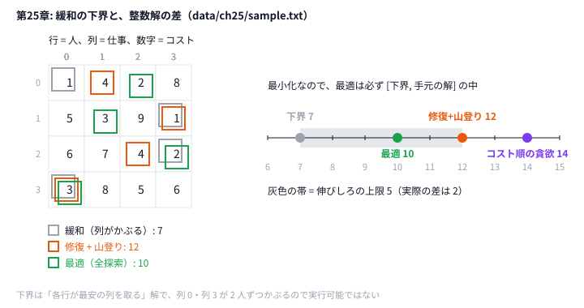

# 第25章 整数計画と緩和

> **到達目標（橙色帯 2400〜2799・発展）**: 割当を最適化問題として定式化し、**緩和で下界** を作って「あとどれだけ伸ばせるか」を見積もれる。緩和解を修復・改善して整数解にできる。
>
> 本章は **発展** 。AHC で LP が主役になることは少ないが、**下界の見積もり**（どこまで伸ばせるか）や **初期解の種** として効く場面がある。急ぐなら飛ばして第27章へ進んでもいい。

---

## 25.1 最適化問題としての定式化

**霊夢**: 割当問題って、N 人に N 仕事を1つずつ当てるやつ？

**魔理沙**: **コスト行列 `cost[i][j]`** があり、各行・各列にちょうど1つ選ぶ。**整数計画（IP）** の典型だ。

```
  minimize  Σ_i Σ_j cost[i][j] · x[i][j]
  subject to  Σ_j x[i][j] = 1   （各行1つ）
              Σ_i x[i][j] = 1   （各列1つ）
              x[i][j] ∈ {0, 1}
```

**霊夢**: ヒューリスティック部門でも厳密に解くの？

**魔理沙**: **N が小さい部分問題** や **下界の見積もり** には IP/LP が効く。本番サイズでは **緩和で見積もり → ヒューリスティックで解を作る** が現実的だ。

| 段 | 本リポジトリ |
|----|-------------|
| 読み込み | `read_cost` — 先頭 `n`、続けて `n` 行 |
| データ | `data/ch25/sample.txt`（`n=4`） |

```text
4
1 4 2 8
5 3 9 1
6 7 4 2
3 8 5 6
```

---

## 25.2 線形計画法（LP）緩和の考え方

**霊夢**: 緩和って、0/1 を 0〜1 の分数にゆるめるの？

**魔理沙**: それが **LP 緩和** だ。`x[i][j] ∈ {0, 1}` を `x[i][j] ∈ [0, 1]` にゆるめると線形計画（LP）になり、ソルバーで速く解ける。制約をゆるめただけだから、**最小化なら LP の最適値 ≤ 本当の最適値**——つまり **下界** になる。

**霊夢**: 下界が分かると何がうれしいの？

**魔理沙**: 手元の解が 12 で下界が 7 なら、「最適は 7〜12 のどこか、伸びしろは最大 5」と分かる。下界と解が近ければ、それ以上の改善に時間を使わなくていい。

**魔理沙**: ただし割当問題には特別な性質があって、**LP 緩和を解くと必ず整数（0/1）の最適解が出てくる**（制約行列が完全単模性を持つため）。だから割当そのものは LP ソルバー（25.3）か Hungarian 法で **厳密に解ける**。LP 緩和が「分数解になって丸めが要る」のは、配置や容量制約が混ざった問題のほうだ。

**霊夢**: じゃあ本章のコードは LP を解いてるの？

**魔理沙**: 標準ライブラリだけで LP ソルバーを書くのは大変なので、本章はもっと簡単な緩和を使う。**「各列に1人」の制約を外す** と、各行が勝手に最安の列を選べばよくなる。これも制約をゆるめただけだから、立派な下界だ。

```python
# python/ch25/assignment_relax.py
def relaxed_lower_bound(cost: List[List[int]]) -> Tuple[List[int], int]:
    """「各列に1人」を外した緩和。各行で最安の列を選ぶ。どんな実行可能解のコストもこれ以上."""
    n = len(cost)
    choice = [min(range(n), key=lambda j: cost[i][j]) for i in range(n)]
    return choice, assignment_cost(cost, choice)
```

```go
// go/ch25/assignment_relax.go — 同じ緩和
func relaxedLowerBound(cost [][]int) ([]int, int) {
```

| 緩和 | 外す制約 | 解きやすさ | 下界の強さ |
|------|---------|-----------|-----------|
| 列の制約を外す（本章） | 各列に1人 | 各行の最小値を取るだけ | 弱め |
| LP 緩和 | 0/1 → [0, 1] | LP ソルバーが要る | 強い（割当なら最適値そのもの） |

---

## 25.3 制約付き最適化ライブラリの使い方（Python: PuLP / OR-Tools, Go: 外部 LP ソルバ連携）

**霊夢**: 本書のコードはライブラリ無し？

**魔理沙**: 第25章ハンズオンは **stdlib のみ**（依存ゼロ）。本番や研究では次を使う。

| 環境 | 選択肢 |
|------|--------|
| Python | [PuLP](https://pypi.org/project/PuLP/), [OR-Tools](https://developers.google.com/optimization) |
| Go | 外部ソルバ（GLPK, CBC）への subprocess、または Cgo |

**霊夢**: PuLP だとどう書くの？

**魔理沙**: 概念だけ示す（実行は任意インストール）。

```python
# 概念例（pip install pulp が必要）
# from pulp import LpMinimize, LpProblem, LpVariable, lpSum
# prob = LpProblem("assign", LpMinimize)
# x = {(i,j): LpVariable(f"x_{i}_{j}", cat="Binary") for i in range(n) for j in range(n)}
# prob += lpSum(cost[i][j]*x[i,j] for i in range(n) for j in range(n))
# 各行・各列の等式制約を追加 → prob.solve()
```

**Go** は **MIP を外部に投げる** 設計が多い。ヒューリスティック本体は Go、**部分問題だけ Python LP** という分担も AHC である。

---

## 25.4 緩和解からヒューリスティック解への変換

**霊夢**: 緩和の解は列がかぶってるのよね。どうやって実行可能にするの？

**魔理沙**: **修復（repair）** する。サンプルの緩和解は `[0, 3, 3, 0]`——行1と行2が列3、行0と行3が列0を取り合っている。本章は **後悔（2番目に安いコスト − 最安のコスト）が大きい行から** 空いている最安の列を取らせる。最安を逃すと損が大きい行を先に満たす、という考え方だ。

```python
# python/ch25/assignment_relax.py
def repair(cost: List[List[int]]) -> List[int]:
    """後悔の大きい行（最安の列を取れないと損が大きい行）から、空いている最安の列を取らせる."""
    n = len(cost)

    def regret(i: int) -> int:
        row = sorted(cost[i])
        return row[1] - row[0] if n > 1 else 0

    order = sorted(range(n), key=lambda i: -regret(i))  # 同点は行番号の小さい順（sorted は安定）
    assign = [-1] * n
    used = [False] * n
    for i in order:
        j = min((j for j in range(n) if not used[j]), key=lambda j: cost[i][j])
        assign[i] = j
        used[j] = True
    return assign
```

```go
// go/ch25/assignment_relax.go
func repair(cost [][]int) []int {
	n := len(cost)
	regret := func(i int) int {
		row := append([]int{}, cost[i]...)
		sort.Ints(row)
		if n > 1 {
			return row[1] - row[0]
		}
		return 0
	}
	order := make([]int, n)
	for i := range order {
		order[i] = i
	}
	sort.SliceStable(order, func(a, b int) bool { return regret(order[a]) > regret(order[b]) })
	assign := make([]int, n)
	used := make([]bool, n)
	for _, i := range order {
		best := -1
		for j := 0; j < n; j++ {
			if !used[j] && (best == -1 || cost[i][j] < cost[i][best]) {
				best = j
			}
		}
		assign[i] = best
		used[best] = true
	}
	return assign
}
```

**霊夢**: 修復したあと改善する余地は？

**魔理沙**: **2 行の割当を入れ替える山登り**（第6章の 2-opt と同じ発想）で詰める。

```python
# python/ch25/assignment_relax.py
def swap_improve(cost: List[List[int]], assign: List[int]) -> List[int]:
    assign = list(assign)
    n = len(assign)
    improved = True
    while improved:
        improved = False
        for i in range(n):
            for k in range(i + 1, n):
                a, b = assign[i], assign[k]
                delta = (cost[i][b] + cost[k][a]) - (cost[i][a] + cost[k][b])
                if delta < 0:
                    assign[i], assign[k] = b, a
                    improved = True
    return assign
```

| 段 | サンプルでの値 | 意味 |
|----|---------------|------|
| 緩和（下界） | 7 | 最適はこれ以上 |
| 修復 | 12 | 実行可能な整数解 |
| 入れ替え山登り | 12 | この解は入れ替えでは改善できない（局所最適） |
| 比較: コスト昇順の貪欲 | 14 | 安い所から詰めると後で高い所が残る |
| 全探索の最適 | 10 | 確かに [7, 12] の中にある |

---

## 25.5 ハンズオン: 割当問題で緩和の下界を作り、修復・改善した整数解と比べる

```bash
python python/ch25/assignment_relax.py < data/ch25/sample.txt
go run go/ch25/assignment_relax.go < data/ch25/sample.txt
```

検証済み出力（Python / Go 同じ）:

```text
lower_bound 7 relaxed_assign [0, 3, 3, 0]
repaired_assign [1, 3, 2, 0] cost 12
improved_assign [1, 3, 2, 0] cost 12
greedy_assign [0, 3, 2, 1] cost 14
optimal_assign [2, 1, 3, 0] cost 10
n=4 optimal is in [7, 12]
```

**霊夢**: 最適は 10。修復した解 12 とは 2 違うのね。

**魔理沙**: そして下界 7 との間は 5。**本番では最適が分からない** ので、「解と下界の差」が伸びしろの目安になる。n=4 なら全探索 `brute_optimal` で確かめられるが、本番サイズでは無理だ。



**魔理沙**: 左の灰色の枠が緩和の解だ。列 0 と列 3 に 2 人ずつ入っていて、そのままでは使えない。右の数直線の灰色の帯が「最適が入っているはずの範囲」で、手元の解を良くするか、下界を強くするかで帯が狭まる。

**霊夢**: 入れ替え山登りで 10 に届かないのはなぜ？

**魔理沙**: 12 の解 `[1, 3, 2, 0]` から最適 `[2, 1, 3, 0]` へは、2 行の入れ替え1回では行けない（3 行をぐるっと回す必要がある）。だから **局所最適** で止まる。SA（第9章）や 3 行の回転を近傍に足せば届く——演習3だ。

### ハンズオン 4 ステップ

1. 上記コマンドで 6 行の出力を確認する
2. `repair` の順番を「行番号順」に変え、修復後のコストがどう変わるか比べる
3. `swap_improve` に「3 行の割当を回す」近傍を足し、10 に届くか試す
4. `n=8` の乱数行列を作り、下界と `improved` の差を記録する（全探索は n=8 なら 4 万通りなのでまだ可能）

---

## 25.6 演習

1. **Hungarian 法**（O(n³)）を調べ、同一 `data/ch25/sample.txt` で最適 10 と一致するか外部実装と比較する。
2. PuLP または OR-Tools で、`x[i][j]` を **連続変数（0〜1）** にした LP 緩和を解き、答えが 0/1 になること（割当の LP 緩和は整数解が出ること）を確かめる。
3. 「行の制約を外す緩和」（各列で最安の行を選ぶ）も作り、列の制約を外したものとどちらの下界が強い（大きい）か比べる。2 つの大きい方も下界になる。
4. 第11章パイプラインに「緩和で下界を出し、解との差を stderr に出す」段を足す設計図を描く。
5. AHC の **配置・割当系** 過去問を1つ選び、どの変数を `x[i][j]` に対応づけ、どの制約を外せば下界が作れるか書く。

```bash
# 下界と解の比較
python python/ch25/assignment_relax.py < data/ch25/sample.txt | grep -E 'lower_bound|improved|optimal'
```

<details>
<summary>ヒント</summary>

1. 自分で書くなら、Hungarian 法は「行ごとに最小値を引く → 列ごとに最小値を引く → 0 で割当を作る → 作れなければ調整」をくり返す。外部実装なら、`scipy.optimize.linear_sum_assignment` が使える。
2. 変数は `x[i][j]`（i を j に割り当てるなら 1）の 16 個。制約は「各行の和が 1」「各列の和が 1」。`0 ≤ x ≤ 1` の連続変数にして解く。PuLP がなければ `scipy.optimize.linprog` でもよい。
3. 「行の制約を外す」は「各列が、自分を担当する一番安い行を選ぶ」こと。コストは各列の最小値の和になる。
4. 下界を出すのは一瞬なので、どの段の前後に置いても時間はほぼかからない。「解 − 下界」の差を見ると、何が分かるかを考える。
5. 「どれを、どこに割り当てるか」を決める問題を探す。そこで外しやすい制約は、たいてい「重ならない」「1 つの場所に 1 つまで」の形をしている。

</details>

<details>
<summary>解答例</summary>

**1.** `linear_sum_assignment` で解くと、割当 `[2, 1, 3, 0]`・コスト 10 で、`assignment_relax.py` の `optimal_assign [2, 1, 3, 0] cost 10` と一致する。

```python
# 解答例: scipy の Hungarian 法の実装で確かめる
import numpy as np
from scipy.optimize import linear_sum_assignment

cost = np.array([[1, 4, 2, 8], [5, 3, 9, 1], [6, 7, 4, 2], [3, 8, 5, 6]])
rows, cols = linear_sum_assignment(cost)
print(list(cols), cost[rows, cols].sum())  # → [2, 1, 3, 0] 10
```

n=4 なら全探索（4! = 24 通り）でも解けるが、Hungarian 法は O(n³) なので、n=1000 でもすぐ解ける。

**2.** 連続変数にした LP 緩和の最適値は `10.0` で、解は x の各行・各列に 1 が 1 つだけの 0/1 の行列になる（割当 `[2, 1, 3, 0]`）。割当問題の制約の行列は「完全単模」という性質を持っていて、LP 緩和を解くと自動的に整数解が出る。だから割当問題は、整数計画ではなく LP（や Hungarian 法）で厳密に解ける。

```python
# 解答例: scipy の linprog で LP 緩和を解く（PuLP / OR-Tools でも同じ形）
import numpy as np
from scipy.optimize import linprog

cost = np.array([[1, 4, 2, 8], [5, 3, 9, 1], [6, 7, 4, 2], [3, 8, 5, 6]])
n = len(cost)
a_eq, b_eq = [], []
for i in range(n):  # 各行の和 = 1
    a_eq.append([1 if k // n == i else 0 for k in range(n * n)])
    b_eq.append(1)
for j in range(n):  # 各列の和 = 1
    a_eq.append([1 if k % n == j else 0 for k in range(n * n)])
    b_eq.append(1)
res = linprog(cost.flatten(), A_eq=a_eq, b_eq=b_eq, bounds=[(0, 1)] * (n * n), method="highs")
print(res.fun)                         # → 10.0
print(res.x.reshape(n, n).round(3))   # 0 と 1 だけの行列
```

**3.** 行の制約を外した緩和（各列で最安の行）は `1 + 3 + 2 + 1 = 7`。今の `relaxed_lower_bound`（列の制約を外す、各行で最安の列）も `1 + 1 + 2 + 3 = 7` で、このサンプルでは同じ強さだった。大きい方を取っても 7。最適 10 との差は 3 ある。緩和の下界はゆるいことが多く、差を詰めるには、LP 緩和（2 の答え）のように制約を残す緩和を使う。

**4.** 例えば次のように設計する。

```text
greedy（初期解） → hill_climb → sa → [下界] → 出力
                                      │
                                      └ stderr: lower_bound=… solution=… gap=…（%）
```

- 下界は入力だけで決まるので、最初に 1 回計算しておけばよい。
- `gap` が小さければ「もう伸びしろが少ない」ので、残り時間を別の工夫に回す判断ができる。`gap` が大きいときは、解が悪いのか、下界がゆるいだけなのかを見分ける必要がある（3 の答えのように、下界は最適よりかなり小さいことがある）。
- 複数のテストケースで `gap` を並べると、どの入力で解が弱いかが分かる。

**5.** 例えば AHC001（広告の矩形）なら、次のように書ける。

```markdown
- 変数: x[i][r] = 企業 i に候補の矩形 r を割り当てるなら 1
- 制約: 各企業にちょうど 1 つの矩形（行の制約）、矩形同士が重ならない（列の制約に相当）
- 外す制約: 「重ならない」を外す → 各企業が、自分の点を含み面積がちょうど r_i の矩形を自由に取れる
- 下界（最大化なので上界）: 全企業が満点 → 10^9。上界がゆるすぎるので、重なりを一部だけ残すなどの工夫がいる
```

</details>

---

## 章末まとめ

**霊夢**: 緩和は下界、修復で整数解、あとはヒューリスティックで仕上げ——発展の道具ね。

**魔理沙**: AHC では脇役だが、知っていると打ち手が増える。

> **第25章まとめ**
>
> - **定式化**: 割当は 0/1 変数と行・列の等式制約
> - **緩和** = 制約をゆるめる。最小化なら **下界** になり、「解と下界の差」が伸びしろの目安
> - 割当の **LP 緩和** は整数解が出る（LP ソルバーや Hungarian 法で厳密に解ける）。本章は stdlib だけで作れる **列の制約を外す緩和** を使う
> - **ライブラリ**: 本番は PuLP / OR-Tools、Go は外部ソルバ連携が一般的
> - **修復**（後悔の大きい行から） → **入れ替え山登り** で整数解に。局所最適で止まることもある
> - 実装: `python/ch25/assignment_relax.py` / `go/ch25/assignment_relax.go`
> - 検証: 下界 7、修復・改善 12、最適 10（最適は [7, 12] の中）
> - 次章: 遺伝的アルゴリズムと母集団探索（第26章）

**霊夢**: 下界があれば、どこまで粘るか決められるのね。

**魔理沙**: そういうことだ。**緩和だけでは提出に足りない** が、解の良さを測る物差しになる。使うなら **緩和で見積もり、第9〜19章のメタヒューリスティックで仕上げる** パイプラインを組む。次は GA で **多様な母集団** から解を育てるんだぜ。
