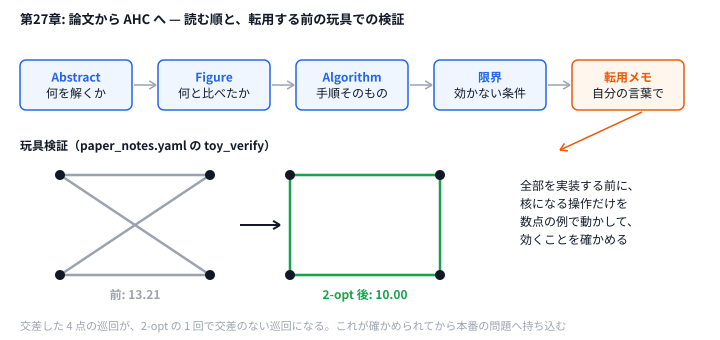

# 第27章 最新研究と AHC 解法

> **到達目標（赤色帯 2800〜）**: 組合せ最適化の **古典問題** と近年の **メタヒューリスティック** を地図として持ち、論文・スライドから **AHC に転用できる部分** だけを抽出できる。最小実装でアイデアを検証する習慣が身につく。

---

## 27.1 組合せ最適化の古典（TSP, VRP, スケジューリング）

**霊夢**: AHC の問題、全部バラバラに見えるけど、研究では整理されてるの？

**魔理沙**: そう。**古典問題** の名前を知ると、文献検索が一気に楽になる。

| 古典 | 中身 | AHC での例 |
|------|------|-----------|
| **TSP** | 点を1周する最短巡回 | 移動・訪問順 |
| **VRP** | 複数台・容量・順序制約つきの配送 | AHC006（店で受け取ってから届ける順序制約） |
| **Scheduling** | 機械・日付への割当 | 工場・シフト系 |
| **Packing** | 矩形・容器への配置 | AHC001 |

**霊夢**: TSP って2-opt だけで足りる？

**魔理沙**: 小規模なら **2-opt / 3-opt** が強い。大規模は **分割統治** や **LNS** と組み合わせる。第19章 LNS は、ここから来ている。

TSP 距離（第27章玩具検証でも使用）:

```python
# python/ch27/paper_transfer.py
def tour_length(points: Sequence[Sequence[int]]) -> float:
    n = len(points)
    if n < 2:
        return 0.0
    total = 0.0
    for i in range(n):
        x1, y1 = points[i]
        x2, y2 = points[(i + 1) % n]
        total += math.hypot(x2 - x1, y2 - y1)
    return total
```

VRP では **容量制約** などが加わる。AHC では「制約違反にペナルティ → 探索中に係数調整」が定番（第25章の「制約をゆるめる」考え方とも接続）。

**霊夢**: スケジューリングは第9章の SA と同じ？

**魔理沙**: 骨格は同じ。**古典名** を知ると「Job Shop」「Flow Shop」など **近傍の文献** が見つかる。AHC 固有部分はスコア関数と制約の形だけだ。

Scheduling → AHC 対応表:

| 古典制約 | 典型手法 | AHC での写像 |
|---------|---------|-------------|
| 前工程完了 | トポロジカル + 局所 | 操作順シミュレーション |
| リソース上限 | ペナルティ SA | スコア罰則 |
| 納期 | 重み付き目的 | 時間減点スコア |

---

## 27.2 近年のメタヒューリスティック動向

**霊夢**: 赤色帯で押さえる「新しさ」って何？

**魔理沙**: 全部実装する必要はない。**地図** として押さえる。

| 系統 | キーワード | AHC への示唆 |
|------|-----------|-------------|
| **ILS** | 摂動（キック）→ 局所探索 の繰り返し | 第13章。局所最適からの脱出 |
| **LNS** | 破壊 → 再構築 → 受理判定 | 第19章。解の一部を大きく作り直す |
| **ALNS** | 破壊・再構築演算の適応選択 | 演算ごとの重み更新 |
| **VNS** | 近傍サイズを変えて脱出 | k-opt の k を動的に |
| **Hybrid** | LP / CP + 局所探索 | 第25章（緩和で下界・種）の延長 |
| **Learning-assisted** | 初期解・演算選択を学習 | 研究寄り・本番は要検証 |

第27章の `paper_notes.yaml` では **ILS for VRP** を例に、AHC006 風・AHC011 風への **転用候補** を書いている。

```yaml
# data/ch27/paper_notes.yaml（抜粋）
transfer_candidates:
  - target: "AHC006 風の配送ルート"
    technique: "ILS + 2-opt"
    expected_gain: "初期貪欲から +3〜8% 程度（問題依存）"
    risk: "時間制限内に再構築が終わらない"
```

**霊夢**: 論文の実装を丸ごと持ってくる？

**魔理沙**: **禁止に近い**。持ってくるのは **アイデア1〜2個** と **疑似コードの骨** だけ。残りは AHC の時間制限に合わせて削る。

2-opt の骨（第27章 `paper_transfer.py` と同型）:

```python
# python/ch27/paper_transfer.py
def two_opt_once(points: List[List[int]]) -> Tuple[List[List[int]], float]:
    n = len(points)
    best = [list(p) for p in points]
    best_len = tour_length(best)
    # 辺 (i, i+1) と (j, j+1) を張り替える。i=0 のとき j=n-1 は辺 (n-1, 0) が隣接するので除く
    for i in range(n - 1):
        for j in range(i + 2, n if i > 0 else n - 1):
            new = best[: i + 1] + best[i + 1 : j + 1][::-1] + best[j + 1 :]
            new_len = tour_length(new)
            if new_len + 1e-9 < best_len:
                best = new
                best_len = new_len
    return best, best_len
```

```go
// go/ch27/paper_transfer.go
func twoOptOnce(points []pt) ([]pt, float64) {
	n := len(points)
	best := append([]pt{}, points...)
	bestLen := tourLength(best)
	// 辺 (i, i+1) と (j, j+1) を張り替える。i=0 のとき j=n-1 は辺 (n-1, 0) が隣接するので除く
	for i := 0; i < n-1; i++ {
		end := n
		if i == 0 {
			end = n - 1
		}
		for j := i + 2; j < end; j++ {
			cand := append([]pt{}, best...)
			for l, r := i+1, j; l < r; l, r = l+1, r-1 {
				cand[l], cand[r] = cand[r], cand[l]
			}
			if l := tourLength(cand); l+1e-9 < bestLen {
				best, bestLen = cand, l
			}
		}
	}
	return best, bestLen
}
```

> 玩具検証なので、1 回の試行ごとに `tour_length` を全部計算し直している（O(n)）。本番では第6章のように、張り替える 2 辺だけの差分で判定する。

Go 版（同じ出力）:

```go
// go/ch27/paper_transfer.go
func tourLength(pts []pt) float64 {
	n := len(pts)
	if n < 2 {
		return 0
	}
	total := 0.0
	for i := 0; i < n; i++ {
		a, b := pts[i], pts[(i+1)%n]
		total += math.Hypot(b.x-a.x, b.y-a.y)
	}
	return total
}
```

---

## 27.3 論文・解説スライドの読み方

**霊夢**: 英語の論文、どこから読めばいい？

**魔理沙**: 順番は固定だ。

1. **Abstract** — 問題クラスと手法名
2. **Figure / Table** — 何と比較しているか
3. **Algorithm 1** — ループ構造だけ写す
4. **Experiment** — どのサイズで効いているか（AHC 規模と比較）
5. **Conclusion** — 限界（時間・メモリ）をメモ

スライド（上位入賞者解説）の読み方:

| スライド要素 | 取るもの |
|-------------|---------|
| 問題の言い換え | 自分のメモの1行目 |
| パイプライン図 | construct → improve の分割 |
| 1枚の式 | スコアあるいはペナルティ |
| 失敗談 | リスク欄に書く |

**reader_notes** 欄に「図3 = ランダム k 頂点削除」のように **自分語** で書く。

```yaml
reader_notes: |
  自分用メモ: 図3の破壊演算は「ランダム k 頂点削除」に相当。
  実装メモ: 再構築は貪欲で足りるか、それとも LP が要るか。
```

**霊夢**: 参考文献リストは付録にある？

**魔理沙**: [付録F](https://info.atcoder.jp/overview/contest/heuristic) と [AHC Rating System](https://img.atcoder.jp/file/AHC_rating_v2_en.pdf) を起点に、**問題クラス名 + metaheuristic** で検索する。

---

## 27.4 ハンズオン: 論文 1 本を選び、AHC 問題に転用できる部分を抽出する

**霊夢**: この repo には何があるの？

**魔理沙**: `paper_transfer.py` が **YAML メモ → 転用アイデア表示 → 玩具検証** まで回す。

### Step 1: メモを読む

`data/ch27/paper_notes.yaml` を編集し、読んだ論文の `title` / `key_ideas` / `transfer_candidates` を埋める。

### Step 2: 転用アイデアを抽出

```bash
python python/ch27/paper_transfer.py
# または
python python/ch27/paper_transfer.py data/ch27/paper_notes.yaml

# Go 版（同じ出力）
go run go/ch27/paper_transfer.go data/ch27/paper_notes.yaml
```

> PyYAML（`pip install pyyaml`）が入っていればそれで読み、なければ同梱の簡易ローダーで読む。簡易ローダーと Go 版が扱えるのは、入れ子の map / list・`[a, b]`・`|` ブロック程度の **YAML のサブセット**だ。凝った書き方をしたいなら `data/ch27/paper_notes.json` のように JSON で書いて渡してもいい。

出力例:

```text
=== key ideas → AHC ===
- iterated_local_search: 初期解を得たあと、破壊→再構築→局所探索を繰り返し...
  AHC: AHC の経路・配置問題で、広い近傍（LNS）の外側ループとして使える。

=== transfer candidates ===
- target: AHC006 風の配送ルート
  technique: ILS + 2-opt
```

PyYAML が無い環境では `paper_notes.json` にフォールバックする（stderr に note 表示）。

### Step 3: 玩具検証（2-opt）

同じスクリプトが `toy_verify` を実行:

```yaml
toy_verify:
  algorithm: two_opt
  points:
    - [0, 0]
    - [3, 0]
    - [0, 2]
    - [3, 2]
```

```text
length before: 13.2111
length after:  10.0000
improved: True
```



**魔理沙**: 転用メモを書いたら、いきなり本番の問題に実装しない。核になる操作だけを数点の例で動かして、効くことを確かめてから持ち込む。

### Step 4: AHC 問題へ接続

転用候補1件について **時間見積り** を書く:

```
ILS 1回 = 破壊 O(n) + 再構築 O(n log n) + 2-opt O(n²)
AHC 2秒 → 外側ループ 20 回まで、など
```

転用メモのチェックリスト:

| 項目 | 質問 |
|------|------|
| 初期解 | 第5章貪欲で足りるか |
| 近傍 | 第6章2-opt / 第19章LNS か |
| 時間 | 2秒で何イテレーションか |
| 検証 | 玩具データで改善するか |

---

## 27.5 演習

1. 古典問題から **自分が解いた AHC** を1つマッピングし、`paper_notes.yaml` の `problem_class` に追記する。
2. 転用候補の `risk` を **実際の TLE 体験** と照合し、1行更新する。
3. `toy_verify` に **別アルゴリズム**（例: ランダム swap 1回）を足す設計を書く（実装任意）。
4. 上位解説スライドを1本選び、`key_ideas` と同じ形式で3行要約する。

```bash
python python/ch27/paper_transfer.py data/ch27/paper_notes.yaml 2>&1 | tee transfer.log
grep "AHC:" transfer.log
```

<details>
<summary>ヒント</summary>

1. `problem_class` はリストなので、`  - ` で 1 行足す。後ろに `# コメント` で、どの AHC かを書いておける。
2. `risk` に、何がどのくらい起きたかを数字で書く。「TLE の危険」より「2 秒で 50 回しか回らない」のほうが、次に判断しやすい。
3. `run_toy_verify` は `algorithm` の値で分岐している。新しい値を足すときは、乱数の seed もメモに書けるようにすると、結果を再現できる。
4. `key_ideas` の 1 つは `name`・`summary`・`ahc_analogy` の 3 行。`summary` には「何をするか」、`ahc_analogy` には「AHC のどこで使うか」を書く。

</details>

<details>
<summary>解答例</summary>

**1.** 例えば次のように足す。

```yaml
problem_class:
  - VRP
  - routing
  - destroy_and_repair
  - TSP  # AHC005（巡回の部分）を解いた
```

`paper_transfer.py` で読み込むと、`problem_class` は `['VRP', 'routing', 'destroy_and_repair', 'TSP']` になる（`#` から後ろはコメントとして捨てられる）。

**2.** 例えば次のように書き直す。

```yaml
    risk: "再構築を全点でやると 2 秒で 50 回しか回らない（AHC005 で TLE）。壊すのは 10〜20 点まで"
```

**3.** 例えば、`algorithm: random_swap` と `seed:` を足し、次の関数を呼ぶ分岐を `run_toy_verify` に入れる。

```python
# 解答例: python/ch27/paper_transfer.py の toy_verify に「ランダムな swap 1 回」を足す
def random_swap_once(points, rng):
    i, j = rng.sample(range(len(points)), 2)
    new = [list(p) for p in points]
    new[i], new[j] = new[j], new[i]
    return new, tour_length(new)
```

サンプルの 4 点（長さ 13.21）では、seed 0 だと 13.21 のまま、seed 1 と 2 だと 11.21 になった。2-opt の 1 回（10.00）には届かない。ランダムな 1 手は、当たれば良くなるが、外れることも多い。toy_verify で「論文の手法が、本当に素朴な手より良いか」を小さく比べておくと、本番に持ち込む前の判断材料になる。

**4.** 例えば、第13章の ILS の考え方を、この形式で 3 行にまとめると次のようになる。

```yaml
  - name: double_bridge_kick
    summary: "2-opt で止まったら、巡回を 4 つに切って入れ替える大きな摂動を入れ、また 2-opt を回す。"
    ahc_analogy: "第13章の ILS のキック。局所最適から抜ける手が SA の温度以外にも作れる。"
```

</details>

---

## 章末まとめ

**霊夢**: 論文は全部読まなくて、転用部分だけ拾えばいいんだね。

**魔理沙**: その通り。

> **第27章まとめ**
>
> - **TSP / VRP / Scheduling** など古典名で文献を引く
> - **ILS / ALNS / Hybrid** など動向は地図として把握
> - 論文は Abstract → 図 → Algorithm → 限界の順
> - ハンズオン: `paper_transfer.py` + `paper_notes.yaml`
> - 演習: **最小実装**（2-opt 玩具）で転用を検証
> - 次章: 第28章「超高速実装」

**霊夢**: アイデアがあっても、遅いと提出できないもんね。

**魔理沙**: 第28章では **Python / Go / C++** の速度を数えて、ボトルネックを潰すぜ。
