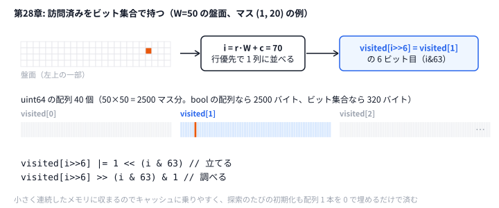

# 第28章 超高速実装

> **到達目標（赤色帯 2800〜）**: Python の **ボトルネック特定**（profiling / PyPy）と Go の **定数因子削減**（メモリプール・ビット演算・キャッシュ局所性）ができる。**提出言語を乗り換えるか** を計測にもとづいて判断でき、同一アルゴリズムの **言語間ベンチマーク** を再現できる。

---

## 28.1 Python のボトルネック特定（profiling, PyPy）

**霊夢**: Python でも赤色帯で戦えるの？

**魔理沙**: 問題によっては戦える。ただし提出は **1言語・1ファイル** だから、「一部だけ C++」はできない。ホットループを計測して、**PyPy で足りるか、Go / C++ / Rust に乗り換えるか** を決めるんだ。

| 手段 | 用途 |
|------|------|
| `time.perf_counter()` | 粗い全体時間 |
| `cProfile` | 関数別 cumulative time |
| `line_profiler` | 行単位（任意） |
| **PyPy** | 純 Python ループの加速（依存に注意） |

プロファイル例:

```bash
python -m cProfile -s cumulative python/ch28/benchmark.py 2>&1 | head -25
```

典型的な Python ボトルネック:

```python
# 概念: 遅い例 — 毎回 list を新規作成
dist = [[INF] * n for _ in range(n)]

# 改善: 1次元配列 + インデックス
dist = [INF] * (n * n)
def at(r, c): return dist[r * n + c]
```

**霊夢**: PyPy はそのまま AtCoder に出せる？

**魔理沙**: 出せる。AHC は AtCoder の **どの提出言語でも参加でき**、PyPy3 も選べる。ループ中心のコードなら CPython より数倍〜数十倍速くなることが多いので、Python で書くなら **まず PyPy で提出** してみろ。それでも足りなければ言語の乗り換えを考える。上位勢は C++ / Rust が多いぜ。

ベンチマーク本体（Python）:

```python
# python/ch28/benchmark.py
def run_benchmark() -> Tuple[float, int]:
    grid = build_grid(GRID_N)
    tr, tc = GRID_N - 1, GRID_N - 1
    checksum = 0
    start = time.perf_counter()
    for _ in range(REPEAT):
        for sr in range(0, GRID_N, 5):
            for sc in range(0, GRID_N, 5):
                if grid[sr][sc] == 1:
                    continue
                checksum += dijkstra(grid, sr, sc, tr, tc)  # 距離の合計（XOR だと偶数回のくり返しで 0 に消える）
    elapsed = time.perf_counter() - start
    return elapsed, checksum
```

---

## 28.2 Go における高速化（メモリプール, ビット演算, キャッシュ局所性）

**霊夢**: Go は第28章の `benchmark.go` みたいに書けば速い？

**魔理沙**: 同じ Dijkstra でも **定数因子** で Python の数倍が普通だ。第28章計測例:

```text
python: 8.90s  checksum=196600
go:     2.69s  checksum=196600
speedup (python/go): 3.31x
```

（時間と倍率はマシン速度で変わる。`checksum` は同じになる。）

Go 側の要点:

```go
// go/ch28/benchmark.go — ヒープは container/heap
type cell struct{ d, r, c int }
type pq []cell

func dijkstra(grid [][]int, sr, sc, tr, tc int) int {
    dist := make([][]int, n)  // 探索ごとに確保（ベンチ用）
    // ...
}
```

本番向け最適化:

| 技法 | 効果 |
|------|------|
| **スライス再利用** | `dist` バッファをプールから取得 |
| **ビットセット** | 訪問済みを `uint64` 配列で |
| **固定配列 `[4]int`** | 方向ベクトルの alloc 削減 |
| **行優先アクセス** | `grid[r][c]` を連続走査 |

ビット演算例（4方向マスク）:

```go
// 概念: visited をビット集合で持つ
const (
    W = 50
)
visited := make([]uint64, (W*W+63)/64)
func setBit(i int) { visited[i>>6] |= 1 << (i & 63) }
```

**霊夢**: メモリプールって大げさじゃない？

**魔理沙**: **探索1回あたり ms 単位** の問題では効く。Dijkstra を数千回呼ぶ AHC では **alloc 削減 = そのまま提出可能** になりやすい。



**魔理沙**: 上のビット演算を図にするとこうだ。2500 マス分の訪問済みが 320 バイトに収まるので、キャッシュに乗りやすい。探索ごとの初期化も、40 個の `uint64` を 0 にするだけで済む。

---

## 28.3 提出言語の選び方と乗り換えの判断（Python → Go / C++ / Rust）

**霊夢**: 遅い関数だけ C++ で書いて、Python から呼べばいいんじゃない？

**魔理沙**: ローカルの実験ツールならそれもアリだが、**AHC の提出は1言語・1ファイル** だ。提出コードの一部だけ別言語にはできない。だから判断は「**どの言語で提出するか**」になる。

判断フロー:

```
プロファイル → ボトルネックはアルゴリズム？ 定数倍？
  アルゴリズム → まず計算量を改善（差分更新・データ構造。第9章・第14章）
  定数倍       → PyPy で提出して足りるか試す
                   足りない → Go / C++ / Rust で提出版を書き直す
```

**魔理沙**: 書き直すなら **全部まとめて**、ただし **ロジックは Python 版をそのまま移す**。本書が Python / Go を並べているのはこのためだ。同じ入力で両方動かし、スコアや checksum が一致することを確かめてから提出する。

**霊夢**: ローカル側はどう？

**魔理沙**: 入力生成・大量テスト・集計のような **ローカルツール** は自由だ。Python から C++ / Rust のバイナリを subprocess で呼ぶ、なども普通にやる。

| 言語 | 向く用途 |
|------|---------|
| C++ | テンプレート・AtCoder 慣習 |
| Rust | 安全 + 速度、CLI 単体 |
| Go | 中規模全体・並行・ビルド速 |

**霊夢**: Python で考えて C++ で書く？

**魔理沙**: **正解** に近い。速度が足りない問題では、Python で設計を固めてから提出版を移植する流れが堅い。第28章ベンチは **同一アルゴリズム** を揃え、checksum で一致確認する。

---

## 28.4 ハンズオン: 同一アルゴリズムの Python / Go 速度比較

**霊夢**: 何を計測してるの？

**魔理沙**: 50×50 グリッド上で **Dijkstra を繰り返し**、合計時間と checksum（距離の合計）を出す。

### Step 1: Python 単体

```bash
python python/ch28/benchmark.py
```

stderr:

```text
python: 8.904025s  checksum=196600
go:     2.692218s  checksum=196600
speedup (python/go): 3.31x
```

（時間と倍率はマシン速度で変わる。`checksum` は同じになる。）

### Step 2: Go 単体

```bash
go run go/ch28/benchmark.go
```

### Step 3: パラメータ改変

`GRID_N` / `REPEAT` を1つずつ変え、速度曲線を取る。

```python
# python/ch28/benchmark.py
GRID_N = 50
REPEAT = 40
```

### Step 4: コンテスト形式

「2秒で回せる Dijkstra 回数」を見積もる:

```
go 2.69s で REPEAT=40 → 2秒なら ≒ 30 ループ相当
python 8.90s → 2秒なら ≒ 9 ループ相当
```

→ **同じ2秒でも探索回数が3倍以上** — 赤色帯の差になりやすい。

Go 側は Python から subprocess で呼び、checksum を照合:

```python
# python/ch28/benchmark.py（抜粋）
proc = subprocess.run(
    ["go", "run", str(go_file), "--timing-only"],
    cwd=repo_root(), capture_output=True, text=True,
)
# stderr: BENCHMARK_SEC=...  BENCHMARK_CHECKSUM=...
```

C++ 比較（任意）:

```bash
# 同じ build_grid + dijkstra を ch28/benchmark.cpp に写す
# g++ -O2 -std=c++17 go/ch28/benchmark.cpp -o /tmp/bench && /tmp/bench
```

---

## 28.5 演習

1. `cProfile` で `dijkstra` の cumulative time 比率を報告する。
2. Go の `dist` を **sync.Pool** で再利用し、再ベンチ（10%以上短縮を目標）。
3. Python 側 `dist` を1次元化し、**10倍高速化** を目指す（アルゴリズムは変えない）。
4. 自分の過去問で **最遅関数1つ** を選び、「PyPy で足りるか」「提出言語を Go / C++ に乗り換えるか」の **判断メモ** を書く。

```bash
python python/ch28/benchmark.py 2>&1 | tee bench.log
go run go/ch28/benchmark.go 2>&1 | tee -a bench.log
grep -E 'python:|go:|speedup' bench.log
```

<details>
<summary>ヒント</summary>

1. `python -m cProfile -s cumulative python/ch28/benchmark.py` で一覧が出る。ただし Go の計測まで含まれるので、`run_benchmark` だけを `cProfile.Profile()` で囲むほうが見やすい。`REPEAT` を小さくすると早く終わる。
2. `sync.Pool` の `Get` で `dist` を取り出し、使い終わったら `Put` で戻す。取り出した `dist` は前の値が残っているので、毎回 `inf` で埋め直す。時間を何回か測り、ばらつきより大きな差かを見る。
3. `dist[r][c]` は「リストのリストを 2 回引く」。`r * n + c` の 1 次元にすると 1 回で済む。隣のマスの一覧と重みも、ループの外で作っておける。
4. 「何倍速くなれば足りるか」を先に決める。PyPy は書き直しなしで試せるので、最初の候補にする。

</details>

<details>
<summary>解答例</summary>

**1.** `REPEAT = 5` で `run_benchmark` を測ると、手元では次のようになった（1.407 秒中）。

| 関数 | cumulative | 割合 |
|------|-----------|------|
| `run_benchmark` | 1.407 秒 | 100% |
| `dijkstra` | 1.404 秒 | 99.8% |
| `heapq.heappop`（`dijkstra` の中） | 0.234 秒 | 17% |
| `heapq.heappush`（`dijkstra` の中） | 0.127 秒 | 9% |

時間のほぼ全部が `dijkstra` で、そのうち約 74% は `dijkstra` 自身のループ（隣のマスを調べる部分）だ。ヒープの操作は 1/4 ほどしかない。速くするなら、まずループの中身を軽くする。

**2.** 次のように `dist` を使い回すと、手元では 3 回ずつの平均で 2.73 秒 → 2.60 秒（約 5% 短縮）だった。目標の 10% には届かない。Go の時間の大部分は `container/heap` の `Pop` / `Push` で、`interface{}` を経由する呼び出しが重いからだ。10% 以上縮めるなら、ヒープを `[]cell` の専用の型で自分で書くほうが効く。

```go
// 解答例: go/ch28/benchmark.go の dijkstra で dist を sync.Pool から借りる（import に "sync" を足す）
var distPool = sync.Pool{New: func() interface{} {
	d := make([][]int, gridN)
	for i := range d {
		d[i] = make([]int, gridN)
	}
	return d
}}

func dijkstra(grid [][]int, sr, sc, tr, tc int) int {
	n := len(grid)
	dist := distPool.Get().([][]int)
	defer distPool.Put(dist)
	for i := range dist {
		for j := range dist[i] {
			dist[i][j] = inf
		}
	}
	// 以下は元のまま
```

**3.** `dist` を 1 次元にし、隣のマスとその重みを前もって作っておくと、手元では 8.90 秒 → 4.21 秒（約 2.1 倍）になった。checksum は `196600` で同じだ。10 倍には届かない。CPython では、1 回のループの中で何をしても、ループそのものの重さが残るからだ。10 倍を狙うなら、PyPy で動かすか、アルゴリズムを変える（この盤面は重みが全部 1 なので、Dijkstra の代わりに BFS で済む）。

```python
# 解答例: dist を 1 次元にし、隣のマスを前もって計算しておく Dijkstra
def build_neighbors(grid):
    n = len(grid)
    nbrs = [[] for _ in range(n * n)]
    for r in range(n):
        for c in range(n):
            for dr, dc in ((-1, 0), (1, 0), (0, -1), (0, 1)):
                nr, nc = r + dr, c + dc
                if 0 <= nr < n and 0 <= nc < n and grid[nr][nc] != 1:
                    nbrs[r * n + c].append((nr * n + nc, 1 + grid[nr][nc]))
    return nbrs


def dijkstra_flat(nbrs, start, goal):
    dist = [INF] * len(nbrs)
    dist[start] = 0
    pq = [(0, start)]
    pop, push = heapq.heappop, heapq.heappush  # 属性の参照もループの外へ
    while pq:
        d, u = pop(pq)
        if d != dist[u]:
            continue
        if u == goal:
            return d
        for v, w in nbrs[u]:
            nd = d + w
            if nd < dist[v]:
                dist[v] = nd
                push(pq, (nd, v))
    return INF
```

**4.** 例えば次のように書く。

```markdown
- 最遅関数: AHC0xx の SA の delta 計算（全体の 85%）
- 必要な速さ: 今の 1 秒あたり 2 万手を、10 万手以上にしたい（5 倍）
- PyPy: 書き直しなしで試せる。ループ中心なので数倍は期待できる → まず PyPy で提出して手数を測る
- 乗り換え: PyPy でも 5 倍に届かなければ、delta 計算だけでなく全部を Go に移す（第28章 28.3: 書き直すならまとめて）
- 判断: 次の回は PyPy で出し、手数が足りなければ Go 版を用意する
```

</details>

---

## 章末まとめ

**霊夢**: 速さも計測しないと改善できないんだね。

**魔理沙**: 当たり前だ。

> **第28章まとめ**
>
> - Python: **cProfile** / PyPy、ホットループは alloc 削減
> - Go: **プール・ビット・局所性** で定数因子を詰める
> - 提出は **1言語・1ファイル**。足りなければ PyPy → **提出言語の乗り換え**（ロジックは移植して一致確認）
> - ハンズオン: `benchmark.py` / `benchmark.go`、checksum で一致確認
> - 演習: **1関数10倍** を目標に最適化
> - 次章: 第29章「チーム戦・マラソン形式」

**霊夢**: 個人戦だけじゃなく、チームでも回すんだっけ。

**魔理沙**: 長期コンテストでは **週次改善ログ** が武器になる。第29章だぜ。
