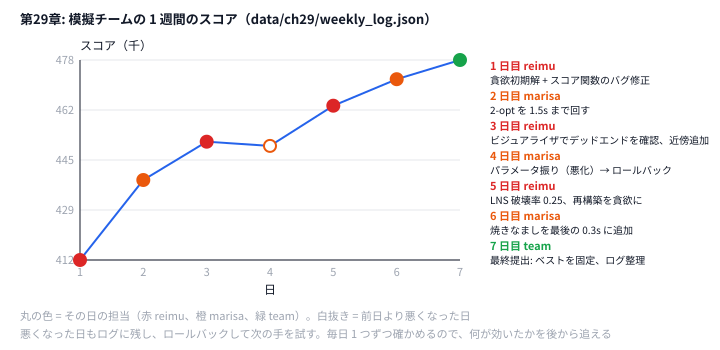

# 第29章 チーム戦・マラソン形式

> **到達目標（赤色帯 2800〜）**: チームで **役割分担**（モデリング / 実装 / パラメータ）し、git でコードベースを共有できる。長期コンテストの **週次改善サイクル** を回し、改善ログから **何が効いたか** を振り返れる。

> **注意**: AHC 本番は **個人戦** で、コンテスト中に他人と相談したりコードを共有したりするのは禁止されている（[コンテスト中のルール](https://info.atcoder.jp/overview/contest/rules)）。本章は **チーム参加が認められたコンテスト**、社内・サークルの **練習会や勉強会**、コンテスト **終了後** の共同改善を想定している。

---

## 29.1 役割分担（モデリング / 実装 / パラメータ調整）

**霊夢**: チーム戦って、全員が同じコードを書くの？

**魔理沙**: 非効率だ。**役割** を分ける。

| 役割 | 担当 | 成果物 |
|------|------|--------|
| **モデリング** | 問題の言い換え・スコア式・制約整理 | 設計メモ、疑似コード |
| **実装** | 初期解・近傍・タイマー | `main` ブランチにマージ可能なコード |
| **パラメータ** | 冷却率・時間配分・seed 探索 | 実験表、ベスト設定 |
| **可視化**（任意） | vis・ログ集計 | 第8章 vis、週次レポート |

**霊夢**: 1人チームみたいなもん？

**魔理沙**: マラソン形式は **日替わりオーナー** も有効。`weekly_log.json` では `owner` が `reimu` / `marisa` / `team` と分かれている。

```json
{
  "day": 3,
  "owner": "reimu",
  "score": 451200,
  "notes": "ビジュアライザでデッドエンドを確認、近傍追加"
}
```

**ルール例**:

- 当日オーナーが **マージ権** を持つ
- パラメータ変更は **1日1テーマ**（同時に複数いじらない）
- 悪化したら **即ロールバック**（day 4 の -1400 が典型）

---

## 29.2 コードベースの共有と git 運用

**霊夢**: 競プロで git って使うの？

**魔理沙**: 1週間〜数週間のマラソンでは **必須** に近い。

推奨ブランチ:

```text
main          … 提出用ベスト（常に動く）
dev/alice     … 機能ブランチ
dev/lns       … LNS 実験
tag/day3      … 日次スナップショット
```

コミットメッセージ例:

```text
feat: add 2-opt with 1.5s budget (marisa, day2)
fix: score penalty sign (reimu, day1)
revert: bad destroy rate 0.4 (marisa, day4)
```

**霊夢**: コンフリクトで1日潰れない？

**魔理沙**: **モジュール分割** する。

```
construct.py   … 初期解（触る人1人）
improve_sa.py  … SA（別担当）
score.py       … 全員が触らない（インタフェース固定）
```

日次オーナー制の例:

| day | owner | 触ってよいファイル |
|-----|-------|-------------------|
| 1 | reimu | construct, score |
| 2 | marisa | improve, timer |
| 3 | reimu | neighbor, vis |
| 7 | team | README, log のみ |

Python / Go **両方** 持つ repo では、片方を canonical に決めるか、**スコア関数だけ共通化** する。

```bash
git log --oneline --since='2026-05-14' --until='2026-05-21'
git diff day3..day5 -- python/ch29/
```

---

## 29.3 長期コンテストでの週次改善サイクル

**霊夢**: 毎日何をするの？

**魔理沙**: **週次サイクル** のテンプレだ。

| 曜日 | 活動 |
|------|------|
| Day1 | 貪欲 + スコアバグ修正 |
| Day2 | 定番近傍（2-opt 等） |
| Day3 | vis で形を見て近傍追加 |
| Day4 | パラメータ探索（悪化なら revert） |
| Day5 | LNS / 広い近傍 |
| Day6 | 仕上げ SA・時間配分 |
| Day7 | 提出固定・ログ整理 |

1週間のスコア推移（`data/ch29/weekly_log.json`）:

```text
412000 → 438500 → 451200 → 449800 → 463100 → 471900 → 478250
Δ +66250 (+16.08%)   regression days: 1
```



**霊夢**: 4 日目だけ下がってるの。

**魔理沙**: パラメータを振って悪くなったので、ロールバックした日だ。悪くなった日もログに残すから、「何をしたら下がったか」まで後から追える。

**霊夢**: 悪化した日も記録するの？

**魔理沙**: **必須**。後から「何をやってはいけないか」が分かる。day 4 はパラメータ振りで -1400、ロールバックメモあり。

週次レポートに含める項目:

```json
{
  "contest": "MOCK-MARATHON (simulated team marathon)",
  "problem": "grid_route_pack",
  "team": "yukkuri-solvers",
  "unit": "score",
  "days": [ "... day entries ..." ]
}
```

各 day エントリ:

```json
{
  "day": 5,
  "date": "2026-05-18",
  "owner": "reimu",
  "score": 463100,
  "notes": "LNS 破壊率 0.25、再構築を貪欲に",
  "commits": 6
}
```

---

## 29.4 ハンズオン: 模擬チームで 1 問を 1 週間改善し続ける

**霊夢**: この repo ではどう再現する？

**魔理沙**: `improvement_log.py` / `improvement_log.go` が **週次 JSON** を要約する。

### Step 1: ログを読む

`data/ch29/weekly_log.json` を開き、7日分の `score` / `notes` / `commits` を確認。

### Step 2: 要約を実行

```bash
python python/ch29/improvement_log.py
go run go/ch29/improvement_log.go -input data/ch29/weekly_log.json
```

Python 要約の核心:

```python
# python/ch29/improvement_log.py
scores = [int(d["score"]) for d in days]
first, last = scores[0], scores[-1]
delta = last - first
regressions = sum(
    1 for i in range(1, len(scores)) if scores[i] < scores[i - 1]
)
```

Go 側:

```go
// go/ch29/improvement_log.go
for i := 1; i < len(scores); i++ {
    if scores[i] < scores[i-1] {
        regressions++
    }
}
```

出力:

```text
contest: MOCK-MARATHON (simulated team marathon)
problem: grid_route_pack  team: yukkuri-solvers
day  date        owner    score     delta    note
  1  2026-05-14  reimu        412000           貪欲初期解 + スコア関数のバグ修正
  2  2026-05-15  marisa       438500   +26500  2-opt を 1.5s まで回す
  ...
  7  2026-05-20  team         478250    +6350  最終提出: ベストを固定、ログ整理
start → end: 412000 → 478250  (Δ +66250, +16.08%)
best: 478250 on day 7
regression days: 1
biggest gain: day 2 (+26500) 2-opt を 1.5s まで回す
owner     days     gain  commits  gain/commit
marisa       3   +33900       20         1695
reimu        2   +26000       10         2600
team         1    +6350        2         3175
total commits: 35
```

（`total commits` だけは stderr に出る。ファイルに保存するときは `2>&1` も付ける。）

### Step 3: 担当者ごとの伸びを見る

**霊夢**: 最後の表は何？

**魔理沙**: その日の伸び（前の日との差）を、その日の `owner` の成果とみなして足したものだ。day 1 は前の日がないので数えない。

```python
# python/ch29/improvement_log.py
    owners: Dict[str, List[int]] = {}  # owner → [日数, 伸びの合計, コミット数]
    for d, g in zip(days[1:], gains):
        row = owners.setdefault(str(d.get("owner", "?")), [0, 0, 0])
        row[0] += 1
        row[1] += g
        row[2] += int(d.get("commits", 0))
```

```go
// go/ch29/improvement_log.go
	for i := 1; i < len(scores); i++ {
		r, ok := owners[days[i].Owner]
		if !ok {
			r = &row{}
			owners[days[i].Owner] = r
			names = append(names, days[i].Owner)
		}
		r.days++
		r.gain += scores[i] - scores[i-1]
		r.commits += days[i].Commits
	}
	sort.Strings(names) // map の順番は毎回変わるので、名前順にそろえる
```

**霊夢**: marisa が一番伸ばしてるけど、コミットあたりだと一番少ないの。

**魔理沙**: day 4 の悪化（−1400）と、7 コミットの空振りが効いている。ただし、この表で人を評価するのは危ない。2-opt（day 2）のように「最初に入れた人の伸びが大きく見える」変更もあるし、後の日の伸びは前の日の土台の上に乗っている。**どの種類の変更が効いたか** を見るための表だと思え。

### Step 4: git の運用を手元で練習する

**魔理沙**: 29.2 のブランチ・タグ・revert を、使い捨てのリポジトリで一度通しておく。本書のリポジトリは汚さない。

```bash
# 練習用のリポジトリを一時ディレクトリに作る（本書のリポジトリは汚さない）
cd "$(mktemp -d)"
git init -q -b main
git config user.name reimu && git config user.email reimu@example.com

echo "score=412000" > best.txt && git add best.txt
git commit -qm "feat: greedy initial solution (reimu, day1)" && git tag day1
echo "score=438500" > best.txt
git commit -qam "feat: add 2-opt with 1.5s budget (marisa, day2)" && git tag day2
echo "score=451200" > best.txt
git commit -qam "feat: add neighbor found with vis (reimu, day3)" && git tag day3
echo "score=449800" > best.txt
git commit -qam "tune: destroy rate 0.4 (marisa, day4)"   # 悪化した変更

git revert --no-edit HEAD                                  # day 4 を打ち消すコミットを足す
cat best.txt                                               # → score=451200
git log --oneline
```

`git log --oneline` には、悪化した day 4 のコミットと、それを打ち消す `Revert "tune: ..."` の両方が残る。`git reset` で消すのと違い、**悪化した記録が履歴に残る** のが revert のよいところだ。`git diff day1 day3 -- best.txt` で、タグの間の変化も見られる。

### Step 5: 改変（1日分を追加）

JSON に day 8 を足し、スコアが上がるか下がるかを仮想実験としてメモ。

### Step 6: コンテスト形式

- 毎日 **best-so-far** を `best.json` に保存
- stderr / ログに **提出スコア** を残す
- 最終日は **コード凍結**（feature freeze）

---

## 29.5 演習

1. `weekly_log.json` から **最大伸び日** と **regression 日** を読み、原因を `notes` と照合する。
2. 担当者ごとの表（`gain/commit`）も見ながら、`commits` とスコア Δ の **相関** を言語化する（コミット多い＝良いとは限らない）。
3. 3人チームの **役割表** を1ページ書く（自分の強みを1列に）。
4. day 4 の revert を再現するため、git で `revert` コミットメッセージを実際に書く（repo 任意）。

```bash
python python/ch29/improvement_log.py data/ch29/weekly_log.json 2>&1 | tee week.log
grep -E 'best:|biggest|regression|commits' week.log
```

<details>
<summary>ヒント</summary>

1. `biggest gain:` の行と、表の `delta` 列がマイナスの日を見る。
2. 担当者ごとの表と、日ごとの `commits` と `delta` を並べる。コミットが多い日ほど伸びているか。
3. 29.1 の役割表の 4 行（モデリング・実装・パラメータ・可視化）を、3 人にどう割り振るかから始める。
4. 29.4 の Step 4 の練習用リポジトリで試す。`git revert` が作るメッセージの 1 行目のあとに、理由を足す。

</details>

<details>
<summary>解答例</summary>

**1.** 一番伸びたのは day 2（+26500、「2-opt を 1.5s まで回す」）。最初の貪欲から、定番の近傍を入れた日が一番伸びる、というよくある形だ。悪化したのは day 4 だけ（−1400、「パラメータ振り（悪化）→ ロールバック」）で、メモどおり、パラメータを変えて悪化し、元に戻している。

**2.** 日ごとに並べると次のようになる。

| day | commits | delta |
|-----|---------|-------|
| 2 | 5 | +26500 |
| 3 | 4 | +12700 |
| 4 | 7 | −1400 |
| 5 | 6 | +13300 |
| 6 | 8 | +8800 |
| 7 | 2 | +6350 |

コミットが一番多い day 6（8）や day 4（7）は伸びが小さいか悪化で、伸びが一番大きい day 2 は 5 コミットだった。担当者ごとでも、`gain/commit` は marisa 1695・reimu 2600・team 3175 で、コミットの多い人ほど低い。コミットの数は「どれだけ試したか」で、「どれだけ効いたか」ではない。パラメータを振る日は、試行が増えるのでコミットが増えるが、伸びは小さくなりやすい。

**3.** 例えば次のように書く。

| 役割 | 担当 | 強み | 主に触るファイル |
|------|------|------|----------------|
| モデリング + 可視化 | A | 問題の言い換え、図を描く | 設計メモ、vis |
| 実装 | B | 速いコード、Go | construct, improve |
| パラメータ + ログ | C（自分） | 実験を回して表にする | 設定ファイル、weekly_log.json |

**4.** `git revert` を `--no-edit` なしで実行すると、エディタが開く。1 行目はそのままにして、理由と数字を足す。

```text
Revert "tune: destroy rate 0.4 (marisa, day4)"

This reverts commit 85385e2.
破壊率 0.4 で 451200 → 449800（-1400）に下がった。
0.25 に戻し、day 5 で LNS の再構築側を直す。
```

「何を戻したか」は git が自動で書くので、自分で足すのは「なぜ戻したか」と「次に何をするか」だ。

</details>

---

## 章末まとめ

**霊夢**: ログを残すと、チームでも個人でも振り返れるね。

**魔理沙**: その通り。

> **第29章まとめ**
>
> - **役割分担**: モデリング / 実装 / パラメータ / vis
> - **git**: main=提出可、日次 tag、悪化は revert
> - **週次サイクル**: 貪欲 → 近傍 → vis → LNS → 仕上げ
> - ハンズオン: `improvement_log` + `weekly_log.json` で、一番伸びた日・担当者ごとの伸びを集計し、git の tag / revert を手元で練習
> - 演習: 改善ログと **順位・スコアの相関** を振り返る
> - 次章: 第30章「コンテスト後の成長」

**霊夢**: コンテストが終わっても、学びは続くんだ。

**魔理沙**: 解説を書くと **自分の理解が一番深まる**。第30章で締めるぜ。
